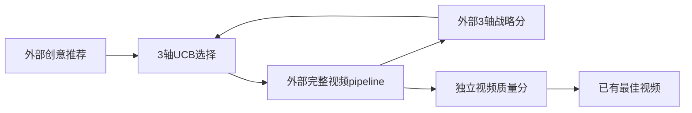
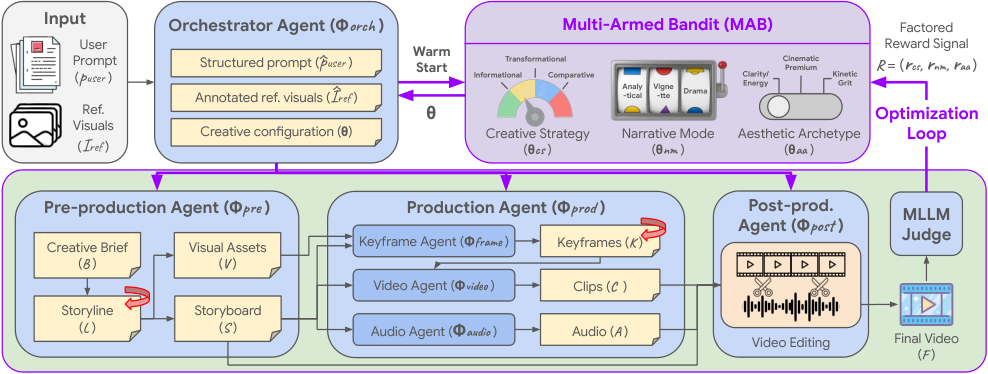

# Co-Director：分轴创意 UCB 与独立视频质量选择

[English](README-en.md)

> **component_only／L1机制诊断，不是完整模型或Agent能力复现。** 完整实验成本过高，不复现（审查 DONE）；仅以下精确定义子组件可执行。

## 论文信息

| 字段 | 内容 |
| --- | --- |
| 论文链接 | [Co-Director: Agentic Generative Video Storytelling](https://arxiv.org/abs/2604.24842v1)，[固定 v1 原文](https://arxiv.org/html/2604.24842v1) |
| 公司 / 机构 | 一作 Yale Song，Google Inc.；已核优先署名：Google，合作属性不覆盖第一署名机构 |
| 首次公开日期 | **2026-04-27 18:00:00 UTC**；历史补漏，不是2026-11-13新首发 |
| 原作者代码 | [已核公开仓库](https://github.com/GoogleCloudPlatform/genmedia-izumi-agent/tree/main/demos/backend/ads_codirector)；不代表本地已运行完整系统 |
| 本地 adapter / key | `co-director`；`adapter=null`；未接入Evolve |
| 本地复现代码 | `src/auto_research/agent_research/co_director.py` |

## 原始论文总结

### 背景与主要改动

Co-Director 将生成式视频拆为全局创意方向与局部多模态修正。创意方向有策略 3 类、叙事 3 类、美学 4 类；一次完整视频产生三个战略效果分，各自更新所属轴，而最终视频用独立质量分选择。

原文写 UCB1 和 LLM 初始化期望值；所链接官方实现的 warm start 具体是优先选择 LLM 推荐的未试 arm。源码没有为推荐凭空增加观察次数。本地按该可核实接口执行，不捏造数值先验、MLLM打分或视频。

### 架构与流程



<!-- paper-figure:start -->
### 原论文关键图

[](https://arxiv.org/html/2604.24842v1/pipeline.png)

图片来自[原论文](https://arxiv.org/html/2604.24842v1#S2.F1)，版权归原作者所有。保存官方HTML原PNG字节，未裁剪、重画或PDF渲染。原文完整pipeline，不代表本地已接入任何视频模型。
<!-- paper-figure:end -->

### 核心公式

$$
UCB_j(a)=\bar r_j(a)+c\sqrt{\frac{\log(\sum_bN_j(b))}{N_j(a)}},\qquad
R=(r_{strategy},r_{narrative},r_{aesthetic})\in[0,100]^3.
$$

官方 UCBBandit 默认 c=2；未试 arm 先试，推荐 arm 若未试则优先，其余未试用局部 seeded RNG。并列已试值按固定类别顺序是明示局部约定。更新只动三个选中的 arm；不把同一视频当 36 条联合路径。为了保持论文 factored 信号，本地缺任一轴分就拒绝，不采用上游兼容分支中的全局分fallback。

### 论文离线与线上效果

作者在 400 场景 GenAd-Bench 比较完整多模型视频生成，给出质量、语义与人类偏好评估及搜索消融。战略轴分是MLLM观察，不是因果识别的贡献分；不能以分轴更新声称已解决真实因果credit assignment。未报告生产线上 A/B。本地只测UCB算术。

## 本地复现

### 数据协议与代码映射

`VideoEvaluation` 要求视频身份、三轴选择、三个战略分和独立质量分；`FactoredUCB` 实际执行选择与均值/count更新，`best_video` 只按已有外部 quality 取视频，不重新生成。没有视频字节、actor或评测gold进入组件。

```bash
PYTHONPATH=src python -c 'from auto_research.agent_research.co_director import diagnostic; print(diagnostic(42))'
PYTHONPATH=src python -m pytest tests/test_nov13_colm_agent_components.py -q
```

### 结果与负控

测试推荐未试arm优先、先探索未试arm、分轴reward不混合、全部已试后UCB公式、最高视频质量与战略分之和不同仍选前者、重复视频ID拒绝。固定分数不能证明创意优化或观众效果。

三seed机制执行回执见[CPU组件指标](metrics/component-cpu-seeds42-44.json)及本轮冻结记录；它是固定输入机制诊断，不是完整训练、能力提升或线上收益。GPU验收仅以真实A100/A30回执为准。

## 复现边界

没有orchestrator、LLM推荐器、storyline/keyframe self-refinement、Gemini/NanoBanana/Veo/TTS/Lyria接口、GenAd-Bench或视频judge。外部MLLM分数需独立验证，不用随机分替代真实视觉评价；本地未接Evolve。

### 高成本完整实验

400场景、每场4次完整video pipeline、3次localretry、Gemini3Pro/NanoBananaPro/Veo3.1/TTS/Lyria2；完整商业视频生成高成本不复现。 这是论文／上游配置成本依据，不是本地训练测量。没有为估价试训、调用收费API或下载checkpoint。**成本过高，不复现（审查 DONE）**；不进入自动重试或自动实现队列。
