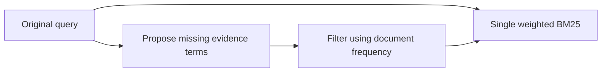
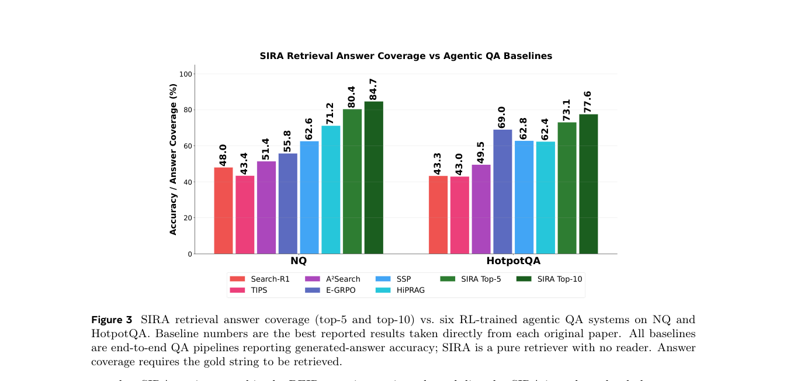

# SIRA: Superintelligent Retrieval Agent

<!-- source-sha256: 95eadf0a82ba73874ad7624db3fbd5092baf71257fe6061432ac9e1bc6ead8a7 -->

[简体中文](README.md)

> L1 DF gate and one-pass weighted retrieval. No author LLM or 25.58-million-document index.

## Paper information

| Field | Details |
|---|---|
| Paper | [arXiv](https://arxiv.org/abs/2605.06647) |
| Institution | Meta Superintelligence Labs / Rice University (first author; work done at Meta). |
| First public release | 2026-05-07 (arXiv v1) |
| Author code | [facebookresearch/sira](https://github.com/facebookresearch/sira). |
| Local adapter or method key | `sira` |
| Local reproduction code | [`src/auto_research/agent_research/official_meta_backfill_20261004.py`](https://github.com/daiwk/auto-research/tree/main/src/auto_research/agent_research/official_meta_backfill_20261004.py) |

## Paper method and evidence

A frozen LLM proposes evidence terms missing from the original query. Filter absent or overly common terms by inverted-index document frequency; combine original and verified expansion in one weighted BM25 pass.

<!-- paper-figure:start -->
### Original paper figure

The original figure shows expansion followed by DF filtering and a single retrieval. From the [original paper](https://arxiv.org/abs/2605.06647); copyright remains with the authors.
<!-- paper-figure:end -->

### Core equation

$score(d)=BM25(q_{orig},d)+w\,BM25(q_{exp},d)$ with $0<DF(t)\le\tau|C|$ for expansion terms.

### Reported results

The paper reports better mean retrieval across ten BEIR tasks than compared dense, learned sparse, and agent retrieval baselines. BrowseComp-Wikipedia Recall@1/10/100: 9.70%/15.27%/36.14%. No attributable production A/B; author offline metrics are not local.

## Local reproduction

Compare disabled/default with [three-seed mechanism diagnostics](metrics/mechanism-seeds42-44.json). `diagnostic_only=true`, excluded from capability ranking. No paper LLM, full index, or online experiment.
