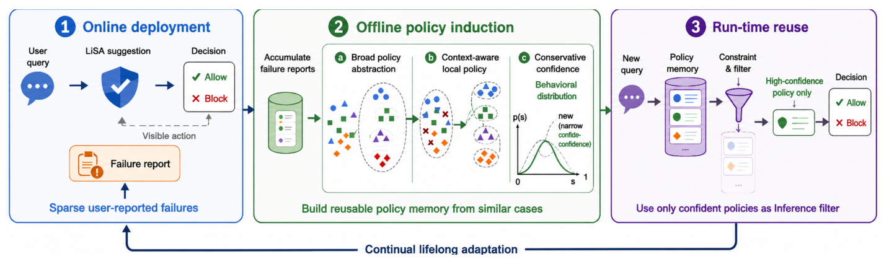
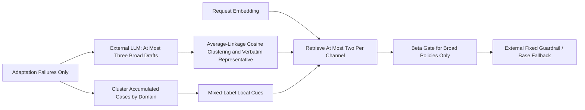

# LiSA: Updating Safety Memory with Conservative Evidence Gates

<!-- source-sha256: 40ed2f47946b3f33598f1a1b5cc6298d5436f2f1f04866613f8d41ad149534a0 -->

[简体中文](README.md)

> `component_only`, CPU / L1 mathematical and memory-update kernel. No LLM policy induction, real semantic embedding, or final safety classifier. Full experiments are **not reproduced because of high cost; review DONE**. This is an independently recovered May paper, not a November first release.

## Paper Information

| Field | Value |
| --- | --- |
| Paper | [LiSA: Lifelong Safety Adaptation via Conservative Policy Induction](https://arxiv.org/abs/2605.14454); reviewed [v1](https://arxiv.org/html/2605.14454v1) and [PDF affiliations](https://arxiv.org/pdf/2605.14454v1) |
| Company / institution / university | First author Minbeom Kim, Google Cloud AI Research / Seoul National University; collaborators at Google / Google Cloud AI Research |
| First public release | 2026-05-14 06:47:35 UTC, arXiv v1 |
| Author source code | No public author implementation found in the paper or [Google detail](https://research.google/pubs/lisa-lifelong-safety-adaptation-via-conservative-policy-induction-2/); not advertised as open source |
| Local adapter | None (`adapter: null`); component key `lisa` |
| Local code | `src/auto_research/agent_research/lisa.py`; `tests/agent_research/test_nov11_priority.py` |

## Original Paper Summary

<!-- paper-figure:start -->
### Key Figure from the Paper



Source: [v1 PDF, page 2, Figure 1](https://arxiv.org/pdf/2605.14454v1#page=2), cropped from the original, not redrawn. The deployment stream is simulated in the paper, not production A/B evidence. The local component covers conservative mathematics and memory state only, not the real model calls shown here.

Image from the [original paper](https://arxiv.org/pdf/2605.14454v1#page=2); copyright belongs to its authors. Full-system or experimental results shown are not local component results.

<!-- paper-figure:end -->

### Background and Main Changes

LiSA adapts a fixed guardrail using sparse, potentially noisy failure reports. Broad policy memory supports reuse; local cues preserve boundaries where semantically similar cases have opposing labels. The base model is not repeatedly fine-tuned. [Section 3](https://arxiv.org/html/2605.14454v1#S3)



### Core Equations

With support $s$, contradictions $c$, and a uniform prior:

$$
\theta\mid\mathcal D\sim\mathrm{Beta}(1+s,1+c),\qquad
\mathrm{Conf}=Q_{0.05}(\mathrm{Beta}(1+s,1+c)).
$$

Retrieved broad policies require $\mathrm{Conf}\ge\tau(\ell)$, with default thresholds 0.55 for both labels. Local rules are not confidence-gated: they expose narrow conflicts rather than assert general reliability. One versus five flawless observations give lower bounds approximately 0.22361 and 0.60696. [Equations 1–2 and Appendix C.3](https://arxiv.org/html/2605.14454v1#A3.SS3)

Appendix C.4 uses average-linkage cosine clustering with distance threshold 0.20, not single-linkage connectivity. Broad representatives reuse existing statements closest to the centroid. Domain-local case clusters need at least two cases and both labels; conflict is $1-\max_y n_y/\sum_y n_y$, without another balance threshold.

### Reported Offline and Online Outcomes

The paper compares fixed and adaptive guardrails on simulated PrivacyLens+, ConFaide+, and AgentHarm streams, including 20% report-label noise. These are not production logs or online A/B results. Scenario-group splits isolate held-out evaluation from adaptation; reported five-seed results are not local safety measurements.

## Local Component and Boundaries

### Run

```bash
python -m pip install -e '.[research-components]'
PYTHONPATH=src python -c 'from auto_research.agent_research.lisa import diagnostic; print(diagnostic(seed=42))'
PYTHONPATH=src python -m pytest -q tests/agent_research/test_nov11_priority.py
```

### Data Protocol and Code Mapping

`beta_lower` computes the actual Beta quantile. `Memory.refresh` implements the daily three-item limit, majority fallback for malformed labels, cross-day reclustering of raw policies, count/provenance aggregation, and two label-specific cues from mixed domain-local clusters. When an invalid draft label meets tied feedback, the paper gives no tie-break; the component rejects the draft for upstream correction rather than inventing allow/refuse precedence.

Policy drafts, case embeddings, and local-text embeddings must come from explicit external providers. Token matching is not presented as Gemini embeddings or LLM induction. Local cues deterministically linearize recorded metadata differences. Runtime evidence updates only actually surfaced broad policies; refresh carries those statistics only for a surviving verbatim representative. Retrieval takes at most two items per channel before broad-policy gating and does not backfill from farther policies. Empty broad and local contexts trigger base fallback. `heldout_groups` blocks evaluation scenarios from adaptation without receiving test answers.

### Local Results and Negative Controls

The [three-seed artifact](metrics/component-cpu-seeds42-44.json) repeats one explicit synthetic diagnostic: weak broad memory is suppressed while two narrow local cues remain available, with conflict score 0.5. Tests distinguish average from single linkage, prevent cross-domain mixing, carry runtime counts exactly once, drop retired-representative statistics, enforce retrieval-before-gating, reject malformed inputs, and prevent held-out leakage. **No macro-F1, safety success rate, model capability comparison, or Evolve promotion is claimed.**

### High-Cost Full Experiments

Sections 4.2 and C.1–2 use two online API models, a Gemini-3.1-pro offline manager, and Gemini-embedding-001 across three benchmarks, 5–10 simulated days, daily held-out reevaluation, five seeds, and noise/ablation matrices. The many inference and induction calls cannot be replaced by free single-GPU execution. From that published setup, not a local timing estimate: **not reproduced because of high cost; review DONE**. No API calls or model downloads were made; synthetic embedding checks are not safety-capability evidence.
