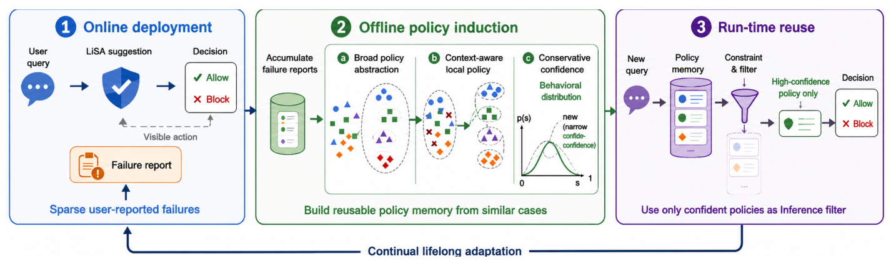
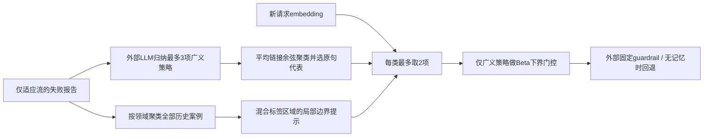

# LiSA：用保守证据门控更新安全记忆

> `component_only`，CPU / L1 数学与记忆更新核。没有 LLM 策略归纳、真实语义 embedding 或最终安全分类器。完整实验**成本过高，不复现（审查 DONE）**；五月论文的独立补漏，不计十一月新首发。

## 论文信息

| 字段 | 内容 |
| --- | --- |
| 论文链接 | [LiSA: Lifelong Safety Adaptation via Conservative Policy Induction](https://arxiv.org/abs/2605.14454)，核对 [v1 正文](https://arxiv.org/html/2605.14454v1)与 [PDF 署名](https://arxiv.org/pdf/2605.14454v1) |
| 公司/机构/学校 | 一作 Minbeom Kim，Google Cloud AI Research / Seoul National University；合作作者 Google / Google Cloud AI Research |
| 首次公开日期 | 2026-05-14 06:47:35 UTC，arXiv v1 |
| 原文开源代码 | 正文与 [Google 官方详情](https://research.google/pubs/lisa-lifelong-safety-adaptation-via-conservative-policy-induction-2/)未找到公开作者实现；明确不写为已开源 |
| 本地 Adapter | 无（`adapter: null`）；组件 key：`lisa` |
| 本地复现代码 | `src/auto_research/agent_research/lisa.py`；`tests/agent_research/test_nov11_priority.py` |

## 原始论文总结

<!-- paper-figure:start -->
### 原论文关键图



来源：[v1 PDF 第 2 页 Figure 1](https://arxiv.org/pdf/2605.14454v1#page=2)，截取原图，未重绘。图中部署为论文模拟设置，不能视为生产 A/B；本地只覆盖保守数学与记忆状态核，不含图中的真实模型调用。

图片来自[原论文](https://arxiv.org/pdf/2605.14454v1#page=2)，版权归原作者所有；图中完整系统或实验结果不等于本地组件结果。

<!-- paper-figure:end -->

### 背景与主要改动

固定安全模型不容易适应组织、用户与情境边界。LiSA 从稀疏且可能有噪声的失败反馈维护两类记忆：可复用的广义策略，以及相似情境中允许/拒绝冲突形成的局部提示。只改变记忆，不反复微调基础模型。[§3](https://arxiv.org/html/2605.14454v1#S3)



### 核心公式

广义策略的支持数 $s$、矛盾数 $c$ 使用均匀先验：

$$
\theta\mid\mathcal D\sim\mathrm{Beta}(1+s,1+c),\qquad
\mathrm{Conf}=Q_{0.05}(\mathrm{Beta}(1+s,1+c)).
$$

仅当 $\mathrm{Conf}\ge\tau(\ell)$ 才展示检索到的广义策略；默认 allow/refuse 阈值均 0.55。局部规则**不套这个门控**，因为其作用是展示已发现的狭窄冲突，不是宣称全局可靠。支持一次与支持五次即使经验正确率都 100%，下界分别约 0.22361、0.60696。[Eq.1–2、§C.3](https://arxiv.org/html/2605.14454v1#A3.SS3)

§C.4 用余弦距离、average linkage、阈值 0.20 重聚类，而非单链接连通分量。广义策略选最接近簇均值的现有原句，不额外调用 LLM 改写。局部案例按领域分组，簇大小至少 2 且两种标签都出现；冲突分数是 $1-\max_y n_y/\sum_y n_y$，没有另设平衡阈值。

### 论文离线与线上效果

论文在 PrivacyLens+、ConFaide+、AgentHarm 的部署**模拟流**上，与固定模型及记忆基线比较，并考察 20% 反馈标签噪声。它不是生产日志或线上 A/B；测试标签不进入适应过程。模型、日常流与 held-out 集按同一 scenario group 隔离，五 seed 结果仍属于论文实验，不是本地安全能力。

## 本地复现与边界

### 一键运行

```bash
python -m pip install -e '.[research-components]'
PYTHONPATH=src python -c 'from auto_research.agent_research.lisa import diagnostic; print(diagnostic(seed=42))'
PYTHONPATH=src python -m pytest -q tests/agent_research/test_nov11_priority.py
```

### 数据协议与代码映射

`beta_lower` 实际计算 Beta 分位数；`Memory.refresh` 执行当日归纳组最多三项、无效标签的多数回退、原始策略跨日重聚类、支持/矛盾与来源汇总，以及按领域生成两种标签的局部提示。标签无效且同票时原文未指定 tie-break，本地拒绝该草稿，要求外层修正，不擅定 allow/refuse。

策略归纳草稿、案例 embedding、局部提示的 embedding 必须由显式外层提供；本地没有词匹配冒充 Gemini embedding 或 LLM 归纳。局部提示只把已有案例元数据的共同差异确定性线性化。运行时统计仅对实际展示的广义策略更新；下次 refresh 只沿用仍被选作代表的**同一原句**。检索先各取最多两项，再过滤广义策略，不回填更远策略；两通道皆空才回退基础模型。`heldout_groups` 拒绝测试情境进入适应，不接收测试答案。

### 本地结果与负控

[三 seed 归档](metrics/component-cpu-seeds42-44.json)是同一明确合成案例的机械诊断：弱广义规则被抑制，两个狭窄局部提示仍可出现，冲突分数 0.5。测试额外区分平均/单链接、跨域标签不混簇、运行时计数只继承一次及代表替换后清除、先检索后门控、标签/embedding 非法值和 held-out 泄漏。**没有 macro-F1、安全成功率或真实模型能力比较**，没有 Evolve 晋级。

### 高成本完整实验

§4.2、§C.1–2 的完整矩阵含两种在线 API 模型、Gemini-3.1-pro 离线管理器及 Gemini-embedding-001；三个基准、5–10 日模拟、固定 held-out 每日复评、五 seed 与噪声/消融矩阵。费用包含大量真实推理及归纳调用，不能由单卡免费替代。依据原配置而非本地计时，**成本过高，不复现（审查 DONE）**；本轮不发 API、不下载模型、不把合成 embedding 诊断称作安全能力。
