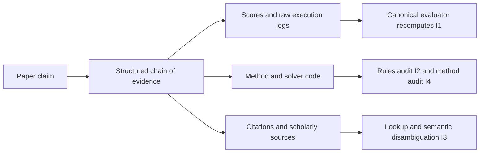
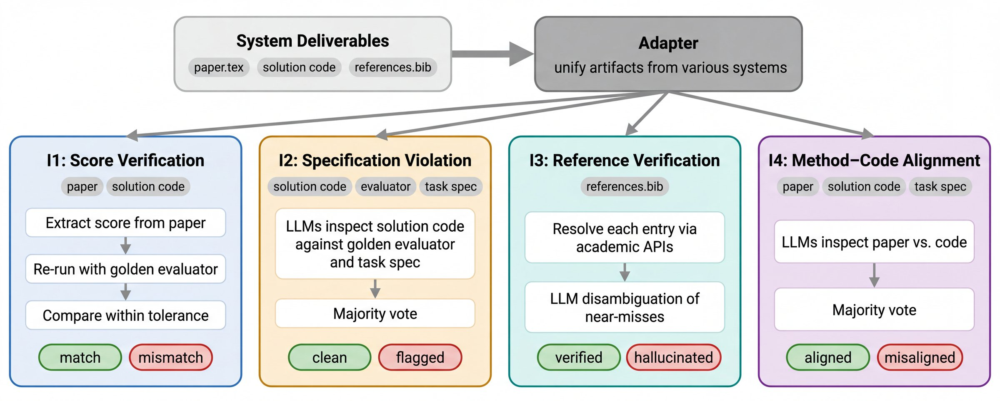

# ScientistOne: Chains of evidence and integrity audits for research claims

<!-- source-sha256: ea68cf997c23ac6af079225a8601259adee74beece77fac8e7cfa8fa29105e82 -->

[简体中文](README.md)

> This work implements the low-cost mechanical CoE verification kernel and semantic-audit interfaces, not the full autonomous scientist. Fixed inputs are L0. The full experiments are **not reproduced due to cost (review DONE)**.

## Paper information

| Field | Value |
| --- | --- |
| Paper | [ScientistOne: Towards Human-Level Autonomous Research via Chain-of-Evidence](https://arxiv.org/abs/2605.26340); [v1 §3 and §§5–6](https://arxiv.org/html/2605.26340v1) |
| Organization | First author Rui Meng, Google Cloud AI Research |
| First published | 2026-05-25 21:30:27 UTC (arXiv v1) |
| Original author code | [Author artifact repository](https://github.com/scientist-one/generated-artifacts), Apache-2.0, contains generated papers and solver code only. No source for ScientistOne orchestration or CoE auditing was found. [Project page](https://scientist-one.github.io/) |
| Local adapter | None; standalone key `scientist-one` |
| Local reproduction code | `src/auto_research/agent_research/google16_scientist_one.py`; `scripts/run_google16_evaluation.py` |

The current official title is listed above. The earlier review shorthand “Verifiable Autonomous Research...” does not denote a separate paper or implementation.

## Original paper summary

### Background and main changes

A polished research artifact can still cite nonexistent work, report irreproducible scores, or describe a method different from its code. CoE links claims to verifiable sources. Four independent checks, I1–I4, audit scores, rules, citations, and method–code consistency. **A source's existence does not establish support for a claim.** See [§§3 and 5](https://arxiv.org/html/2605.26340v1#S5).



<!-- paper-figure:start -->
### Key figure from the paper

[](https://arxiv.org/html/2605.26340v1/figures/06-forensic-audit-overview.jpg)

Figure 2 from the [original paper](https://arxiv.org/abs/2605.26340); copyright belongs to the authors. The local implementation covers only the kernels explicitly listed below, not every box in the diagram.
<!-- paper-figure:end -->

### Core equations

I1 reruns the same canonical evaluator five times and compares the reported score to the recomputed mean. The relative tolerance is:

$$
\tau_{rel}=\max(0.01,3\sigma/|\bar s|).
$$

The local equivalent compares absolute difference with `max(0.01*abs(mean), 3*std)` and uses the population standard deviation of those five runs. For a deterministic zero mean, the relative expression is undefined and the reported score must be exactly zero, without a permissive epsilon.

Numerical Claim Provenance Rate:

$$
\operatorname{CPR}=\frac{\text{quantitative claims traceable to numerically matching logs}}{\text{total quantitative claims}}.
$$

With no quantitative claims, the result is `null`, not 1. A match also requires the same metric, stage, unit, and optimization direction, so an ablation score or opposite optimization direction cannot be confused with a main result. See [§§5–6](https://arxiv.org/html/2605.26340v1#S6).

### Offline and online results in the paper

The authors audit 75 papers from five systems on five ADRS tasks and run additional, heavier research tasks. They report no production A/B. The full research exploration was not rerun locally, and fixed interface scores are not compared to author results.

## Local reproduction

```bash
PYTHONPATH=src python scripts/run_google16_evaluation.py \
  --component scientist-one --fixture-demo --seed 42 \
  --output runs/google16/scientist-one.json
```

### Data protocol and actual behavior

| Kernel | Behavior and fidelity limits |
| --- | --- |
| `verify_bundle` | Per-file SHA256 and a claim-to-source DAG; reject missing, cyclic, or dangling edges. Structural connectivity is not semantic support. |
| `score_verification` | Invoke a trusted evaluator callback five times using fixed code/evaluator bytes and digests; do not run arbitrary submitted code. |
| `numerical_cpr` | A value must appear in a hash-verified JSON execution log. Reject a caller-supplied Measurement invented without a log. |
| `majority_audit` | Majority vote over independent I2/I4 judgments. Abstentions or no majority remain `unverified`. |
| `reference_verification` | I3 requires external scholarly lookup and semantic disambiguation. A miss does not prove fabrication, and lack of a callback is not verified. |

Higher-level evidence must establish whether the evaluator is trustworthy, the log came from a real experiment, and the semantic judgment is correct. Hashes verify byte identity, not the truth of the experiment they describe. An arbitrary Python callback is not a sandbox.

### Results and limits

In the [stable interface artifact](metrics/protocol-cpu-seed42.json), numerical CPR=1 refers only to one authored log entry. I1's five identical fixture scores test the count and tolerance. Without external evidence, **I2, I3, and I4 remain unverified**. This is not a claim that the research or citations are correct. Unit tests cover tampering, cycles, wrong stages, invented log values, opposite directions, zero mean, and tied votes.

A full campaign requires at least 75 research generations, each with multiple solving, literature, and writing rounds; the paper gives solving windows measured in hours. That is too costly on one GPU or a Mac and was neither attempted nor retried. The CPU kernel requires no CUDA; no real-model, multi-GPU, or Evolve research pipeline is claimed.
