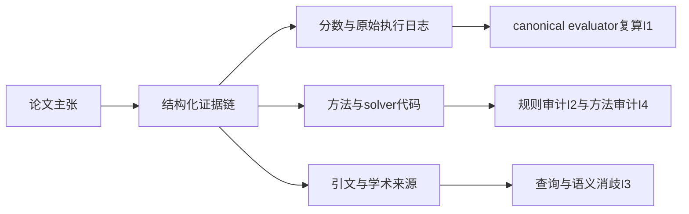
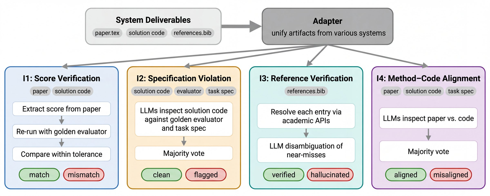

# ScientistOne：研究主张的证据链与完整性审计

> 本地实现低成本 CoE 机械核验内核与语义审计接口，不是完整自主科学家。固定刺激为 L0；完整实验 **成本过高，不复现（审查 DONE）**。

## 论文信息

| 字段 | 内容 |
| --- | --- |
| 论文链接 | [ScientistOne: Towards Human-Level Autonomous Research via Chain-of-Evidence](https://arxiv.org/abs/2605.26340)，[v1 §3、§5–6](https://arxiv.org/html/2605.26340v1) |
| 公司/机构 | 一作 Rui Meng，Google Cloud AI Research |
| 首次公开日期 | 2026-05-25 21:30:27 UTC（arXiv v1） |
| 原文开源代码 | [作者产物库](https://github.com/scientist-one/generated-artifacts)，Apache-2.0，仅生成论文和 solver code；未核到 ScientistOne 编排/CoE 审计系统源码；[项目页](https://scientist-one.github.io/) |
| 本地 Adapter | 无；独立组件 key：`scientist-one` |
| 本地复现代码 | `src/auto_research/agent_research/google16_scientist_one.py`；`scripts/run_google16_evaluation.py` |

当前官方标题如上。历史审查使用的简称“Verifiable Autonomous Research...”不作为新论文或另一项实现。

## 原始论文总结

### 背景与主要改动

研究产物看起来完整，仍可能引用虚构、分数无法复算或方法描述与代码不同。CoE 将主张连到可核验来源；独立 I1–I4 检查分数、规则、引用和方法/代码一致性。**来源存在不等于主张被支持**。[原文 §3 与 §5](https://arxiv.org/html/2605.26340v1#S5)



<!-- paper-figure:start -->
### 原论文关键图

[](https://arxiv.org/html/2605.26340v1/figures/06-forensic-audit-overview.jpg)

图片来自[原论文](https://arxiv.org/abs/2605.26340) Figure 2，版权归原作者所有。本地只实现下表明确列出的内核，不把流程图所有方框算作完成。
<!-- paper-figure:end -->

### 核心公式

I1 对同一规范 evaluator 重跑五次，比较报告值与复算均值。论文相对容差为：

$$
\tau_{rel}=\max(0.01,3\sigma/|\bar s|).
$$

本地等价地比较绝对差与 `max(0.01*abs(mean), 3*std)`；显式使用这五次运行的总体标准差。确定性零均值时相对式无定义，要求报告值精确为零，不添加宽松 epsilon。

数值 Claim Provenance Rate：

$$
\operatorname{CPR}=\frac{\text{能追溯到数值匹配日志的定量主张数}}{\text{定量主张总数}}.
$$

没有定量主张时为 `null`，不是 1。匹配还要求 metric、stage、unit、direction 一致，避免把消融分数或相反优化方向混成正式结果。[原文 §5–6](https://arxiv.org/html/2605.26340v1#S6)

### 论文离线与线上效果

原文在 75 篇、五系统、五 ADRS 任务上做完整性审计；另有更重研究任务。未报告生产线上 A/B。本地不重跑完整科研探索，不将接口的固定分数与作者论文结果对比。

## 本地复现

```bash
PYTHONPATH=src python scripts/run_google16_evaluation.py \
  --component scientist-one --fixture-demo --seed 42 \
  --output runs/google16/scientist-one.json
```

### 数据协议与实际行为

| 内核 | 行为与保真边界 |
| --- | --- |
| `verify_bundle` | 逐文件 SHA256、主张到来源的 DAG、缺失/循环/悬空边拒绝；不把结构连通称为语义支持 |
| `score_verification` | 真实调用受信任的 evaluator 回调五次，使用固定 code/evaluator bytes 和摘要；不执行任意提交代码 |
| `numerical_cpr` | 数值必须实际出现在经哈希核验的 JSON execution log 中；调用方凭空传入 Measurement 会拒绝 |
| `majority_audit` | I2/I4 独立判断的多数表决，弃权与无多数保留 `unverified` |
| `reference_verification` | I3 要求外部学术检索和语义消歧；无结果不能直接断言虚构，无回调也不算 verified |

canonical evaluator 的可信性、日志是否由实际实验产生、语义判断是否正确仍由上层证据保障；哈希只能证明“相同字节”，不能证明“字节描述了真实实验”。本地不将任意 Python callback 当安全沙箱。

### 结果与边界

[稳定接口产物](metrics/protocol-cpu-seed42.json)中数值 CPR=1 仅对应自写单条日志；I1 的五次相同 fixture 评分只测复算次数/门槛。I2、I3、I4 因没有外部证据**全部保留 unverified**，不以此宣称研究或引用正确。单测还覆盖篡改、循环、错误 stage、虚构日志值、错误优化方向、零均值和投票平局。

完整 campaign 至少包含 75 次研究生成、每次多轮求解/文献/写作，原文还给出小时级求解窗口；对单卡和 Mac 都明显高成本，本轮不尝试、不重试。当前 CPU 内核无需 CUDA；不宣称真实模型/多 GPU 科研流水线或 Evolve 集成。
