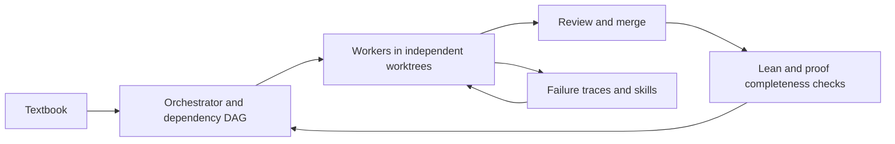
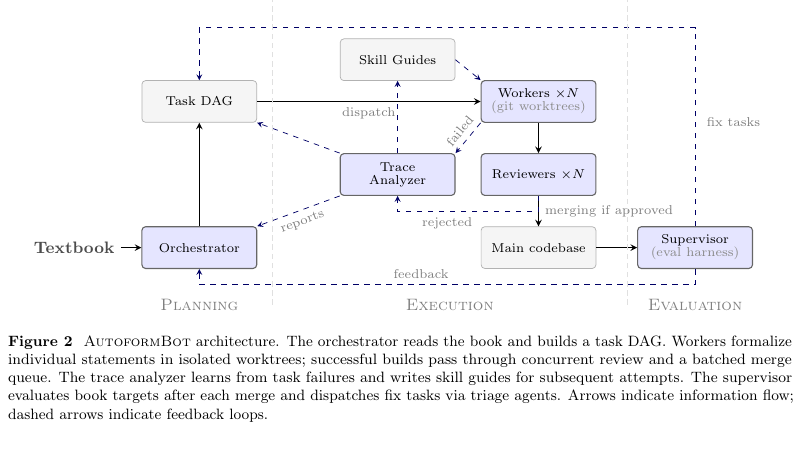

# AutoformBot: multi-agent formalization of entire textbooks

<!-- source-sha256: 47cbd05df4b6b53515f9e95e9893a2ad58e7efdc91866e6575eca605a46b74af -->

[简体中文](README.md)

> Historical coverage prioritizing Google and Meta. **Not reproduced due to cost (review complete).** An open framework does not establish local execution.

## Paper information

| Field | Details |
|---|---|
| Paper | [Formalizing Mathematics at Scale](https://arxiv.org/abs/2605.29955); [official Meta page](https://ai.meta.com/research/publications/autoformbot-formalizing-mathematics-at-scale/) |
| Organization | First author Ahmad Rammal; FAIR at Meta / CERMICS, ENPC, Institut Polytechnique de Paris |
| First public release | arXiv v1: 2026-05-28 14:00:22 UTC. Meta's catalog separately lists May 27. The source difference is retained; the PDF byline does not override v1. |
| Authors' code | [autoform-bot](https://github.com/facebookresearch/autoform-bot), MIT; formalization library [atlas-lean](https://github.com/facebookresearch/atlas-lean). No plugin was installed. |
| Adapter / method | No executable adapter (`adapter: null`); reference key `autoformbot` |
| Local reproduction code | None; this page and `src/auto_research/paper_specs/catalog/agent-research/autoformbot.json` only |

## Original paper

### Motivation and method

Build a dependency DAG of textbook declarations. Workers write Lean in independent worktrees, then concurrent review and a merge queue land changes. Failure traces generate skills. A supervisor checks objectives after merges and feeds findings back into planning. See [Sections 3–4](https://arxiv.org/html/2605.29955v1).

<!-- paper-figure:start -->
### Key figure from the paper

> **Figure 2:** Page 3 of the original PDF shows planning, execution, and evaluation feedback. This is not a local run. From the [original paper](https://arxiv.org/abs/2605.29955); copyright remains with the authors.
<!-- paper-figure:end -->

### Acceptance protocol and paper results

Compilation is necessary but insufficient. Illegal axioms, `sorry`, weakened statements, and hidden dependencies can bypass a proof. The authors combine dependency graphs, mechanical checks, matchers, and independent review to assess fidelity; a scheduling state machine cannot substitute. They report over 45,000 declarations across 26 textbooks, without completing every book. These are paper results, not local measurements. No industrial online A/B is reported. See [Section 5](https://arxiv.org/html/2605.29955v1#S5).

## Local reproduction and cost decision

The paper takes about a week per book. Even an ablation on a small 39-target book uses 600M to 1200M tokens and runs for hours. **Not reproduced due to cost (review complete).** No paid model calls or multi-agent Lean jobs were started. The source and protocol are indexed, with no local score, GPU receipt, executable evolve mapping, or automatic retry.
