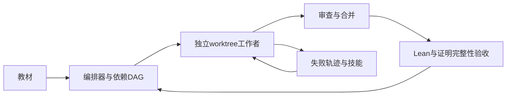
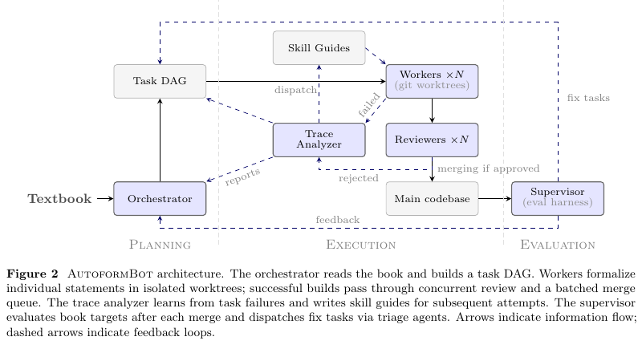

# AutoformBot：面向整本教材的多Agent形式化

> Google/Meta优先补漏。**成本过高，不复现（审查 DONE）**；开源框架不等于本地已运行。

## 论文信息

| 字段 | 内容 |
| --- | --- |
| 论文链接 | [Formalizing Mathematics at Scale](https://arxiv.org/abs/2605.29955)；[Meta官方页](https://ai.meta.com/research/publications/autoformbot-formalizing-mathematics-at-scale/) |
| 公司 / 机构 | 一作Ahmad Rammal，FAIR at Meta / CERMICS, ENPC, Institut Polytechnique de Paris |
| 首次公开日期 | arXiv v1：2026-05-28 14:00:22 UTC；Meta目录另标05-27，保留来源差异，不用PDF落款改写v1 |
| 原作者代码 | [autoform-bot](https://github.com/facebookresearch/autoform-bot)，MIT；形式化库[atlas-lean](https://github.com/facebookresearch/atlas-lean)。本轮未安装插件 |
| 本地 adapter / 稳定键 | 无可执行adapter（`adapter: null`）；资料键`autoformbot` |
| 本地复现代码 | 无；仅本文和`src/auto_research/paper_specs/catalog/agent-research/autoformbot.json` |

## 原始论文总结

### 背景与主要改动

先构建教材声明的依赖DAG，工作者在独立worktree写Lean，经并发审查和合并队列进入主库；失败轨迹生成技能，监督者在合并后核查目标并反馈重规划。[原文§3–4](https://arxiv.org/html/2605.29955v1)

<!-- paper-figure:start -->
### 原论文关键图

> 原论文Figure2，PDF第3页，展示规划、执行与评估反馈。图片来自[原论文](https://arxiv.org/abs/2605.29955)，版权归原作者所有；不是本地运行截图。
<!-- paper-figure:end -->

### 核心验收与原文效果

编译只是必要条件：非法axiom、`sorry`、削弱命题和隐藏依赖仍可能绕过证明。作者结合依赖图、机械检查、匹配器与独立评审核定忠实性，不能用调度状态机替代。原文26本教材产生超过45,000个声明，但各书没有全部完成；这是作者结果，不是本地测量，未报告工业线上A/B。[原文§5](https://arxiv.org/html/2605.29955v1#S5)

## 本地复现与成本决策

每书约一周；39目标的小书消融仍使用600M至1200M tokens，持续数小时。**成本过高，不复现（审查 DONE）**，不调用付费模型、不启动Lean多Agent任务。保留源码和协议，无本地分数、GPU回执或evolve可执行映射，不重新排入自动队列。
