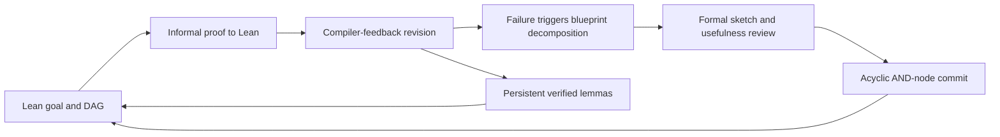
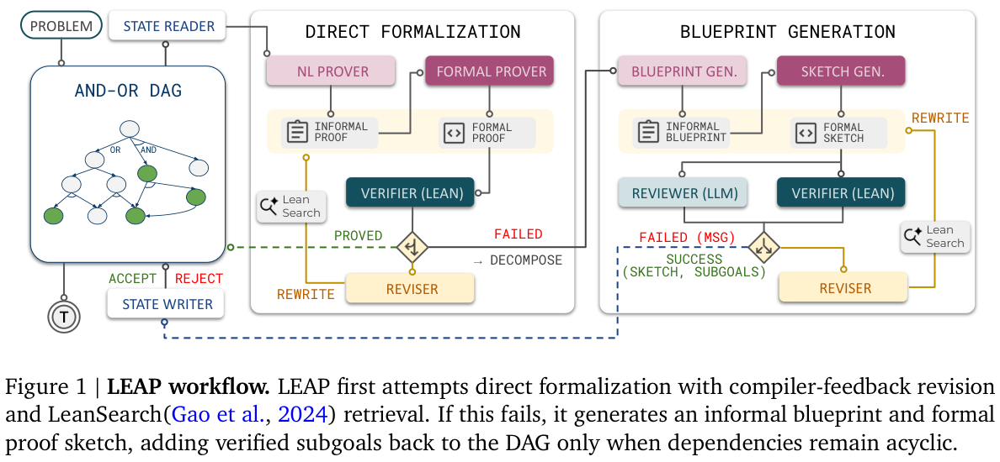

<!-- source-sha256: 17fe86bc34707ba86c654c88b441365dad786ad11fd9d177498f4865f20608ed -->
# LEAP: persistent AND–OR proof memory between informal planning and Lean

[简体中文](README.md)

> **review_only: historical Google-priority revision backfill.** The complete campaign is too costly and not reproduced (review DONE). No Lean proof/model execution occurred; generic DAG code is not a formal-math agent.

## Paper information

| Field | Value |
| --- | --- |
| Paper | [LEAP](https://arxiv.org/abs/2606.03303), reviewed [fixed v3](https://arxiv.org/html/2606.03303v3), retaining the [v1 record](https://arxiv.org/abs/2606.03303v1) |
| Institution | First author Po-Nien Kung lists Google Cloud AI Research first and UCLA additionally; collaborators include Google Cloud and DeepMind |
| Original publication | **2026-06-02 08:16:42 UTC**; reviewed v3 **2026-11-12 18:13:31 UTC**. Historical recall through a revision, not a November first release |
| Authors' code | The [official leap directory](https://github.com/google-deepmind/superhuman/tree/main/leap) releases Lean4 proof results/paper, with Apache2.0 software and CC-BY4.0 other materials. No verifiable general agent/harness release was found; results are not system code |
| Local adapter / key | `leap-formal-math`; `adapter=null`; no executable operator or Evolve integration |
| Local code | **None**; method record at `src/auto_research/paper_specs/catalog/agent-research/leap-formal-math.json` and documentation |

## Original paper

### Motivation and changes

Plausible informal reasoning does not guarantee a complete Lean-checked proof. LEAP first attempts informal proof→Lean→compiler-feedback revision, then decomposes failures through blueprints in a persistent AND–OR DAG. OR goals admit alternative strategies; AND decompositions require every necessary child lemma. Verified lemmas are reusable across branches.

Compilability alone does not establish useful decomposition. Sketches permit sorry only for proposed lemmas, not the parent theorem body, and graph updates must remain acyclic. An LLM reviewer separately checks relevance, simplification and a plausible route, avoiding renamed copies of the original goal. DFS/backtracking organizes search; the reviewer is a heuristic, not the formal kernel.

### Architecture

<!-- paper-figure:start -->
### Key original figure

From [fixed v3 PDF page4 Figure1](https://arxiv.org/pdf/2606.03303v3#page=4), cropped with PyMuPDF while preserving the entire caption without redrawing. Provenance records the PDF hash/point coordinates; copyright remains with the authors. LeanSearch, model, compiler and proof-state components are not locally implemented.
<!-- paper-figure:end -->

### Core equations

The following summarizes graph semantics, not a substitute for semantic search:

$$
proved(g)=\bigvee_{d\in strategies(g)}[verifiedSketch(d)\land\bigwedge_{u\in required(d)}proved(u)].
$$

A verified sketch and all required children resolve the parent. Anticipatory auxiliary lemmas need not be required by the current AND node. Acyclicity cannot replace semantic duplicate detection or useful simplification.

### Author results

Fixed v3 reports12/12 Putnam2025,83.3% Basic and56.7% Advanced on Lean-IMO-Bench; the tree ablation obtains73.3%/40.0%. Direct formalization uses pass@128 while full LEAP uses two rollouts, not identical single-attempt accuracy. Headline proving receives Lean statements without reference informal proofs; translation baselines separately receive references. No production A/B is reported and no tasks ran locally.

## Local reproduction

### Protocol and code mapping

Only fixed-v3 methods, the original-v1 date, figures and learning material are collected. Official solutions contain answers and must not be injected into actor observations. No model, LeanSearch/compiler bridge, proof DAG agent, evaluator, selection, runtime, capability metrics or GPU receipt is supplied.

### Full experiment and limits

Section4.1 Table3 reports822 aggregate per-problem minutes and about28M tokens for Putnam's twelve tasks alone. The wider matrix adds60 Lean-IMO tasks, pass@128/two-rollout comparisons, up to20 compiler-feedback revisions and ablations. Gemini3.1Pro and differing systems make reported aggregate runtimes neither a controlled architecture comparison nor a local single-GPU estimate. **Too costly; not reproduced (review DONE)**. No paid APIs, models/data or probes. Public proof artifacts do not establish an open full harness or local reproduction.
