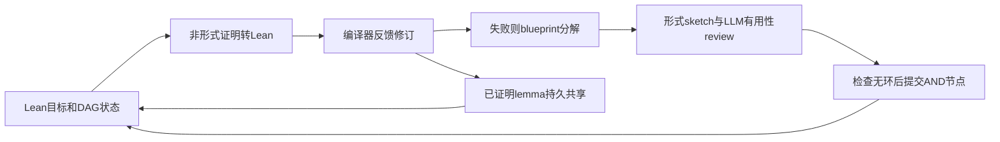
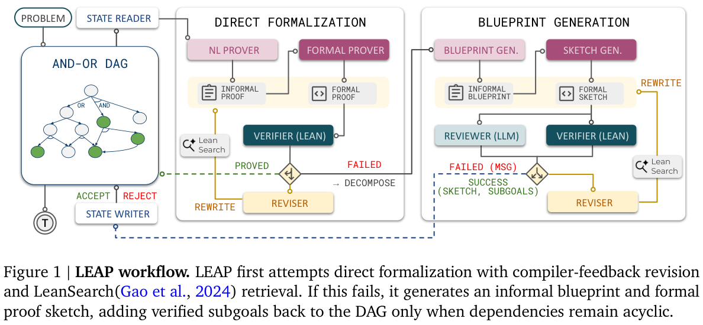

# LEAP：用持久AND–OR DAG连接非形式规划与Lean证明

[English](README-en.md)

> **review_only：Google高优先历史修订补漏，仅资料收录。** 完整实验成本过高，不复现（审查 DONE）。未运行Lean证明或模型，不把通用DAG组件包装成形式化Agent。

## 论文信息

| 字段 | 内容 |
| --- | --- |
| 论文链接 | [LEAP](https://arxiv.org/abs/2606.03303)，本轮核对[固定v3](https://arxiv.org/html/2606.03303v3)，保留[v1记录](https://arxiv.org/abs/2606.03303v1) |
| 公司 / 机构 | 一作 Po-Nien Kung，首列Google Cloud AI Research，另署UCLA；合作者含Google Cloud和DeepMind |
| 首次公开日期 | **2026-06-02 08:16:42 UTC**；本轮修订v3为**2026-11-12 18:13:31 UTC**。历史漏项随修订召回，不称11月新首发 |
| 原作者代码 | [官方leap目录](https://github.com/google-deepmind/superhuman/tree/main/leap)明确公开Lean4证明结果与论文，软件Apache2.0、其他材料CC-BY4.0；未找到可核实通用LEAP agent/harness源码，结果开源不等于系统代码开源 |
| 本地 adapter / key | `leap-formal-math`；`adapter=null`，无可执行operator，未接入Evolve |
| 本地复现代码 | **无**；仅 `src/auto_research/paper_specs/catalog/agent-research/leap-formal-math.json` 方法规格与资料 |

## 原始论文总结

### 背景与主要改动

能写出看似合理的数学论证，不代表一次就能生成Lean核通过的长证明。LEAP先直接尝试非形式论证→Lean代码→编译器反馈修订，失败后提出blueprint，再把lemma依赖写进持久AND–OR DAG。OR节点是待证目标的替代策略，AND节点是一种需要所有子lemma成立的分解，已验证结果可跨分支复用。

形式可编译仍不等于分解有价值。Lean sketch只允许新lemma处保留sorry，主目标正文不得sorry；依赖还必须无环。LLM reviewer另评估子问题是否相关、变简单并提供可行路径，避免把原目标换名字又当新lemma无限展开。DFS加回溯管理搜索；reviewer是启发式，不是形式正确性核。

### 架构与流程

<!-- paper-figure:start -->
### 原论文关键图

图片来自[原论文](https://arxiv.org/pdf/2606.03303v3#page=4)固定v3 PDF第4页Figure 1，经PyMuPDF裁取并保留完整caption，无内容重画；PDF哈希与点坐标见provenance，版权归原作者所有。图中LeanSearch、模型、compiler与状态读写均非本地已实现。
<!-- paper-figure:end -->

### 核心公式

用逻辑关系概括AND–OR状态，而非代替原文语义搜索：

$$
proved(g)=\bigvee_{d\in strategies(g)}\left[verifiedSketch(d)\land\bigwedge_{u\in required(d)}proved(u)\right].
$$

有效sketch加全部子目标证明才解决父目标；前瞻提出的辅助lemma不一定是当前AND节点的必要条件。DAG共享避免重复证明，但语义重复识别和子目标简化判断不能由“节点无环”取代。

### 论文离线与线上效果

固定v3报告Putnam2025为12／12，Lean-IMO-Bench Basic 83.3%、Advanced 56.7%；去掉DAG的tree配置分别73.3%、40.0%。直接formalization用pass@128，完整方法为2rollout，不能把采样预算口径混为单次准确率。主要证明实验只收Lean statement，不收参考非形式proof；translation baseline另给参考proof。未报告生产线上A/B，本地未执行这些题目。

## 本地复现

### 数据协议与代码映射

只收录固定v3原文及原始v1日期、方法、图与学习资料。官方解答repo不是本地actor可读的输入；它包含证明答案，不能偷偷作为待证任务提示。未实现模型、LeanSearch、Lean compiler桥接、DAG证明Agent、Lean-IMO评测器或模型筛选，无runtime／能力metrics／GPU收据。

### 高成本完整实验与边界

§4.1表3仅Putnam12题就报告按题累计822分钟、约28M tokens，完整矩阵还含60题Lean-IMO、pass@128／两rollout对照、最多20次compiler-feedback修订及消融。报告使用Gemini3.1Pro等不同模型和系统配置，跨系统累计计时不是受控架构比较，也非本地单卡预测。**成本过高，不复现（审查 DONE）**；不调用收费API、不下载模型／数据或运行成本探针。原文可验证证明产物不等于完整harness已开源或本地已复现。
