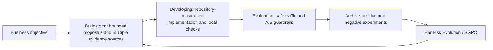
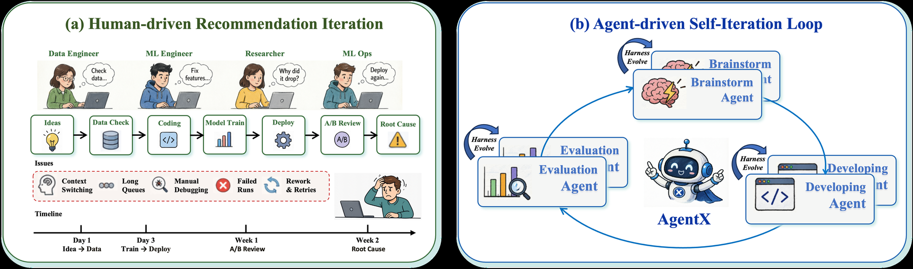

# AgentX: Agent-Driven Self-Iteration for Industrial Recommendation

<!-- source-sha256: 001851227fa1f4608b813fb7c96f9a8ab1d1763d48a861e200c6aa44c9caf196 -->

[简体中文](README.md)

> **Reproduction level: core-loop mini-suite.** The local controller implements Brainstorm, Developing, Evaluation, and Harness Evolution, and checks how experiment reuse reduces execution cost.

## Paper information

| Field | Details |
|---|---|
| Paper | [arXiv 2606.26859](https://arxiv.org/abs/2606.26859) |
| Organization | Kuaishou (credited to the AgentX Team). |
| First public release | 2026-06-26 (arXiv v1) |
| Authors' code | No public author implementation was found as of 2026-08-24. |
| Adapter / method | `agentx` |
| Local reproduction code | [`src/auto_research/agent_research/latest_20260824.py`](https://github.com/daiwk/auto-research/blob/main/src/auto_research/agent_research/latest_20260824.py) |

## Original paper

### Motivation and method

Traditional recommender iterations require engineers to connect hypotheses, production code, live A/B tests, and attribution, and lessons are difficult to accumulate. AgentX creates a four-stage loop. Brainstorm draws evidence-backed candidates from prior experiments, system knowledge, analysis, and papers. Developing implements and verifies them within repository constraints. Evaluation uses guarded online A/B with vetoes. SGPO updates the harness from successful and failed trajectories.



<!-- paper-figure:start -->
### Key figure from the paper

[](https://arxiv.org/html/2606.26859v2/figures/Agentx_introduction.png)

> **Figure 1:** The workflow, key stages, and data flow. From the [original paper](https://arxiv.org/abs/2606.26859); copyright remains with the authors.
<!-- paper-figure:end -->

### Core equations

Proposal scores weigh objective fit, business value, feasibility, handoff completeness, and evidence, then subtract risk:

$$
E(c\mid q)=\sum_{k\in\mathcal K}\alpha_k(q,c)e_k(c),\qquad
S(c\mid q)=\lambda_oO+\lambda_bB+\lambda_fF+\lambda_hH+\lambda_eE-\lambda_rR.
$$

A significant main-metric gain is insufficient when any critical guardrail vetoes release. Both success and failure traces enter the knowledge base for later proposals and harness updates.

### Paper results

Three weeks of production deployment covered Kuaishou's main feed and local-life recommendation. Three workers turned 374 ideas into 10 launchable experiments. Concurrency was 8× the manual process, weekly throughput per worker doubled, and business value was 3.7× the human engineer comparison. Launched experiments report +0.561% app time and more than RMB 100 million annualized revenue. This is production-loop evidence, not merely an offline benchmark.

## Local reproduction

Of 120 deterministic `planbench-mini` episodes, 12 first-seen task types execute proposal, implementation, double local checks, global guardrails, archival, and policy updates; the remaining 108 reuse archived solutions. Joint success is 1.0000 and average proxy cost 0.5870.

| Metric | Local result |
| --- | ---: |
| Joint success | 1.0000 |
| First-time loop / reuse | 12 / 108 |
| Bounded proposal explorations | 36 |
| Local / global verifier calls | 132 / 120 |
| Archival writes / policy updates | 12 / 120 |
| Average proxy cost | 0.5870 |

See [stable metrics](metrics/planbench-mini-seed42.json) and [batch index](../../experiments/recent-papers-20260824-seed42.json).

```bash
auto-research agent-eval --method agentx --benchmark planbench-mini \
  --episodes 120 --memory-size 24 --seed 42
```

## Limits

Without Kuaishou's internal repositories, traffic, users, and SGPO large-model training, this cannot reproduce business uplift. The mini-suite checks loop mechanics, reuse, archived outcomes, and verifier gates. Proxy cost measures control flow, not productivity, revenue, or app time.
