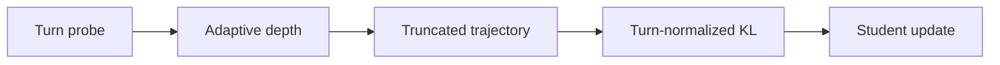
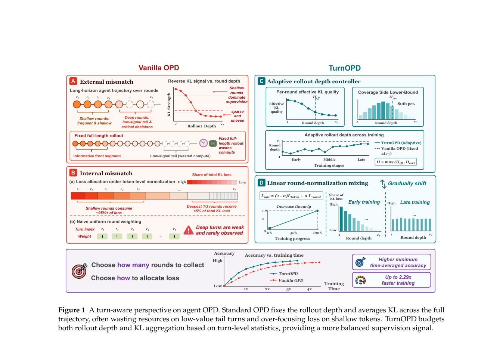

# TurnOPD: Turn-Aware Distillation for Long-Horizon Agents

<!-- source-sha256: d733b3f53c8bfa0e3a9b93fe8ccc61bc7a793ceb17a144b18630ab6f2c3f14e5 -->

[简体中文](README.md)

> **Local core-mechanism evidence.** Paper outcomes and local results are separate.

## Paper information

| Field | Value |
| --- | --- |
| Paper | [TurnOPD (arXiv 2607.05804)](https://arxiv.org/abs/2607.05804) |
| Affiliations | Academic author team |
| First public release | 2026-07-07 |
| Authors' code | No official author repository found as of 2026-07-29. |
| Adapter / method | `turn-opd` |
| Local code | [`src/auto_research/agent_research/`](https://github.com/daiwk/auto-research/tree/main/src/auto_research/agent_research/) |

## Original paper

### Background and contribution

Use probe statistics to choose rollout depth adaptively, gradually moving token KL budget into turn-normalized supervision.



<!-- paper-figure:start -->
### Key figure from the paper

[](https://arxiv.org/pdf/2607.05804#page=2)

Original Figure 1: TurnOPD. From the [paper](https://arxiv.org/abs/2607.05804); copyright belongs to the authors. Not a local result.
<!-- paper-figure:end -->

### Core mechanism

$$
L^\star=\operatorname{Budget}(\hat I_1,\ldots,\hat I_T),\quad \mathcal L=\sum_{t\le L^\star}\frac{1}{|y_t|}\mathrm{KL}(\pi_\theta^t\Vert\pi_T^t).
$$

### Paper results

At equal wall time, the paper improves validation accuracy and the accuracy–time frontier on ALFWorld, WebShop, and Multi-Hop Search. No production A/B.

## Local reproduction

ScaleMCP mini-suite executes depth probing, truncation, and normalization. Joint success 1.0000, average cost 1.3333, 40 turns saved. [Fixed-seed results](../../experiments/agent-20260729-seed42.json).

```bash
auto-research agent-eval --method turn-opd --episodes 120 --seed 42
```

## Reproduction limits

Teacher behavior comes from deterministic task oracles, not a task-specific LLM. Mechanism only.
