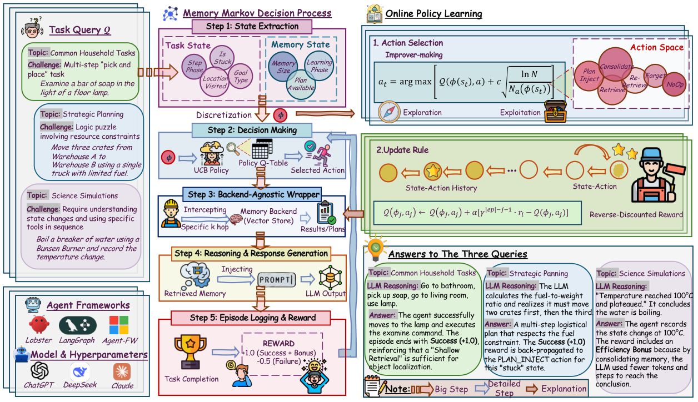

<!-- source-sha256: bde8ea8ee0efb81ebe113c9577863b1fbd087e0506457d6c3386f08f38ef0f96 -->

[简体中文](README.md) · English

# MemCon: Learning when and how to use agent memory online

> **Implemented: CPU core controller and real memory operations, with L1 mechanism diagnostics.** No LLM is called, and no reference answer or plan is read. This is not a capability reproduction of the paper's six benchmarks and is not promotion evidence for Evolve.

## Paper information

| Field | Details |
|---|---|
| Paper | [arXiv 2607.13591](https://arxiv.org/abs/2607.13591); implementation follows the [v3 full text](https://arxiv.org/html/2607.13591v3) |
| Institution | First author: Eric Hanchen Jiang. The HTML does not clearly map the first author to an affiliation. We neither guess nor use a collaborator's institution. Other authors list the University of Washington, UCLA, and Northwestern University. |
| First public release | 2026-07-15 (arXiv v1); the verified v3 was updated on 2026-10-12 |
| Author code | [Released: ericjiang18/MemCon](https://github.com/ericjiang18/MemCon/); MIT |
| Local adapter / operator | `memcon`, with class entry point `MemCon`; standalone CPU operator, not registered for legacy `agent-research --method` or `reproduce` |
| Local reproduction code | [`src/auto_research/agent_research/memcon.py`](https://github.com/daiwk/auto-research/blob/main/src/auto_research/agent_research/memcon.py) |

## Original paper summary

### Background and main changes

MemCon makes memory usage a separate online control problem. It chooses retrieval depth, plan injection, a replacement query, or memory maintenance based on task progress, repeated actions, memory size, and available successful plans. A lightweight tabular UCB controller explores and learns from end-of-task binary feedback and an efficiency reward without making extra LLM calls to choose memory operations.

### Architecture


<!-- paper-figure:start -->
### Key figure from the paper

[](https://arxiv.org/html/2607.13591v3/memcon_main.png)

Image from [Figure 1 of the original paper v3](https://arxiv.org/html/2607.13591v3/memcon_main.png), copyright the authors.
<!-- paper-figure:end -->

Original Figure 1 is from the [official v3 full text](https://arxiv.org/html/2607.13591v3#S1.F1), copyright the authors, and attributed under the paper's CC BY 4.0 license. Answers in that figure illustrate the workflow; they are not local evaluation outputs. The Mermaid diagram above depicts the local implementation. Neither is capability evidence.

### Core equations

Appendix C discretizes state by goal type; step phase `<8`, `8–17`, or `≥18`; whether the last two actions were repeated; objects held `min(n,2)`; places visited `min(n//3,4)`; memory size `min(n//10,5)`; existence of a successful plan; and task index `≤15` for cold start, otherwise warm.

State-local UCB chooses

$$
a=\arg\max_a\left[Q(\phi,a)+c\sqrt{\frac{\log N(\phi)}{N_a(\phi)}}\right],
\quad N(\phi)=\sum_a N_a(\phi).
$$

Unvisited actions are explored first, with initial Q breaking infinite-bonus ties. Priors for retrieval, plan use, replacement query, merging, forgetting, and no-op are `0.5 / 0.3 / 0.1 / 0 / -0.1 / -0.2`. Defaults are `alpha=0.15, gamma=0.9, c=1.4`.

$$
r_i=\mathbf1[success]-0.5\mathbf1[failure]
 +0.3\max(0,1-T_i/T_{max}),
$$

$$
Q(\phi_j,a_j)\leftarrow Q(\phi_j,a_j)+\alpha
 \left[\gamma^{|episode|-j-1}r_i-Q(\phi_j,a_j)\right].
$$

Later operations receive stronger terminal credit. Repeated state-action pairs are updated one at a time in reverse order. This is not sample-mean UCB, does not bootstrap future Q, and offers no convergence guarantee in a continually changing memory/agent environment.

| Index | Operation | top_k / insight_k / hop |
|---|---|---|
| 0 / 1 / 2 | Shallow, medium, deep retrieval | `1/3/1`, `2/5/1`, `3/8/2` |
| 3 | Inject plan extracted from a successful executed trajectory | `1/3/0` |
| 4 | Append `alternative approach` and retrieve again | `2/5/2` |
| 5 / 6 | Merge / forget memory | Backend maintenance interface |
| 7 | Minimal retrieval | `1/2/0` |
| 8 | Do not use memory | No retrieval |

**Source code versus full text:** The mutable `main` branch's [official policy.py](https://github.com/ericjiang18/MemCon/blob/main/hmf/mcp_framework/policy.py) uses the global selection count for the exploration term and fixed-index tie-breaking for unvisited actions. The local code follows v3's state-local counts and prior-based tie-breaking. This is an explicit reference choice, not a line-by-line reproduction of mutable upstream code.

### Offline and online results

The paper compares six task environments, three agent frameworks, and multiple LLMs. Its full text reports that GPT-4.1-mini improves average success over G-Memory by 2.6–4.2 percentage points across six benchmarks, with 10.9%–24.1% fewer input tokens on average. Simpler baselines can still be cheaper. No industrial online A/B test is reported; these are not local results.

## Local reproduction

### Cost and running the controller

The core algorithm uses only the Python standard library and runs on CPU. No weights or data are downloaded and no paid calls are made. The end-to-end comparisons across six benchmarks, multiple frameworks, and multiple LLMs require many long-trajectory inference runs. They are **too costly and not reproduced**; no trial was launched merely to prove the cost.

After basic repository installation, run:

```bash
python -m auto_research.agent_research.memcon --episodes 60 --seed 42 \
  --output runs/memcon/diagnostic-seed42.json
```

If the package is not installed, use `PYTHONPATH=src python -m ...`. This is not `auto-research agent-research --method memcon`, avoiding accidental integration into the legacy answer-visible fixture. See the [experiment integrity contract](../../design/experiment-integrity.md) for diagnostic results and evidence levels.

### Integration with a real agent

```python
from pathlib import Path
from auto_research.agent_research.memcon import InMemoryBackend, MemCon

controller = MemCon(InMemoryBackend())
controller.begin("public_goal_type")
context = controller.execute("query from actual observation", step=0)
# Pass context entries/insights/plan to the external agent and collect execution feedback.
# The following success/steps/actions must come from the real environment, not a reference answer or plan.
controller.finish(success=False, steps=30, observed_actions=("observed attempted action",))
controller.save(Path("runs/memcon/state.json"))
restored = MemCon.load(Path("runs/memcon/state.json"))
```

One lifecycle is `begin → execute (possibly several times) → finish`. Reusable plans come only from successful, genuinely observed `observed_actions`. Failures are also written to memory and retain negative feedback. The built-in backend implements term retrieval, multi-hop traversal along explicit links, insight deduplication, and forgetting failure records. Generic backends report an explicit no-op reason for unsupported maintenance. Policy, counts, successful plans, the built-in backend, and unfinished episodes can all be restored together. Owners of external backends manage their storage.

### Data protocol and measured results

Stable artifact: [CPU mechanism diagnostics, seeds 42/43/44](metrics/cpu-mechanism-seeds42-44.json). Each seed uses 12 generated publicly observable records, 60 episodes, and two memory decisions per episode. Feedback tests whether the requested record appears in real retrieval output, not whether an answer or plan is correct.

| Metric | Result per seed |
|---|---|
| Record retrieval hit rate | `0.8666667` |
| Mean terminal reward | `1.08` |
| Policy updates / memory decisions | `60 / 120` |
| State-table rows | `7` |
| Selection counts for all nine actions | `17,21,16,15,11,8,8,16,8` |

The three seeds only change the order of queried records. Simple inputs yield identical policy statistics; **this is neither an independent capability dataset nor evidence of reliable gains**. Hit rate is not forced to 1; misses from maintenance and no-op actions are retained. This tests execution, credit assignment, and restoration, not a capability gain over a baseline.

## Scope

- Implemented: Appendix C states/actions, the paper's UCB, warm-start, terminal reward, reverse credit, real backend operations, persistence, and restoration.
- The run does not implement the original G-Memory private network or evaluate the original six environments. Built-in term and explicit-link storage is a transparent substitute backend, not a reproduction of neural capabilities.
- The paper's goal-decomposition heuristic depends on domain mappings and is not included. Local plan generalization substitutes numeric identifiers only, without claiming semantic abstraction on new vocabularies.
- `diagnostic_only=true`, `formal_comparison=false`, `promotion_eligible=false`. UCB memory-operation execution rate is not agent answer accuracy and does not imply integration into Evolve capability promotion.
