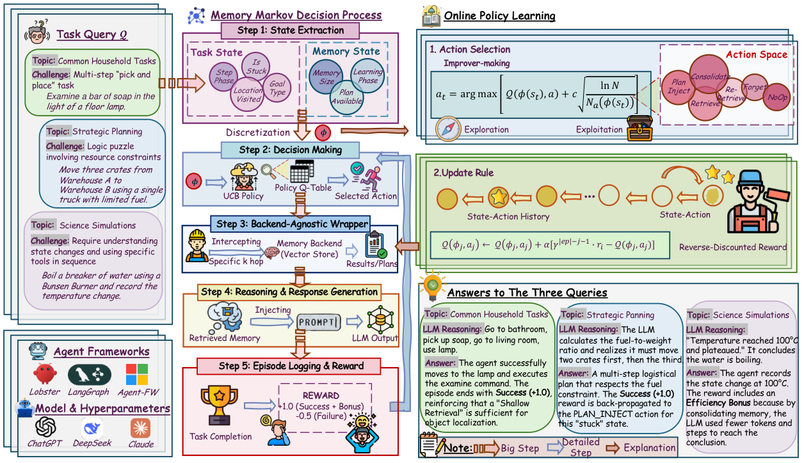

# MemCon：在线学习什么时候、如何使用 Agent 记忆

> **本轮完成：CPU 核心控制器与真实记忆操作；L1 机制诊断。** 没有调用 LLM，没有读取任务标准答案或标准计划，不是原论文六个 benchmark 的能力复现，也不作为 evolve 晋级证据。

## 论文信息

| 字段 | 内容 |
|---|---|
| 论文链接 | [arXiv 2607.13591](https://arxiv.org/abs/2607.13591)；实现依据 [v3 正文](https://arxiv.org/html/2607.13591v3) |
| 公司 / 机构 | 一作 Eric Hanchen Jiang；正文 HTML 未明确显示一作机构映射，暂不猜测或归入合作作者单位；文中其他作者有 University of Washington、UCLA、Northwestern University 署名 |
| 首次公开日期 | 2026-07-15（arXiv v1）；本轮核验版本 v3 更新于 2026-10-12 |
| 原作者代码 | 已公开：[ericjiang18/MemCon](https://github.com/ericjiang18/MemCon/)；MIT |
| 本地 adapter / operator | `memcon`，类入口 `MemCon`；独立 CPU operator，未注册旧 `agent-research --method` 或 `reproduce` adapter |
| 本地复现代码 | [`src/auto_research/agent_research/memcon.py`](https://github.com/daiwk/auto-research/blob/main/src/auto_research/agent_research/memcon.py) |

## 原始论文总结

### 背景与主要改动

MemCon 将记忆使用拆成一个独立的在线控制问题：根据任务进展、重复动作、记忆规模和已有成功计划，选择检索深度、计划注入、替换查询或记忆维护。控制器用轻量表格 UCB 探索，并从任务结束时的二元反馈及效率奖励学习，不为了选择记忆操作额外调用 LLM。

### 主要架构


<!-- paper-figure:start -->
### 原论文关键图

[](https://arxiv.org/html/2607.13591v3/memcon_main.png)

图片来自[原论文](https://arxiv.org/html/2607.13591v3/memcon_main.png) v3 Figure 1，版权归原作者所有。
<!-- paper-figure:end -->

原文 Figure 1；来自[官方 v3 正文](https://arxiv.org/html/2607.13591v3#S1.F1)，版权归原作者，按论文 CC BY 4.0 许可注明来源。图中的任务回答是流程示意，不是本地评测输出；上方 Mermaid 是本地实现重绘，两者不混作能力证据。

### 核心公式

状态按附录 C 离散化：目标类型；步骤阶段 `<8`、`8–17`、`≥18`；是否连续两次重复动作；持有物体数 `min(n,2)`；访问地点 `min(n//3,4)`；记忆规模 `min(n//10,5)`；成功计划是否存在；任务序号 `≤15` 为 cold，否则 warm。

状态局部的 UCB 选择为：

$$
a=\arg\max_a\left[Q(\phi,a)+c\sqrt{\frac{\log N(\phi)}{N_a(\phi)}}\right],
\quad N(\phi)=\sum_a N_a(\phi).
$$

尚未访问的动作优先探索，用初始 Q 打破无穷奖励的平手。检索、计划、替换查询、合并、遗忘、空操作的先验分别为 `0.5 / 0.3 / 0.1 / 0 / -0.1 / -0.2`。默认 `alpha=0.15, gamma=0.9, c=1.4`。

$$
r_i=\mathbf1[success]-0.5\mathbf1[failure]
 +0.3\max(0,1-T_i/T_{max}),
$$

$$
Q(\phi_j,a_j)\leftarrow Q(\phi_j,a_j)+\alpha
 \left[\gamma^{|episode|-j-1}r_i-Q(\phi_j,a_j)\right].
$$

后面的操作得到更强终末信用；同一状态动作多次出现时按逆序逐次更新。它不是 sample-mean UCB，不做未来 Q 的 bootstrap，也不能保证在持续变化的记忆/Agent 环境中收敛。

| 索引 | 操作 | top_k / insight_k / hop |
|---|---|---|
| 0 / 1 / 2 | 浅、中、深检索 | `1/3/1`、`2/5/1`、`3/8/2` |
| 3 | 注入已执行成功轨迹提炼的计划 | `1/3/0` |
| 4 | 加 `alternative approach` 后重新检索 | `2/5/2` |
| 5 / 6 | 记忆合并 / 遗忘 | backend 维护接口 |
| 7 | 最小检索 | `1/2/0` |
| 8 | 不使用记忆 | 不调用检索 |

**源码与正文差异**：[官方 policy.py](https://github.com/ericjiang18/MemCon/blob/main/hmf/mcp_framework/policy.py) 可变 `main` 使用全局选择数计算探索项，并以固定索引打破未访问动作平手。本地采用 v3 正文的状态局部计数和先验平手规则；这是明确的依据选择，不声称逐行复刻可变上游代码。

### 论文离线与线上效果

原文报告六种任务环境、三种 Agent 框架和多个 LLM 的比较。这里只记录正文已披露的结论：在 GPT-4.1-mini 上，相对 G-Memory，六 benchmark 平均成功率提高 2.6–4.2 个百分点，平均输入 token 减少 10.9%–24.1%；简单基线仍可能更便宜。未报告工业线上 A/B，不能把这些数字当成本地结果。

## 本地复现

### 成本与运行方式

本轮核心算法只使用 Python 标准库，CPU 上运行，不下载权重或数据，不增加付费调用。原六 benchmark、多框架和多 LLM 的端到端比较会产生大量长轨迹推理，**成本过高，暂不复现**；没有为证明成本而启动试跑。

在仓库完成基础安装后运行：

```bash
python -m auto_research.agent_research.memcon --episodes 60 --seed 42 \
  --output runs/memcon/diagnostic-seed42.json
```

若没有安装包，使用 `PYTHONPATH=src python -m ...`。这里不是 `auto-research agent-research --method memcon`，避免误接入历史的答案可见 fixture。诊断结果与证据分级规范见[实验可信度契约](../../design/experiment-integrity.md)。

### 接入实际 Agent

```python
from pathlib import Path
from auto_research.agent_research.memcon import InMemoryBackend, MemCon

controller = MemCon(InMemoryBackend())
controller.begin("public_goal_type")
context = controller.execute("query from actual observation", step=0)
# 将 context 的 entries/insights/plan 交给外部 Agent；执行并收集环境反馈。
# 下列 success/steps/actions 必须来自真实环境，而非标准答案或标准计划。
controller.finish(success=False, steps=30, observed_actions=("observed attempted action",))
controller.save(Path("runs/memcon/state.json"))
restored = MemCon.load(Path("runs/memcon/state.json"))
```

`begin → execute（可多次）→ finish` 是一轮生命周期。只从真实成功的 `observed_actions` 提取可复用计划；失败也写入记忆并保留负反馈。内置 backend 实现词项检索、显式 link 的多跳传播、insight 去重和失败记录遗忘；通用 backend 不支持的维护操作会输出明确 no-op 原因。策略、计数、成功计划、内置 backend 和未结束 episode 可一起恢复；外部 backend 的存储由其所有者管理。

### 数据协议与实测结果

稳定产物：[CPU 机制诊断，seeds 42/43/44](metrics/cpu-mechanism-seeds42-44.json)。每个 seed 使用 12 条生成的公开可观测记录、60 个 episode、每 episode 两次记忆决策；反馈检查实际检索输出中是否出现被请求的记录，不评估问答或规划能力。

| 指标 | 每个 seed 的结果 |
|---|---|
| 记录检索命中率 | `0.8666667` |
| 终末平均 reward | `1.08` |
| 策略更新 / 记忆决策 | `60 / 120` |
| 状态表行数 | `7` |
| 九个动作的选择次数 | `17,21,16,15,11,8,8,16,8` |

三个 seed 只改变查询记录顺序，简单输入使策略统计相同；**这不是独立能力数据集或稳定提升证明**。没有强制命中率为 1，维护和空操作产生的未命中保留在结果中。这里只做执行、信用和恢复回归检查，不设计胜过基线的能力结论。

## 复现边界

- 已实现：附录 C 状态/动作、正文 UCB、warm-start、终末奖励、逆序信用、真实 backend 操作、持久化/恢复。
- 没有实现原 G-Memory 的私有网络或原六环境评测；内置词项/显式 link 存储是透明的替换 backend，并不是其神经能力复现。
- 原文目标分解启发式依赖领域映射，本轮不加入；成功计划的本地泛化仅替换数字标识，遇新词表不声称语义抽象。
- `diagnostic_only=true`、`formal_comparison=false`、`promotion_eligible=false`；不把 UCB 记忆操作的执行率当作 Agent 答案正确率，也不伪装成已接入 evolve 能力晋级。
