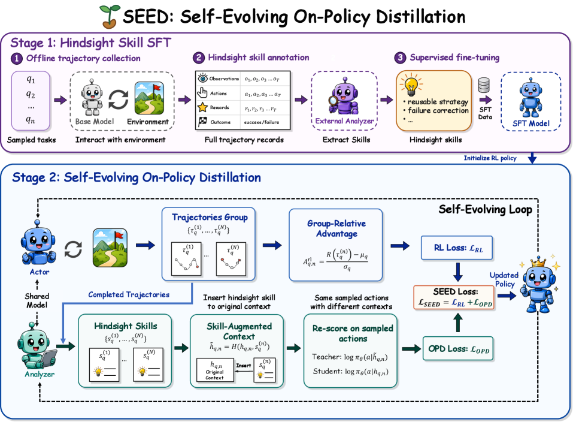

# SEED: Self-evolving on-policy distillation

<!-- source-sha256: dbcbefae8f3fc39076018a17ac10dfcbb4819735c82dc1399895bf1998c99f9c -->

[简体中文](README.md)

> Core state and update mechanism on a deterministic mini-suite, not paper-scale training.

## Paper information

| Field | Details |
|---|---|
| Paper | [SEED (arXiv 2607.14777)](https://arxiv.org/abs/2607.14777) |
| Institution | Tsinghua University / Zhejiang University / CUHK / NTU / Tongji University. |
| First public release | 2026-07-16 |
| Author code | [jinyangwu/SEED](https://github.com/jinyangwu/SEED). |
| Local adapter or method key | `seed` |
| Local reproduction code | [`src/auto_research/agent_research/`](https://github.com/daiwk/auto-research/tree/main/src/auto_research/agent_research/) |

## Paper method and evidence

Reflect on completed trajectories to extract reusable hindsight skills. Compare action log probabilities with and without skill context to supply dense on-policy distillation credit.


<!-- paper-figure:start -->
### Original paper figure

[](https://arxiv.org/html/2607.14777v1/x3.png)

The original figure shows extracting and distilling hindsight skills. From the [original paper](https://arxiv.org/abs/2607.14777); copyright remains with the authors.
<!-- paper-figure:end -->

### Core equation

$$
r_t^{\mathrm{skill}}=\log\pi_\theta(a_t\mid s_t,z)-\log\pi_\theta(a_t\mid s_t),\quad \mathcal L=\mathcal L_{\mathrm{RL}}+\lambda\mathcal L_{\mathrm{OPD}}.
$$

### Reported results

The paper reports consistent capability and sample-efficiency gains in text and visual agent tasks and evaluates transfer to unseen settings. No production A/B.

## Local reproduction

Compress success/failure traces into structured skills in PlanBench mini and record reuse across episodes. Joint success **1.0000**, mean cost **0.9800**, hindsight skills / dense credit updates **12 / 360**.

```bash
auto-research agent-eval --method seed --episodes 120 --seed 42
```

[Fixed metrics](../../experiments/agent-20260729-seed42.json). No visual model or large-scale policy gradient training.
