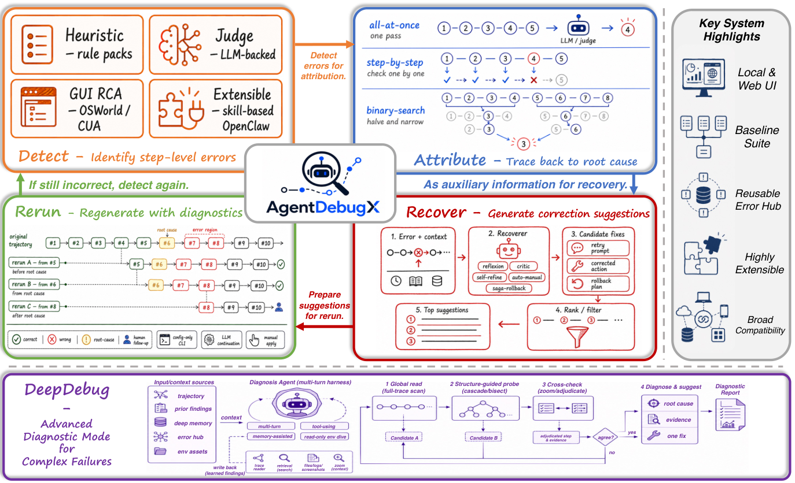

<!-- source-sha256: 4a68edeca9208cb293cd3cf72fdd03c7c88a30f5ceba711029407c6670c79391 -->

[简体中文](README.md) · English

# AgentDebugX: Failure attribution and repair on auditable trajectories

> **Research material only.** No executable local adapter, model metrics, or Evolve integration. The full experiment is **too costly and will not be reproduced (review DONE)**. It is not automatically retried or queued for implementation.

## Paper information

| Field | Details |
|---|---|
| Paper | [arXiv 2607.18754v1](https://arxiv.org/abs/2607.18754v1); [pinned v1 full text](https://arxiv.org/html/2607.18754v1) |
| Institution | UIUC is first author Kunlun Zhu's first affiliation; coauthor Xiangru Tang is at Google |
| First public release | **2026-07-21 06:21:13 UTC** (arXiv v1) |
| Author code | [AgentDebugX/AgentDebugX](https://github.com/AgentDebugX/AgentDebugX/tree/2437c73c3183e6b6495259dfbb12464a7f07f6b8), pinned to `2437c73c3183e6b6495259dfbb12464a7f07f6b8` |
| Author code license | MIT. The original paper figure is CC BY-NC-SA 4.0, a separate license. |
| Local adapter or method key | Research reference `agentdebugx`; no capability adapter; `evolve_integrated=false` |
| Local reproduction code | None. Documentation and source record only; a schema script is not a DeepDebug implementation. |

## Original paper summary

### Background and main changes

AgentDebugX adds Detect, Attribute, Recover, and Rerun artifacts to an immutable raw trajectory. DeepDebug first reads the entire trajectory, then attributes the failure independently for single- or multi-agent structures. When candidates disagree, it cross-examines them and returns responsible steps, supporting evidence, and concrete recommendations. Repair generates suggestions only. A human or policy gate must authorize an actual rerun; imported logs do not trigger arbitrary external tool replay.

<!-- paper-figure:start -->
### Key figure from the paper

Original Figure 1 PNG, not redrawn. From the [paper](https://arxiv.org/abs/2607.18754v1), copyright belongs to the authors, under CC BY-NC-SA 4.0. See `assets/provenance.json` for the source and hash.
<!-- paper-figure:end -->

### Core mechanism and evaluation boundaries

Trajectories preserve event order, parent events, inputs/outputs, and evidence. Attribution emits multiple hypotheses with confidence and provenance, rather than treating a symptom's location as necessarily the root cause. The loop saves a result only after a distinct repaired trajectory is scored against the objective. The paper does not evaluate learning gains from memory or Error Hub.

The paper reports five attribution metrics for the responsible agent, exact or ±1 step, and joint agent-plus-step attribution. Who&When **provides the task reference answer to the debugger under its with-ground-truth protocol**, but not the gold agent or step. This is not an online agent capability comparison without answers; that privileged input is part of the protocol.

### Offline and online results

On 184 Who&When cases, Qwen3.5-9B strict joint accuracy rises from 21.7% for the best single strategy to 28.8% with DeepDebug. In the 165-task GAIA validation set, 73 originally failed and 13 succeeded after one repair attempt. Different hosted backbones do not always improve. These are the authors' full-recipe results, not production A/B or local measurements.

## Local reproduction and cost

Local work verifies sections 3/4 and Appendix C, the pinned author repository, and the original figure. The full recipe needs 9B/27B models, multi-round Gemini debugging and search, GAIA tool reruns, and multiple repair comparisons. DeepDebug uses about 5 model calls and averages 12.8K tokens per diagnosis across 25 examples. The full experiment is **too costly and will not be reproduced (review DONE)**. No weights or tasks were downloaded, no external tools or models were run, and there are no local metrics or GPU receipts. Fixed rules do not stand in for the attribution agent.
