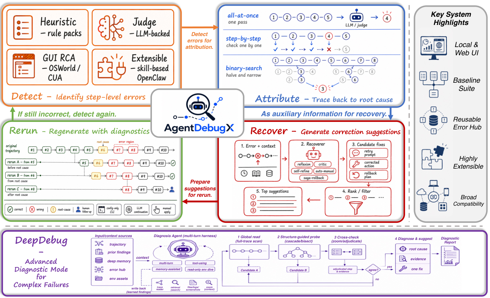

# AgentDebugX：可审计轨迹上的失败定位与修复闭环

> **仅研究资料**，没有可执行本地 adapter、模型指标或 Evolve 集成。完整实验**成本过高，不复现（审查 DONE）**，不会自动重试或进入实现队列。

## 论文信息

| 字段 | 内容 |
|---|---|
| 论文链接 | [arXiv 2607.18754v1](https://arxiv.org/abs/2607.18754v1)；[固定正文 v1](https://arxiv.org/html/2607.18754v1) |
| 公司 / 作者机构 | 一作 Kunlun Zhu 第一机构 UIUC；共同作者 Xiangru Tang 为 Google |
| 原始发布日期 | **2026-07-21 06:21:13 UTC**（arXiv v1） |
| 原作者代码 | [AgentDebugX/AgentDebugX](https://github.com/AgentDebugX/AgentDebugX/tree/2437c73c3183e6b6495259dfbb12464a7f07f6b8)，固定 `2437c73c3183e6b6495259dfbb12464a7f07f6b8` |
| 原作者代码许可 | MIT；论文原图为 CC BY-NC-SA 4.0，二者不能混同 |
| 本地 Adapter / key | 资料键 `agentdebugx`，无能力 adapter，`evolve_integrated=false` |
| 本地代码 | 不提供：仅本篇文档与来源记录，不将 schema 脚本冒充 DeepDebug |

## 原始论文总结

### 背景与主要改动

AgentDebugX 在不可变原始轨迹外叠加 Detect、Attribute、Recover、Rerun 产物。DeepDebug 先全局读，再按单/多 Agent 结构独立定位；候选不一致时交叉质询，最终给出责任步骤、证据和具体建议。修复只生成建议，实际重跑仍经过人或 policy gate；不会从导入日志擅自重放任意外部工具。

<!-- paper-figure:start -->
### 原论文关键图

原始 Figure 1 PNG，未重绘。图片来自[原论文](https://arxiv.org/abs/2607.18754v1)，版权归原作者所有，CC BY-NC-SA 4.0；来源和哈希见 `assets/provenance.json`。
<!-- paper-figure:end -->

### 核心机制与评测边界

轨迹保留事件顺序、父事件、输入/输出和证据。归因输出是带置信度与来源的多个假设，不把症状位置当作必然根因。闭环只在修复后的独立轨迹被目标评分后保存结果；memory / Error Hub 的学习收益在本文并未评估。

原文报告责任 Agent、exact / ±1 step、联合 Agent+step 五项归因指标；Who&When 按其 **with-ground-truth 协议向诊断器提供任务 reference answer**，但不提供 gold Agent/step。它不是无答案条件的在线 Agent 能力比较，不能省略这个特权输入。

### 论文离线与线上效果

184 条 Who&When 上 Qwen3.5-9B strict joint 由最好单策略 21.7% 到 DeepDebug 28.8%；GAIA 验证 165 题中，原始失败 73 题，一次修复成功 13 题。不同 hosted backbone 未总是改善；这些是作者完整配方结果，不是生产 A/B 或本地实测。

## 本地复现与成本

本地仅核对正文 §3/4 和 Appendix C、固定作者仓库及原图。完整配方需要 9B/27B 模型、多轮 Gemini 诊断/搜索、GAIA 工具重跑及多种修复对照；DeepDebug 约 5 次模型调用，在 25 条样本上平均 12.8K token/诊断。完整实验**成本过高，不复现（审查 DONE）**；未下载权重/任务、未运行外部工具或模型，没有本地 metrics / GPU receipt，也不以固定规则替代归因 Agent。
