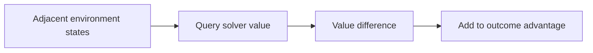
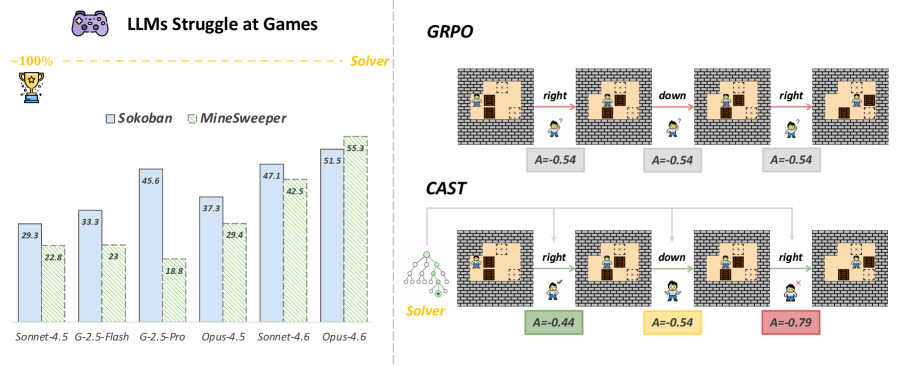

# CAST: Game solvers as turn-level teachers

<!-- source-sha256: 06de8bf9c9c2f2757c2be0b66136e944509865dd64dc59522c3ebb0800b571aa -->

[简体中文](README.md)

> Deterministic mini-suite mechanism, not large-model game training.

## Paper information

| Field | Details |
|---|---|
| Paper | [CAST (arXiv 2607.25308)](https://arxiv.org/abs/2607.25308) |
| Institution | USTC / Nanjing University / Wuhan University. |
| First public release | 2026-07-28 |
| Author code | [Wloner0809/CAST](https://github.com/Wloner0809/CAST). |
| Local adapter or method key | `cast` |
| Local reproduction code | [`src/auto_research/agent_research/`](https://github.com/daiwk/auto-research/tree/main/src/auto_research/agent_research/) |

## Paper method and evidence

Use successive differences in solver state value as a solver advantage that supplies turn-level credit alongside sparse outcome reward.



<!-- paper-figure:start -->
### Original paper figure

[](https://arxiv.org/html/2607.25308v1/x1.png)

The original figure shows solver-supported credit. From the [original paper](https://arxiv.org/abs/2607.25308); copyright remains with the authors.
<!-- paper-figure:end -->

### Core equation

$$
A_t^{\mathrm{solver}}=V_{\mathrm{solver}}(s_{t+1})-V_{\mathrm{solver}}(s_t),\quad A_t=A^{\mathrm{outcome}}+\lambda A_t^{\mathrm{solver}}.
$$

### Reported results

The paper reports beating baselines in Sokoban, Minesweeper and Rush Hour on seen and unseen difficulty, with highest average zero-shot results on ALFWorld and WebShop. No production A/B.

## Local reproduction

Deterministic shortest paths supply state values in PlanBench mini. Joint success **1.0000**, average cost **1.5000**, solver queries / turn updates **2040 / 360**.

```bash
auto-research agent-eval --method cast --episodes 120 --seed 42
```

[Fixed metrics](../../experiments/agent-20260729-seed42.json). Accurate solver verifies credit assignment, not LLM capability or large-scale RLVR on the three games.
