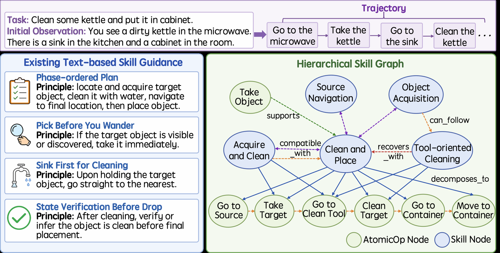

# HiSkill: Hierarchical Skill Graphs

<!-- source-sha256: 9fbc41e50f9f5186761a4f18e88aa4addb632a3f5170f229853f74109c6cf317 -->

[简体中文](README.md)

> **Core mechanism evidence.** Paper and local evaluation are separate.

## Paper information

| Field | Value |
| --- | --- |
| Paper | [HiSkill (arXiv 2607.25853)](https://arxiv.org/abs/2607.25853) |
| Affiliations | Beijing University of Posts and Telecommunications |
| First public release | 2026-07-28 |
| Authors' code | [Author code](https://github.com/BUPT-GAMMA/HiSkill). |
| Adapter / method | `hiskill` |
| Local code | [`src/auto_research/agent_research/`](https://github.com/daiwk/auto-research/tree/main/src/auto_research/agent_research/) |

## Original paper

### Background and contribution

Organize experience into high-level skills, executable AtomicOps, and typed directed edges. Retrieve only a task-relevant subgraph for action grounding.


<!-- paper-figure:start -->
### Key figure from the paper

[](https://arxiv.org/html/2607.25853v1/Figures/intro.png)

Original Figure 1: HiSkill. From the [paper](https://arxiv.org/abs/2607.25853); copyright belongs to the authors. Not a local result.
<!-- paper-figure:end -->

### Core mechanism

$$
G=(V_{\mathrm{skill}}\cup V_{\mathrm{op}},E_{\mathrm{decomp}}\cup E_{\mathrm{temporal}}\cup E_{\mathrm{recovery}}),\quad a_t=\operatorname{Ground}(s_t,G_t).
$$

### Paper results

The paper beats strong baselines in three interactive environments and lowers inference tokens. No live A/B.

## Local reproduction

PlanBench mini builds decomposition, transition, and recovery edges and logs reuse. Joint success 1.0000, average cost 0.6900, nodes/edges/AtomicOp reuse 48/60/324. [Metrics](../../experiments/agent-20260729-seed42.json).

```bash
auto-research agent-eval --method hiskill --episodes 120 --seed 42
```

## Reproduction limits

Graph nodes come from controlled trajectories, not online LLM extraction. Tests diagnose hierarchy and reuse.
