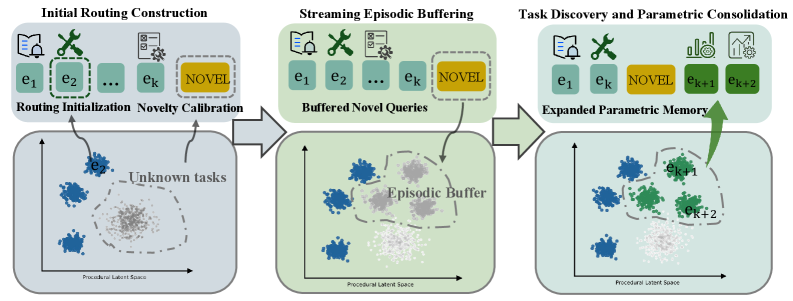

# UniMem: complementary routing from episodic to parametric memory

<!-- source-sha256: 5b504dab3d8a5fc3af96baccdf4a5564d9e47382a02126bf01c659bc9a6c0121 -->

[简体中文](README.md)

> **Fidelity:** Runs the paper's isolatable state and update mechanisms on common public data or a deterministic mini-suite. This does not reproduce the original large model.

## Paper information

| Field | Details |
|---|---|
| Paper | [UniMem: complementary routing from episodic to parametric memory (arXiv 2607.26017)](https://arxiv.org/abs/2607.26017) |
| Organization | CASIA / UCAS / Peking University / University College London |
| First public release | 2026-07-28 |
| Authors' code | No official public repository was found as of 2026-07-29. |
| Adapter / method | `unimem` |
| Local reproduction code | [`src/auto_research/agent_research/`](https://github.com/daiwk/auto-research/tree/main/src/auto_research/agent_research/) |

## Original paper

### Motivation and method

Novel tasks first enter an episodic buffer. A self-routing controller consolidates recurring and reliable execution patterns into scalable parametric memory.


<!-- paper-figure:start -->
### Key figure from the paper

[](https://arxiv.org/html/2607.26017v1/x1.png)

> **Figure 1:** Overall workflow, stages, and data flow. From the [original paper](https://arxiv.org/abs/2607.26017); copyright remains with the authors.
<!-- paper-figure:end -->

### Core equations

$$
z_t=\operatorname{Route}_\theta(x_t),\quad M_p\leftarrow M_p\oplus\operatorname{Consolidate}(M_e)\ \text{if recurrence}\ge\tau.
$$

### Paper results

On long-horizon streaming tasks, execution fidelity is maintained and exact match improves by 4.0 points on average across three backbones. No production online A/B is reported; only offline or environment outcomes are included.

## Local reproduction

The EvoMem mini-suite runs episodic routing, the recurrence threshold, parametric routing, and consolidation statistics.

| Metric | UniMem |
|---|---:|
| Joint success | 1.0000 |
| Average cost | 0.5200 |
| Episodic / parametric / consolidation | 24 / 96 / 12 |

```bash
auto-research agent-eval --method unimem --episodes 120 --seed 42
```

See the [fixed-seed metrics](../../experiments/agent-20260729-seed42.json).

## Reproduction boundaries

Parametric memory is a structured pattern table, not expanded LLM weight blocks. The run checks the stability/plasticity routing logic.
