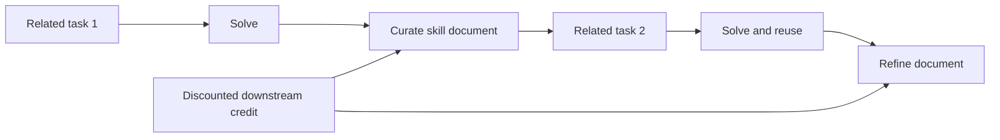
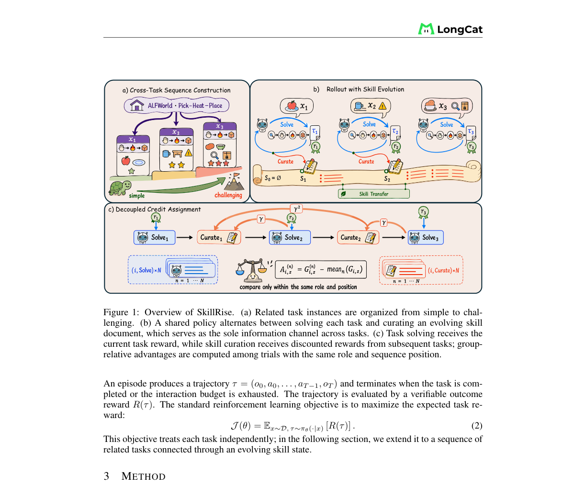

# SkillRise

<!-- source-sha256: 06458fafaf4bddc9f12e488fda51e9d4d782d380594148b7e292d9c8ef565f08 -->

[简体中文](README.md)

## Paper information

| Field | Details |
|---|---|
| Paper | [arXiv 2607.26784](https://arxiv.org/abs/2607.26784) |
| Organization | Zhejiang University / National University of Singapore / Shanghai Jiao Tong University / Meituan |
| First public release | 2026-07-29 (arXiv v1) |
| Authors' code | [Public implementation](https://github.com/Within-yao/SkillRise) |
| Adapter / method | `skillrise` |
| Local reproduction code | `src/auto_research/agent_research/methods.py` |

## Original paper

### Motivation and method

Standard agent RL treats tasks as independent episodes, while an external skill bank entangles extraction, retrieval, and execution. SkillRise orders related but distinct tasks from easy to difficult. One policy alternates solving the current task and curating a skill document passed directly to the next. Solving uses the current outcome; curation uses discounted outcomes from later tasks.



<!-- paper-figure:start -->
### Key figure from the paper

[](https://arxiv.org/abs/2607.26784)

> **Key figure:** Original architecture diagram. Copyright remains with the authors.
<!-- paper-figure:end -->

### Core equations

For task $i$, solving uses the current outcome and curation uses downstream returns:

$$
A^{\rm solve}_i=R_i-b_i,\qquad
A^{\rm curate}_i=\sum_{j=i+1}^{K}\gamma^{j-i-1}R_j-b_i^{\rm curate},
$$

Both phases share a policy, but each advantage applies only to the corresponding generated tokens.

### Paper results

Qwen3-4B Pass@1 is 85.9% on ALFWorld, 84.4% on WebShop, and 54.6% on ScienceWorld, beating the strongest baseline by 2.3, 7.1, and 8.5 points. Pass@3 is 92.2%, 96.1%, and 61.0%, respectively. No production online A/B is reported.

## Local reproduction

PlanBench mini groups related tasks by task axis. Episodes alternate solve and curate, update the skill document on successes, and record cross-task reuse and downstream credit separately.

```bash
auto-research agent-eval --method skillrise --benchmark planbench-mini \
  --episodes 120 --seed 42
```

Joint success is 1.0000 and mean cost 0.655. One skill document was created, reused 119 times across tasks, and updated 120 times, with 360 downstream credit updates. See the [complete metrics](../../experiments/latest-cross-domain-20260730-seed42.json).

## Reproduction boundaries

The run checks state evolution and credit separation. It does not train Qwen3 or run ALFWorld, WebShop, or ScienceWorld. The mini-suite's 100% success cannot be compared directly with paper Pass@k.
