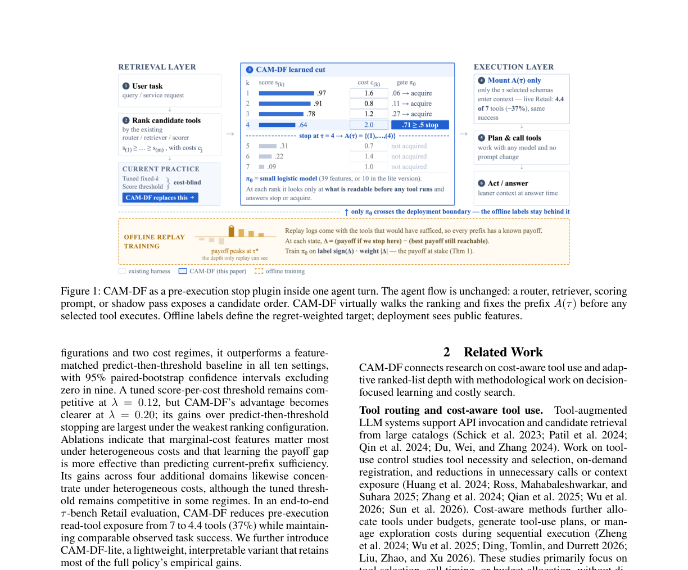

# CAM-DF

<!-- source-sha256: d761a4d27bbf6c21e172faa2202c00aa95e8963038a945f051e5bcdf1af0723d -->

[简体中文](README.md)

> **Core mechanism evidence.** Paper and local evaluations are separate.

## Paper information

| Field | Value |
| --- | --- |
| Paper | [arXiv 2607.27083](https://arxiv.org/abs/2607.27083) |
| Affiliations | Peking University / McGill University / Shanghai University of Finance and Economics / Tsinghua University |
| First public release | 2026-07-29 (arXiv v1) |
| Authors' code | The paper mentions cached artifacts and evaluation scripts but no public repository was found. |
| Adapter / method | `cam-df` |
| Local code | `src/auto_research/agent_research/methods.py` |

## Original paper

### Background and contribution

Router rank alone does not tell how many tools to expose. Virtually traverse ranked prefixes before any tool execution. Payoff is sufficiency less heterogeneous cost; compare stopping with the best future prefix to label each decision and weight errors by regret.


<!-- paper-figure:start -->
### Key figure from the paper

[](https://arxiv.org/abs/2607.27083)

Original CAM-DF figure. From the [paper](https://arxiv.org/abs/2607.27083); copyright belongs to the authors. Not a local result.
<!-- paper-figure:end -->

### Core mechanism

$$
U(A,x)=\operatorname{sufficiency}(A,x)-\lambda\sum_{j\in A}c_j,
$$

$$
\Delta_t=Q_{\rm stop}(t)-Q_{\rm cont}(t),\quad
y_t=\mathbf 1[\Delta_t\ge0],\quad w_t=|\Delta_t|+\epsilon.
$$

### Paper results

1,343 tasks over five tool domains; on live τ-bench Retail, exposed tools fall from 7 to 4.4 (−37%) at similar task success. No production A/B.

## Local reproduction

ScaleMCP mini freezes ranks/costs and evaluates all prefixes. Joint success 1.0000, 480 of 980 tools exposed (−51.02%), early stops 120/120. [Metrics](../../experiments/latest-cross-domain-20260730-seed42.json).

```bash
auto-research agent-eval --method cam-df --benchmark scalemcp-mini \
  --episodes 120 --seed 42
```

## Reproduction limits

Deterministic mini-suite, not live Retail; sufficiency comes from auditable required-tool fixtures, not a learned scorer.
