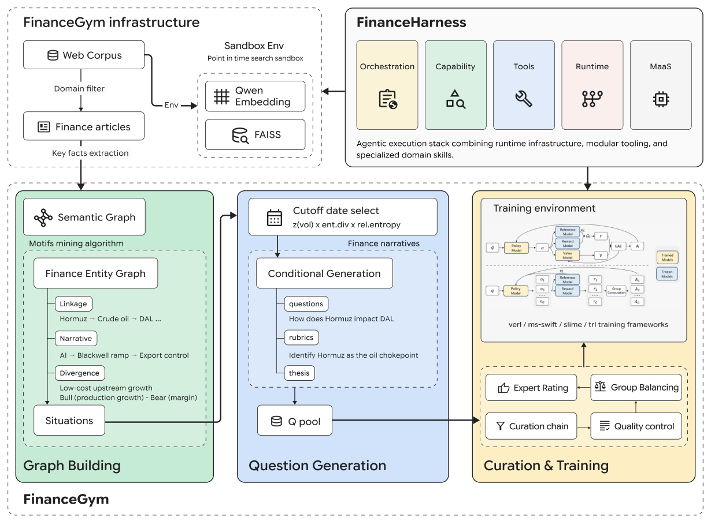

<!-- source-sha256: 63b49b05e79774f196612eac39db7fdf1944f622b2c7fb1f5d7c84673323674b -->

[简体中文](README.md) · English

# FinanceHarness: Point-in-time isolation and equal per-question evaluation

> **L1 CPU-only protocol component; diagnostic only.** Not a financial research agent capability or investment advice. The full experiment is **too costly; not reproduced (review DONE)**. No capability adapter or Evolve integration.

## Paper information

| Field | Details |
|---|---|
| Paper | [arXiv 2607.27853v1](https://arxiv.org/abs/2607.27853v1); [v2 used for local verification](https://arxiv.org/html/2607.27853v2) |
| Institution | First author Yijia Xiao lists Google Cloud AI Research first and UCLA as well. The work was done during a Google student research appointment. |
| First public release | **2026-07-30 08:32:04 UTC** (v1); local protocol verified against v2 dated 2026-08-07 |
| Author code | [FinanceHarness](https://github.com/Yijia-Xiao/FinanceHarness/tree/1163c5e7a8f35ff6217c3a480f7b04562355e0cc), pinned to `1163c5e7a8f35ff6217c3a480f7b04562355e0cc` |
| Evaluation entry point | [Google's official FinanceGym directory](https://github.com/google-research/google-research/tree/b24f2136e8ef405b900b5619760126304f190941/finance_harness), pinned to commit `b24f2136e8ef405b900b5619760126304f190941` |
| Author code license | Author harness Apache-2.0. The corpus and private scoring rubrics are not public; not all original evaluation resources are downloadable. |
| Local adapter or method key | `finance-harness-protocol`, standalone protocol, `evolve_integrated=false` |
| Local reproduction code | `src/auto_research/agent_research/finance_harness_protocol.py` |
| Local entry points and metrics | `PointInTimeStore`, `outcome_score`, `diagnostic`; `metrics/component-cpu-seeds42-44.json` |

## Original paper summary

### Background and main changes

FinanceHarness organizes financial tools, layered skill loading, and report evidence around point-in-time search. FinanceGym separates evidence available on or before the cutoff from forecasts that can only be confirmed after it. The agent sees only the question and cutoff. The thesis, scoring rubric, and future evidence stay with the post-submission evaluator.

<!-- paper-figure:start -->
### Key figure from the paper



Original PNG of Figure 1 from pinned v2, not redrawn. From the [original paper](https://arxiv.org/abs/2607.27853v2), copyright the authors, CC BY 4.0. See `assets/provenance.json` for source and hash. The figure does not indicate that corpus encoding, graph construction, or training are implemented locally.
<!-- paper-figure:end -->

### Core equations

Section 3.3 grades each rubric item on a five-level scale from 0 to 4. Normalize each question first, then average over questions:

$$
Outcome=\frac1{|Q|}\sum_q\frac{\sum_{c\in R(q)}score(q,c)}{4|R(q)|}.
$$

This differs from pooling all rubric items into one mean. Documents must satisfy `publication_date <= cutoff`. Any point-in-time leak **invalidates** the run; it is not silently scored zero or dropped before reporting the benchmark mean.

### Offline and online results

Table 4 fixes Qwen3.6-27B. Search-only reaches 25.3%, the full untrained harness 32.4%, and additional GRPO 32.8%. This is not production A/B; the small training gain is not a substitute for a multi-condition study. These scores use the authors' private point-in-time corpus and are not rerun locally.

## Local reproduction

`PointInTimeStore` preserves external retrieval order but filters future and unknown-date documents. `read` checks independently so directly reading future material cannot bypass search filtering. Submission checks record live-web use and unread citations; a triggered violation prevents scoring. `outcome_score` accepts only complete **post-submission** rubric grades, verifies question/item coverage and integer scores from 0 to 4, and retains equal per-question weights and separate pre/post components.

The component does not run FAISS, a crawler, a model, an LLM judge, a paid data source, or a real financial workflow. Callers supply retrieval rankings and trustworthy publication dates. `live_web_used` is external audit input, not a network sandbox. Diagnostics construct historical, same-day, future, and unknown dates; test that live-web audit invalidates a run; and check that two questions with 1 and 3 rubric items average 0.5, not 0.25. These are not agent capability tests.

```bash
PYTHONPATH=src python -c 'from auto_research.agent_research.finance_harness_protocol import diagnostic; print(diagnostic(42))'
python -m pytest tests/agent_research/test_google_emnlp_protocols.py -q
```

### High-cost full experiment

The paper uses 100M+ articles, a 4B embedding model, 4.37M graph edges, a 27B orchestrator, multiple systems on 500 questions, and private rubrics. A separate GRPO training set has 172 questions. The original corpus and private rubrics are unavailable and cannot be replaced with invented financial materials. The model, retrieval, and evaluation system is **too costly; not reproduced (review DONE)**. Only independently verifiable point-in-time and scoring protocols are delivered.
