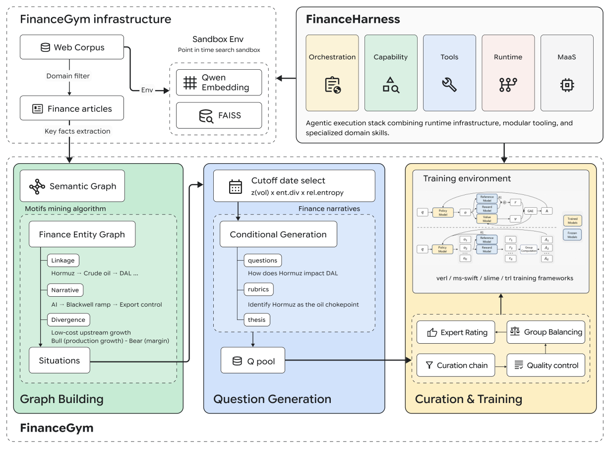

# FinanceHarness：时点隔离与逐题等权评测协议

> **L1 纯 CPU 协议组件，diagnostic only**，不是金融调研 Agent 能力，不提供投资建议。完整实验**成本过高，不复现（审查 DONE）**；无能力 adapter、未接入 Evolve。

## 论文信息

| 字段 | 内容 |
|---|---|
| 论文链接 | [arXiv 2607.27853v1](https://arxiv.org/abs/2607.27853v1)；[本地核对 v2](https://arxiv.org/html/2607.27853v2) |
| 公司 / 作者机构 | 一作 Yijia Xiao 首列 Google Cloud AI Research，另列 UCLA；工作在 Google 学生研究员期间完成 |
| 原始发布日期 | **2026-07-30 08:32:04 UTC**（v1）；本地协议按 2026-08-07 修订 v2 核对 |
| 原作者代码 | [FinanceHarness](https://github.com/Yijia-Xiao/FinanceHarness/tree/1163c5e7a8f35ff6217c3a480f7b04562355e0cc)，固定 `1163c5e7a8f35ff6217c3a480f7b04562355e0cc` |
| 评测入口 | [Google 官方 FinanceGym 目录](https://github.com/google-research/google-research/tree/b24f2136e8ef405b900b5619760126304f190941/finance_harness)，固定路径 commit `b24f2136e8ef405b900b5619760126304f190941` |
| 原作者代码许可 | 作者 harness Apache-2.0；底层 corpus 与私有评分 rubric 不公开，不能写成所有原始评测资源都可下载 |
| 本地 Adapter / key | `finance-harness-protocol`，独立协议，`evolve_integrated=false` |
| 本地代码 | `src/auto_research/agent_research/finance_harness_protocol.py` |
| 本地入口 / 指标 | `PointInTimeStore`、`outcome_score`、`diagnostic`；`metrics/component-cpu-seeds42-44.json` |

## 原始论文总结

### 背景与主要改动

FinanceHarness 围绕时点限定的搜索环境组织金融工具、分层加载技能与报告证据；FinanceGym 再把评分分为截止日前可检索的证据和只能在截止日后核实的预测。Agent 只能看到问题与截止日，thesis、评分 rubric、未来证据留在提交后的评测器。

<!-- paper-figure:start -->
### 原论文关键图



固定 v2 Figure 1 原始 PNG，未重绘。图片来自[原论文](https://arxiv.org/abs/2607.27853v2)，版权归原作者所有，CC BY 4.0；出处与哈希见 `assets/provenance.json`。本地图示不表示已实现语料编码、图构建或训练。
<!-- paper-figure:end -->

### 核心公式

§3.3 每个 rubric 用 0–4 五级评分，先对每一题归一，再对题目取均值：

$$
Outcome=\frac1{|Q|}\sum_q\frac{\sum_{c\in R(q)}score(q,c)}{4|R(q)|}.
$$

这不同于把全体 rubric 混在一起求均值。文档必须满足 `publication_date <= cutoff`；任何时点泄露使运行**无效**，不能把它悄悄算成零分或删掉后继续报 benchmark 均分。

### 论文离线与线上效果

原文 Table 4 固定 Qwen3.6-27B：search-only 为 25.3%，完整未训练 harness 为 32.4%，额外 GRPO 后 32.8%。这不是生产 A/B；小幅训练增益也不能替代多条件研究。以上均为作者私有时点语料上的成绩，本地不复测。

## 本地复现

`PointInTimeStore` 保留外部检索排名，但过滤未来/日期未知文档，`read` 再独立检查，防止跳过搜索直接读未来材料。提交检查记录 live-web 使用或未读引用；触发后不可评分。`outcome_score` 只接收**提交后**的完整 rubric grade，检查题目/条目齐全及 0–4 整数尺度，保留逐题等权与 pre/post 分项。

本地不运行 FAISS、爬虫、模型、LLM judge、付费数据源或真实金融工作流；真实检索排名与可信出版日期由调用方提供。`live_web_used` 是外部审计输入，不是本模块封锁网络的安全沙箱。诊断使用历史/当日/未来/未知日期构造负控，另验证 live-web 审计会使运行无效，以及 1 条/3 条 rubric 的两题应均分为 0.5 而非 0.25；不是 Agent 能力评测。

```bash
PYTHONPATH=src python -c 'from auto_research.agent_research.finance_harness_protocol import diagnostic; print(diagnostic(42))'
python -m pytest tests/agent_research/test_google_emnlp_protocols.py -q
```

### 高成本完整实验

原文使用 100M+ 文章、4B embedding、4.37M 图边、27B orchestrator、500 题多系统运行和私有 rubric；另有 172 题独立 GRPO 训练。原始 corpus 和 private rubric 未公开，不能用自造金融资料冒充。整套模型/检索/评测**成本过高，不复现（审查 DONE）**；只交付可独立验证的时点及评分协议。
