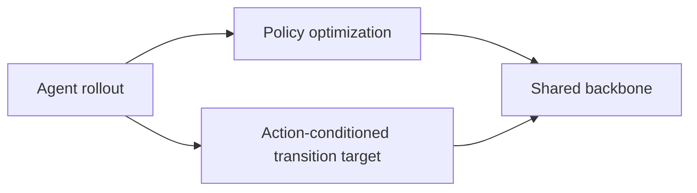
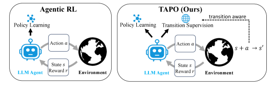

# TAPO: transition-aware policy optimization for agents

<!-- source-sha256: afb2899402091db9852fb612fe622620e5fd24dd27901603ff85c96bdbe1da46 -->

[简体中文](README.md)

> **Fidelity:** Alternates policy actions with action-conditioned next-observation supervision in a deterministic environment.

## Paper information

| Field | Details |
|---|---|
| Paper | [TAPO (arXiv 2607.27973)](https://arxiv.org/abs/2607.27973) |
| Organization | Peking University / Pengcheng Laboratory |
| First public release | 2026-07-30 |
| Authors' code | No official implementation was found when checked on 2026-08-01. |
| Adapter / method | `tapo` |
| Local reproduction code | [`src/auto_research/agent_research/`](https://github.com/daiwk/auto-research/tree/main/src/auto_research/agent_research/) |

## Original paper

### Motivation and method

A sparse task reward says whether the agent ultimately succeeded, without using feedback after each action. TAPO reuses the same rollout and alternates policy optimization with $(s_t,a_t)\to s_{t+1}$ next-observation prediction on a shared backbone. It adds no sampling, expert data, or inference overhead.



<!-- paper-figure:start -->
### Key figure from the paper

[](https://arxiv.org/html/2607.27973v1/x1.png)

> **Key figure:** Original comparison figure. From the [original paper](https://arxiv.org/abs/2607.27973); copyright remains with the authors.
<!-- paper-figure:end -->

### Core equation

$$
\mathcal L=\mathcal L_{\mathrm{policy}}+\lambda\,\mathbb E[-\log p_\theta(s_{t+1}\mid s_t,a_t)].
$$

### Paper results

Across WebShop and ALFWorld, 1.5B and 7B models, and multiple optimizers, TAPO consistently outperforms pure policy optimization and reduces transition-prediction perplexity. No production A/B is reported.

## Local reproduction

> **Local comparison:** PlanBench mini-suite, 120 episodes. Relative to the outcome-only agent, TAPO retains joint success 1.0000 and adds **360 transition targets at 1.0000 prediction accuracy**.

```bash
auto-research agent-eval --method tapo --benchmark planbench-mini --episodes 120 --seed 42
```

See the [fixed metrics](../../experiments/tapo-grsd-planbench-seed42.json).

## Reproduction boundaries

Deterministic observations validate data flow and alternating objectives. They do not reproduce RL training of Qwen2.5 on WebShop or ALFWorld.
