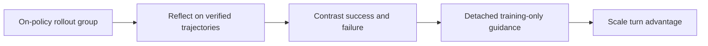
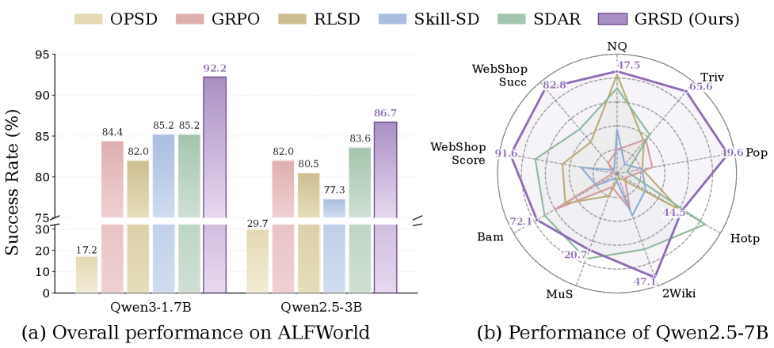

# GRSD: Group-Reflective Self-Distillation for Agents

<!-- source-sha256: 14138580df9fd3400d70cc5f7a56bcf4c4792601cc982c659014c1ac14b85211 -->

[简体中文](README.md)

> Success/failure groups, policy reflection, detached guidance, and turn-level updates.

## Paper information

| Field | Details |
|---|---|
| Paper | [Group-Reflective Self-Distillation (arXiv 2607.28076)](https://arxiv.org/abs/2607.28076) |
| Institution | Baidu Inc. and collaborating universities. |
| First public release | 2026-07-30 |
| Author code | [BinbZheng1/GRSD](https://github.com/BinbZheng1/GRSD). |
| Local adapter or method key | `grsd` |
| Local reproduction code | [`src/auto_research/agent_research/`](https://github.com/daiwk/auto-research/tree/main/src/auto_research/agent_research/) |

## Paper method and evidence

Final reward mixes useful actions, repeated errors, and chance. The policy reflects on verified on-policy traces for one prompt; a stop-gradient snapshot with the same parameters contrasts success/failure reflections to form training-only DO/AVOID guidance and modulates turn-level advantages.



<!-- paper-figure:start -->
### Original paper figure

[](https://arxiv.org/html/2607.28076v1/x1.png)

The original figure shows group contrast and turn-level guidance. From the [original paper](https://arxiv.org/abs/2607.28076); copyright remains with the authors.
<!-- paper-figure:end -->

### Core equation

$$
z_x=\operatorname{sg}(G(\{r_i^+\},\{r_j^-\})),\qquad \tilde A_t=A^{\mathrm{outcome}}\,m_t(z_x),\quad m_t>0.
$$

### Reported results

The paper reports the best aggregate results across ALFWorld, SearchQA and WebShop on 3B/7B models. Removing group guidance lowers ALFWorld/WebShop success by 7.0% each, and removing failure reflection lowers it by 3.9%. No production A/B.

## Local reproduction

PlanBench mini-suite: 120 episodes, joint success 1.0000, 120 reflection groups, 120 success/failure contrasts, and 360 privileged-guidance updates.

```bash
auto-research agent-eval --method grsd --benchmark planbench-mini --episodes 120 --seed 42
```

[Fixed metrics](../../experiments/tapo-grsd-planbench-seed42.json). Reflection is structured and auditable, not natural-language Qwen reflection. Tests verify group contrast and update routing.
