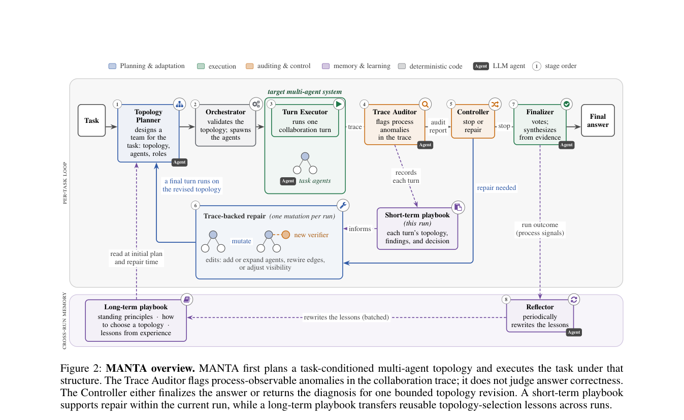

# MANTA: Multi-Agent Network Topology Adaptation for Self-Evolving Multi-Agent Systems

<!-- source-sha256: e2544f8304c21c3a10da7414c40e25654123288283045d6cdbfdc54e3d64335e -->

[简体中文](README.md)

> Deterministic topology mini-suite, not the full external environment.

## Paper information

| Field | Details |
|---|---|
| Paper | [Paper or original source](https://arxiv.org/abs/2607.28527) |
| Institution | Cornell University; first author MaoXun Huang. |
| First public release | 2026-07-30 (arXiv v1) |
| Author code | No public author code found as of 2026-08-24. |
| Local adapter or method key | `manta` |
| Local reproduction code | `src/auto_research/agent_research/historical_b10_b11.py` |

## Paper method and evidence

Initialize communication topology from task priors and monitor collaboration traces. Adapt roles, edges, ordering, visibility and verification under bounds.


<!-- paper-figure:start -->
### Original paper figure

[](https://arxiv.org/pdf/2607.28527#page=3)

Figure shows topology initialization and adaptation. From the [original paper](https://arxiv.org/abs/2607.28527); copyright remains with the authors.
<!-- paper-figure:end -->

### Core equation

$$
G_{t+1}=\Pi_{budget}(G_t+\Delta G(\tau_t))
$$

### Reported results

Paper average 74.0 over five benchmarks, 5.8 points above the strongest baseline; best on PlanCraft.

## Local reproduction

PlanBench mini, 120 episodes: MANTA **1.0000** joint success, mean cost **0.6600**; long-context **1.0000** and **64.5000**. [Metrics](metrics/planbench-mini-seed42.json), [Batch index](../../experiments/historical-b07-b11-seed42.json). With saturated accuracy, inspect traces, provenance and method-specific counters rather than claiming gains. No real browser, AppWorld, SWE-bench or external services. Raw outputs stay under `runs/agent-research/`; only [metrics](../../experiments/) are committed.

```bash
auto-research agent-research --method manta --benchmark planbench-mini --episodes 120 --seed 42
```
