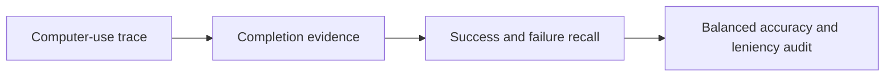
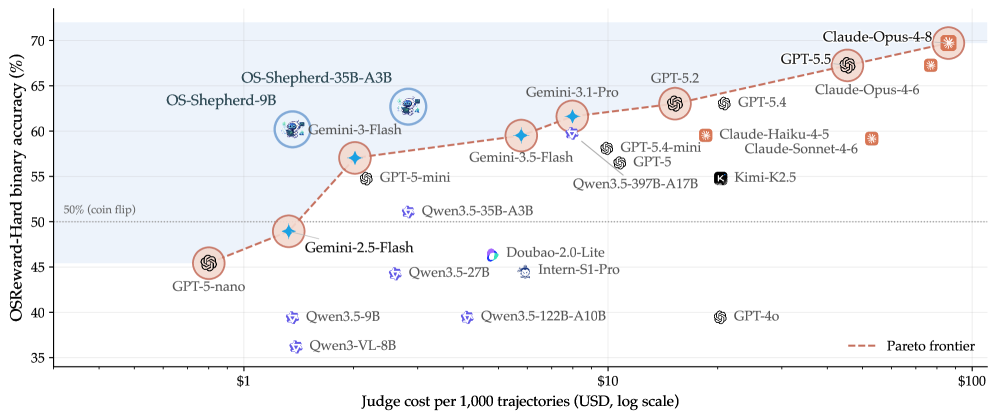

# OSReward: Cross-platform evaluation for computer-use reward models

<!-- source-sha256: bbd2d836b65628b3d83a130ec0d713f41ff38acfa574a2ee1aa755d3aa359764 -->

[简体中文](README.md)

> **Executable evaluation protocol**, not official human-labeled trajectories or OS-Shepherd training. Local benchmark: `osreward-mini`.

## Paper information

| Field | Details |
|---|---|
| Paper | [Paper or original source](https://arxiv.org/abs/2607.28609) |
| Institution | The University of Hong Kong / Nanjing University / NUS / USTC / Xi’an Jiaotong University / University of Oxford / Fudan University |
| First public release | 2026-07-30 |
| Author code | [Project page: code, benchmark, data and weights](https://os-copilot.github.io/OSReward-Home/). |
| Local adapter or method key | `os-shepherd` |
| Local reproduction code | [`src/auto_research/agent_research/osreward.py`](https://github.com/daiwk/auto-research/blob/main/src/auto_research/agent_research/osreward.py) |

## Paper method and evidence

Accuracy can hide a judge that labels nearly every computer-use trajectory successful. OSReward uses human-verified Windows, macOS, Ubuntu and Android tasks/trajectories, plus Hard and Multi subsets. It reports separate success/failure recall, their mean balanced accuracy, and a leniency audit. OS-Shepherd-100K trains open 9B and 35B judges.



<!-- paper-figure:start -->
### Original paper figure

[](https://arxiv.org/html/2607.28609v1/x3.png)

Figure 1 shows the evaluation and reward model framework. From the [original paper](https://arxiv.org/abs/2607.28609); copyright remains with the authors.
<!-- paper-figure:end -->

### Core equation

$$
\mathrm{sRec}=\frac{TP}{TP+FN},\qquad
\mathrm{fRec}=\frac{TN}{TN+FP},\qquad
\mathrm{BalAcc}=\frac{\mathrm{sRec}+\mathrm{fRec}}{2}.
$$

### Reported results

Official OSReward has 1,019 trajectories. The strongest closed judge has about 89.7% accuracy; many judges show leniency bias. OS-Shepherd-9B scores 86.1% accuracy and 86.3% balanced accuracy, reportedly 30–60× cheaper than a frontier commercial judge. No production A/B.

## Local reproduction

`osreward-mini` spans four platforms and task types. It distinguishes UI activity, proof of completion and unmet requirements rather than trusting the agent's success claim. In 120 deterministic episodes at seed 42 both recalls and balanced accuracy are 1.0 and leniency is zero. [Fixed-seed metrics](../../experiments/latest-20260802-seed42.json). This validates protocol behavior, not learned judge generalization; no official screenshots or 9B/35B training.

```bash
auto-research agent-eval --method os-shepherd --benchmark osreward-mini --episodes 120 --seed 42
```
