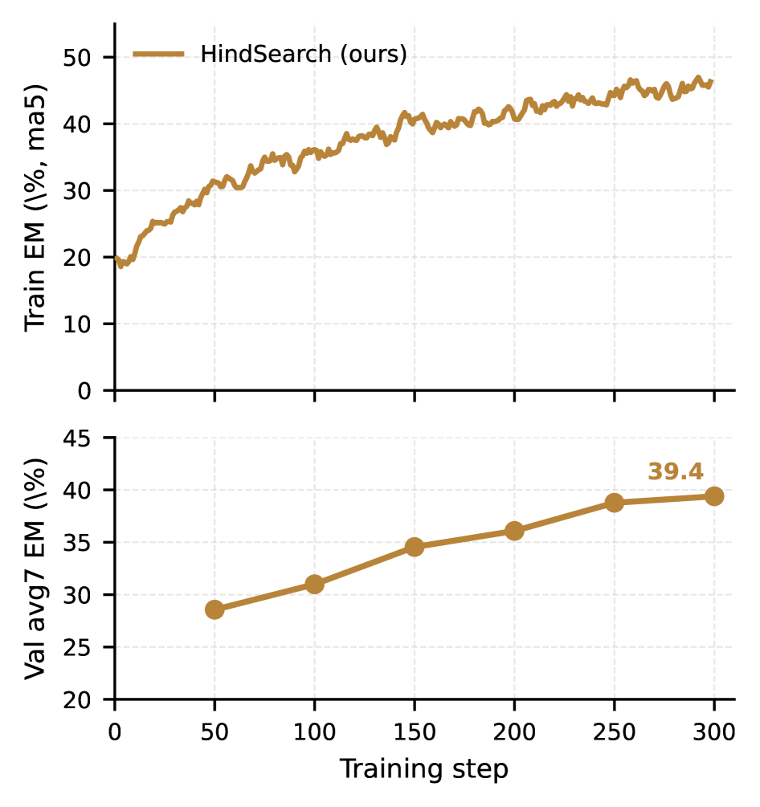

# HindSearch: Trajectory-Level Hindsight Critique for Search-Augmented Reinforcement Learning

<!-- source-sha256: e86fae976d8b18e8b202e29c91e046035ee7498b3bfbfe998ba8205f0c9a7d26 -->

[简体中文](README.md)

> **Core-mechanism mini-suite.** Executes the search-trajectory hindsight operator. A small deterministic evaluation does not reproduce the full paper.

## Paper information

| Field | Details |
|---|---|
| Paper | [arXiv 2608.01597](https://arxiv.org/abs/2608.01597) |
| Organization | Santa Clara University |
| First public release | 2026-08-03 (arXiv v1) |
| Authors' code | [https://anonymous.4open.science/r/hindsearch-anon-EBDC](https://anonymous.4open.science/r/hindsearch-anon-EBDC) |
| Adapter / method | `hindsearch` |
| Local reproduction code | [`src/auto_research/agent_research/latest_20260809.py`](https://github.com/daiwk/auto-research/blob/main/src/auto_research/agent_research/latest_20260809.py) |

## Original paper

### Motivation and method

**Topic: hindsight for search trajectories.** A frozen judge uses gold answers to write trajectory-level critiques for failed searches. Sparse success/failure becomes auxiliary on-policy distillation, combined with GRPO.

### Architecture


<!-- paper-figure:start -->
### Key figure from the paper

[](https://arxiv.org/html/2608.01597v1/x1.png)

> **Figure 2:** Training flow and key optimization steps. From the [original paper](https://arxiv.org/abs/2608.01597); copyright remains with the authors.
<!-- paper-figure:end -->

### Core equation

$\mathcal L=\mathcal L_{GRPO}+\lambda\mathcal L_{distill}(\pi_\theta,\text{critique})$.

### Paper results

The paper reports consistent gains on search-augmented reasoning under its protocol. Local experiments do not present a gold-aware judge as deployed capability.

## Local reproduction

See the [stable metrics](metrics/planbench-mini-seed42.json). Checkpoints and raw run directories are not committed.

```bash
auto-research agent-research --method hindsearch --benchmark planbench-mini --episodes 120 --seed 42
```

> **Local comparison:** Compare HindSearch with a control without the mechanism in the same public mini-suite. Report only local artifact metrics; large-model and real-environment paper results are not local gains.

## Reproduction boundaries

- Implements the paper-specific state, credit, or selection operator, not merely a renamed method.
- No original large model, proprietary environment, or expensive judge was run; these are not marked integrated.
- HindSearch participates in unified evolve candidate discovery. Composed genomes remain subject to public evaluation and budget constraints.
