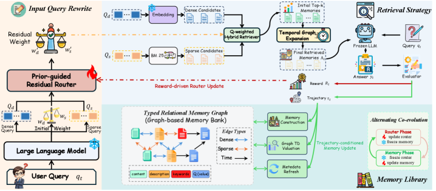

<!-- source-sha256: 48d4084d3086236671b23f286e96328efc18c02d2537013eb22705f99c5d64a5 -->

[简体中文](README.md) · English

# CoEvo-Mem: Alternating co-evolution of retrieval routing and memory banks

> **Core mechanism reproduction.** Paper results, local mechanism checks and missing scope are distinct.

## Paper information

| Field | Details |
| --- | --- |
| Paper | [CoEvo-Mem: Co-Evolving Retrieval Policy and Memory Bank for LLM Agents (arXiv 2608.01739)](https://arxiv.org/abs/2608.01739) |
| Institution | Not listed in the paper |
| First public release | 2026-08-03 (arXiv v1) |
| Author code | No released official code found on 2026-08-08. |
| Local adapter or method key | `coevo-mem` |
| Local reproduction code | [`src/auto_research/agent_research/`](https://github.com/daiwk/auto-research/tree/main/src/auto_research/agent_research/) |

## Original paper summary

### Background and main changes

Optimizing routing or memory in isolation ignores their feedback loop. CoEvo-Mem uses a frozen LLM for route-specific rewrites and priors, with a lightweight residual router adapting online. Task outcomes update routing; trajectories update memory values and graph relationships. Alternate which side is frozen to control nonstationarity.


<!-- paper-figure:start -->
### Key figure from the paper

[](https://arxiv.org/html/2608.01739v1/x1.png)

> **Figure 2:** Training workflow and key optimizations. From the [paper](https://arxiv.org/abs/2608.01739); copyright belongs to the authors. Click for the source.
<!-- paper-figure:end -->

### Core equations

$$
q'=q_{LLM}+\Delta_\phi(q),\quad \phi\leftarrow\arg\max J(\phi;M\ \mathrm{fixed}),\quad M\leftarrow\operatorname{Update}(M;\tau,\phi\ \mathrm{fixed}).
$$

### Offline and online results

The authors report state of the art across seven varied benchmarks to validate retrieval-memory co-evolution. No production A/B.

## Local reproduction

Implements route rewriting, residual routing and alternating router/memory-bank updates. Retrieval keys include the task axis and tool signature to prevent mistaken reuse across tasks.

PlanBench mini-suite, 120 episodes, seed 42: joint success **1.0000**, average cost 0.5000. All paper-specific operations record nonzero telemetry.

```bash
auto-research agent-eval --method coevo-mem --benchmark planbench-mini --episodes 120 --seed 42
auto-research evolve --model agent --dataset planbench-mini --direction "组合 coevo-mem 与已安装论文算子" --generations 2 --population 4
```

Stable metrics: [batch audit](../../experiments/p0-p1-closed-audit-20260808-seed42.json).

## Scope

The deterministic public mini-suite checks core state updates at matched budgets. It does not reproduce large models, multi-GPU RL, private environments or the full benchmark. Local differences are not paper gains.
