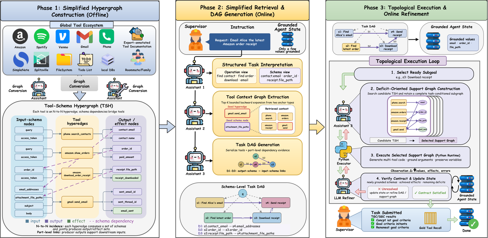

# HyperAgent: Planning and Acting over Tool-Schema Hypergraphs for Tool-Use LLM Agents

<!-- source-sha256: 9ce2e23d00def1e96361a605af6f498e38c2b97c7b9d00d7e146b8be7dc20622 -->

[简体中文](README.md)

> Deterministic graph mechanism, not original external environments.

## Paper information

| Field | Details |
|---|---|
| Paper | [Paper or original source](https://arxiv.org/abs/2608.02650) |
| Institution | University of New South Wales; first author Zian Zhai. |
| First public release | 2026-07-31 (arXiv v1) |
| Author code | No public author code found as of 2026-08-24. |
| Local adapter or method key | `hyperagent` |
| Local reproduction code | `src/auto_research/agent_research/historical_b10_b11.py` |

## Paper method and evidence

Represent tools as input-schema→output-schema hyperedges. Construct a task DAG, then expand producer support for missing state.


<!-- paper-figure:start -->
### Original paper figure

[](https://arxiv.org/html/2608.02650v1/final.png)

The original figure shows tool-schema hypergraph planning. From the [original paper](https://arxiv.org/abs/2608.02650); copyright remains with the authors.
<!-- paper-figure:end -->

### Core equation

$$
e_{tool}:\{schema_{in}\}\rightarrow\{schema_{out}\}
$$

### Reported results

The paper reports higher AppWorld task completion with fewer redundant API calls, LLM interactions and tokens.

## Local reproduction

PlanBench mini 120 episodes: HyperAgent **1.0000** joint success, mean cost **0.5500**, versus long-context **1.0000** and **64.5000**. [Metrics](metrics/planbench-mini-seed42.json), [batch index](../../experiments/historical-b07-b11-seed42.json). Audit traces when success saturates. No browser, AppWorld, SWE-bench, or external services. Raw runs stay in `runs/agent-research/`; only [metrics](../../experiments/) committed.

```bash
auto-research agent-research --method hyperagent --benchmark planbench-mini --episodes 120 --seed 42
```
