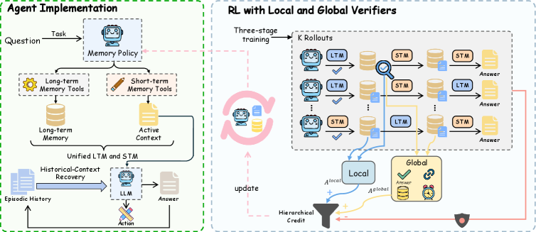

<!-- source-sha256: 8eadddc1ca6eae3b9349b00766771bce35bd3e46a6d0a78620566924c6c029dd -->

[简体中文](README.md) · English

# VerMem: Unified memory management with local and global verifiers

> **Core mechanism reproduction.** Paper conclusions, local checks and unreproduced scope are separate.

## Paper information

| Field | Details |
| --- | --- |
| Paper | [Verifiable Memory: Learning Unified Memory Management with Local and Global Verifiers for Large Language Model Agents (arXiv 2608.03137)](https://arxiv.org/abs/2608.03137) |
| Institution | Sun Yat-sen University / Xiaolong Sun |
| First public release | 2026-08-04 (arXiv v1) |
| Author code | [Released code: Sun-SYSU-24/VerMem](https://github.com/Sun-SYSU-24/VerMem). |
| Local adapter or method key | `vermem` |
| Local reproduction code | [`src/auto_research/agent_research/`](https://github.com/daiwk/auto-research/tree/main/src/auto_research/agent_research/) |

## Original paper summary

### Background and main changes

Long-term memory, active context and episodic history are often optimized separately, and trajectory reward cannot verify one memory action. VerMem uses one policy over all three states and seven atomic operations. A local verifier checks state transitions and a global verifier checks evidence consistency.


<!-- paper-figure:start -->
### Key figure from the paper

[](https://arxiv.org/html/2608.03137v1/x1.png)

> **Figure 1:** Training workflow and key optimizations. From the [paper](https://arxiv.org/abs/2608.03137); copyright belongs to the authors. Click for the source.
<!-- paper-figure:end -->

### Core equations

$$
R=R_{task}+\lambda_lV_{local}(m_t,a_t,m_{t+1})+\lambda_gV_{global}(M_T,\tau)-\lambda_cC(a_t),\quad \max_\pi\mathbb E_\pi[R].
$$

### Offline and online results

The paper reports best results on most metrics over five benchmarks and two backbones, and the best efficiency–performance frontier at a controlled online-token budget. No production A/B.

## Local reproduction

Explicitly maintain long-term memory, active context and episodes. Run retrieve/add/restore and count local and global verifier calls separately.

PlanBench mini-suite, 120 episodes, seed 42: joint success **1.0000**, average cost 0.6100, with nonzero telemetry for paper-specific operations.

```bash
auto-research agent-eval --method vermem --benchmark planbench-mini --episodes 120 --seed 42
auto-research evolve --model agent --dataset planbench-mini --direction "组合 vermem 与已安装论文算子" --generations 2 --population 4
```

See [stable batch metrics](../../experiments/p0-p1-closed-audit-20260808-seed42.json).

## Scope

The deterministic public mini-suite verifies core state updates at matched budgets, not paper-scale models, multi-GPU RL, private environments or full benchmarks. Local changes are not paper gains.
