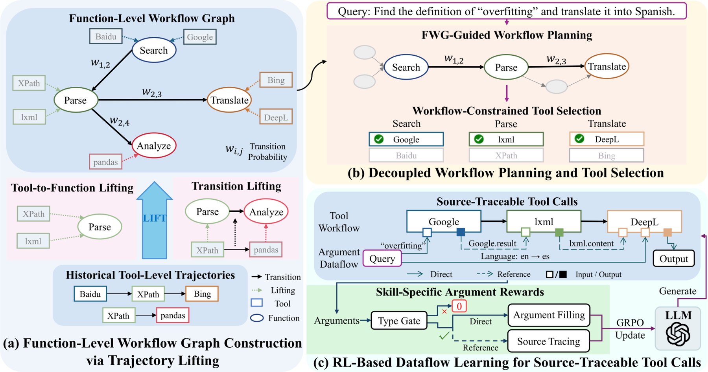

# ToolLIFT: Lifting Tool-Specific Trajectories into Function-Level Graphs for Generalizable Tool Planning

<!-- source-sha256: f7f40170bec20fb8665950e8f62303722feab689d8c7d2f0f69b5de3140c52be -->

[简体中文](README.md)

> **Core agent-mechanism mini-suite.** Implements independent planning, memory, credit assignment, or topology paths and records process counts on deterministic tasks, not the full external environment.

## Paper information

| Field | Details |
|---|---|
| Paper | [arXiv 2608.03468](https://arxiv.org/abs/2608.03468) |
| Organization | The authors do not disclose an affiliation |
| First public release | 2026-08-04 (arXiv v1) |
| Authors' code | No public author code was found as of 2026-08-24. |
| Adapter / method | `toollift` |
| Local reproduction code | `src/auto_research/agent_research/historical_b10_b11.py` |
| First author | Xiuhui You |

## Original paper

### Motivation and method

Lift tool-specific histories into a transferable function workflow graph and separate workflow planning from concrete tool selection.


<!-- paper-figure:start -->
### Key figure from the paper

[](https://arxiv.org/html/2608.03468v1/Method.png)

> **Figure 2:** Overall workflow, stages, and data flow. From the [original paper](https://arxiv.org/abs/2608.03468); copyright remains with the authors.
<!-- paper-figure:end -->

### Core equation

$$
G_F=Lift(\tau_{tool}),\quad tool_t=Select(f_t,s_t)
$$

### Paper results

It beats compared state-of-the-art methods across two in-domain and three out-of-domain benchmarks, particularly on unseen tool sets. These are paper results, not local mini-suite or online conclusions.

## Local reproduction

On 120 planbench-mini episodes, ToolLIFT has joint success 1.0000 and mean cost 0.6100. The long-context control scores 1.0000 and costs 64.5000. With saturated success, inspect traces, source, and method-specific counts rather than inventing improvement. See the [method metrics](metrics/planbench-mini-seed42.json) and [batch index](../../experiments/historical-b07-b11-seed42.json).

```bash
auto-research agent-research --method toollift --benchmark planbench-mini --episodes 120 --seed 42
```

## Reproduction boundaries

The deterministic mini-suite does not access real browsers, AppWorld, SWE-bench, or external tool services. It verifies mechanism branches, intermediate states, and reporting contracts. Reproducing full environments requires the paper's resources. Raw runs are in runs/agent-research/; the repository keeps only metrics. See [experiments](../../experiments/).
