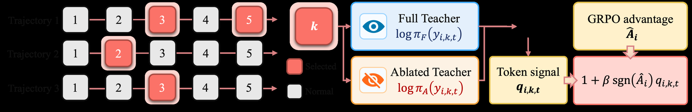

# OCSD: Observation-calibrated distillation without replay scaffolding confounds

<!-- source-sha256: 1fa80d2626aa960a0a7c0877107c87d39e8111db26e9b6bf9a1e7d5498b8e615 -->

[简体中文](README.md)

> Core matched replay, residual calibration and turn credit.

## Paper information

| Field | Details |
|---|---|
| Paper | [Paper or original source](https://arxiv.org/abs/2608.04788) |
| Institution | Nanjing University / Meituan. |
| First public release | 2026-08-05 (arXiv v1) |
| Author code | [yiy1x/OCSD](https://github.com/yiy1x/OCSD). |
| Local adapter or method key | `ocsd` |
| Local reproduction code | [`src/auto_research/agent_research/`](https://github.com/daiwk/auto-research/tree/main/src/auto_research/agent_research/) |

## Paper method and evidence

Future-observation replay changes both information and scaffolding. Match Full and Observation-Ablated replay structure and modulate GRPO on uncertain steps only by their residual.


<!-- paper-figure:start -->
### Original paper figure

[](https://arxiv.org/html/2608.04788v1/Figures/methodology_v6.png)

The original figure shows the two replay branches. From the [original paper](https://arxiv.org/abs/2608.04788); copyright remains with the authors.
<!-- paper-figure:end -->

### Core equation

$$
r_t=(\log\pi_{full}(y_t)-\log\pi_S(y_t))-(\log\pi_{abl}(y_t)-\log\pi_S(y_t)),\quad A'_{t}=A_{traj}(1+\lambda u_tr_t).
$$

### Reported results

The paper consistently outperforms strong controls on ALFWorld, WebShop and Search-QA across three Qwen3 sizes. No single aggregate in the abstract and no production A/B.

## Local reproduction

PlanBench mini 120 episodes, seed 42: joint success **1.0000**, mean cost **1.0200**, nonzero mechanism telemetry. [Metrics](../../experiments/p0-p1-closed-audit-20260808-seed42.json). A public deterministic mini-suite verifies state updates at matched budget, not paper LLMs, multi-GPU RL, private environments or complete benchmarks.

```bash
auto-research agent-eval --method ocsd --benchmark planbench-mini --episodes 120 --seed 42
auto-research evolve --model agent --dataset planbench-mini --direction "Combine ocsd with installed paper operators" --generations 2 --population 4
```
