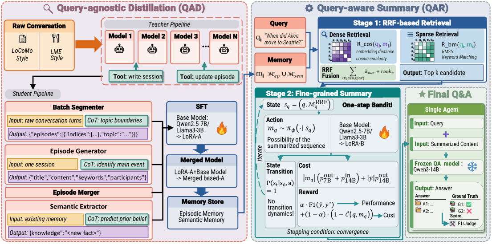

# MemoryCPT: An End-to-End Agent Memory Framework for Cost-Performance Trade-off

<!-- source-sha256: 20d597fdc9da8385c123aa839abb1867a3a8599aee7a38fa9706ed627843bd22 -->

[简体中文](README.md)

> Core memory operator mini-suite, not paper-scale agent evaluation.

## Paper information

| Field | Details |
|---|---|
| Paper | [Paper or original source](https://arxiv.org/abs/2608.04843) |
| Institution | Hong Kong University of Science and Technology / Tencent LIGHTSPEED STUDIOS. |
| First public release | 2026-08-05 (arXiv v1) |
| Author code | No public author code found as of 2026-08-09. |
| Local adapter or method key | `memorycpt` |
| Local reproduction code | [`src/auto_research/agent_research/latest_20260809.py`](https://github.com/daiwk/auto-research/blob/main/src/auto_research/agent_research/latest_20260809.py) |

## Paper method and evidence

Distill offline memory construction into a compact QAD model. QAR retrieves via RRF and summarizes query-relevant context with LoRA; cost-aware GRPO optimizes quality per cost.


<!-- paper-figure:start -->
### Original paper figure

[](https://arxiv.org/html/2608.04843v1/x1.png)

Figure shows memory construction, retrieval and summarization. From the [original paper](https://arxiv.org/abs/2608.04843); copyright remains with the authors.
<!-- paper-figure:end -->

### Core equation

$QPC=Q(answer)/C_{inference}$.

### Reported results

Paper reports improved quality–cost tradeoffs on LoCoMo and LongMemEval, with ablations for QAD, RRF, QAR and cost reward.

## Local reproduction

 [Local metrics](metrics/planbench-mini-seed42.json). Same mini-suite and mechanism-disabled comparator; no author model, proprietary environment or expensive judge. Evolve can discover the operator, but genome composition is constrained by public evaluation and budget. Checkpoints and raw runs are not committed.

```bash
auto-research agent-research --method memorycpt --benchmark planbench-mini --episodes 120 --seed 42
```
