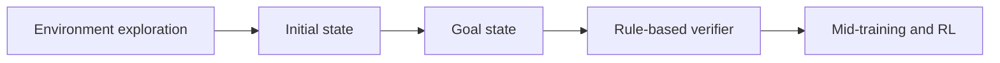
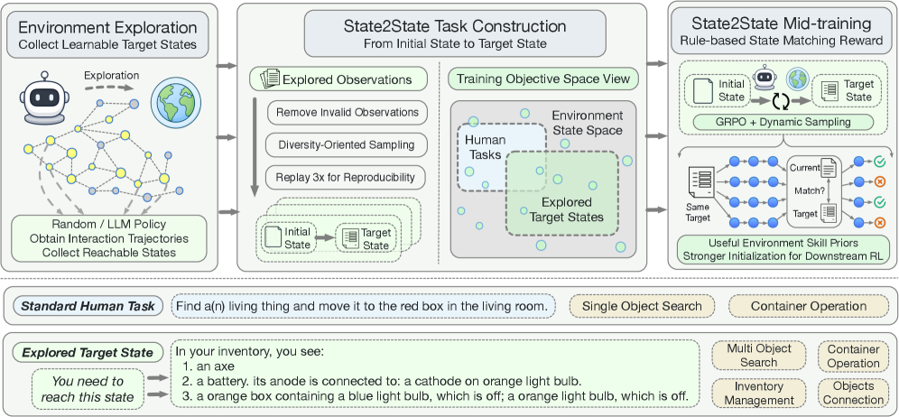

# State2State: Environment-Derived Mid-Training for LLM Agents

<!-- source-sha256: d97652bcf5c4a609fa1e35c17d3fc867b87cf26c1cd2f5cdc3917bfcdc565d4c -->

[简体中文](README.md)

> **Core-mechanism mini-suite.** Executes the environment-derived mid-training operator. A small deterministic evaluation is not a full reproduction.

## Paper information

| Field | Details |
|---|---|
| Paper | [arXiv 2608.04934](https://arxiv.org/abs/2608.04934) |
| Organization | Tsinghua University AIR / Alibaba Group |
| First public release | 2026-08-05 (arXiv v1) |
| Authors' code | [https://github.com/THUNLP-MT/State2State](https://github.com/THUNLP-MT/State2State) |
| Adapter / method | `state2state` |
| Local reproduction code | [`src/auto_research/agent_research/latest_20260809.py`](https://github.com/daiwk/auto-research/blob/main/src/auto_research/agent_research/latest_20260809.py) |

## Original paper

### Motivation and method

**Topic: environment-derived mid-training.** Automatically sample initial and goal states from exploration and use a rule-based state matcher as verifier. This scales mid-training without handcrafted tasks or expert trajectories.

### Architecture



<!-- paper-figure:start -->
### Key figure from the paper

[](https://arxiv.org/html/2608.04934v1/x2.png)

> **Figure 2:** Training flow and key optimization steps. From the [original paper](https://arxiv.org/abs/2608.04934); copyright remains with the authors.
<!-- paper-figure:end -->

### Core equation

$\tau\sim\pi(\cdot\mid s_0),\quad R=\mathbf 1[T(s_T)=T(s^*)]$.

### Paper results

Most ALFWorld and ScienceWorld settings improve. As downstream RL initialization, it improves final results and sample efficiency further.

## Local reproduction

See the [stable metrics](metrics/planbench-mini-seed42.json). Checkpoints and raw run directories are not committed.

```bash
auto-research agent-research --method state2state --benchmark planbench-mini --episodes 120 --seed 42
```

> **Local comparison:** Compare State2State with a control without the mechanism in the same public mini-suite. Report only local artifact metrics; large-model and real-environment paper results are not local gains.

## Reproduction boundaries

- Implements the paper-specific state, credit, or selection operator, not merely a renamed method.
- No original large model, proprietary environment, or expensive judge was run; these are not marked integrated.
- State2State participates in unified evolve candidate discovery. Composed genomes remain subject to public evaluation and budget constraints.
