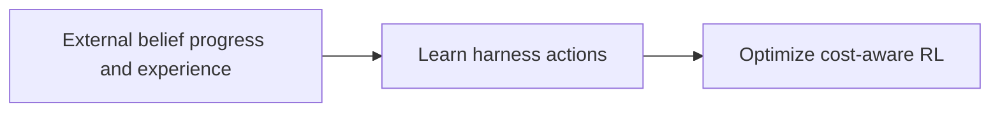
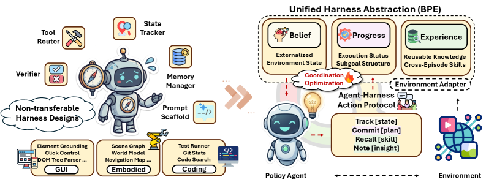

# EvoHarness-RL: Learning Self-Evolving Runtime Harness for Long-Horizon LLM Agents

<!-- source-sha256: b25ea2702d7d30534b6c901fa32ee423921d9cf6b9d912177338671545ea1a51 -->

[简体中文](README.md)

> Core harness-policy operator mini-suite, not a trained paper-scale agent.

## Paper information

| Field | Details |
|---|---|
| Paper | [Paper or original source](https://arxiv.org/abs/2608.05446) |
| Institution | University of Illinois Urbana–Champaign / Meta AI. |
| First public release | 2026-08-05 (arXiv v1) |
| Author code | No public author code found as of 2026-08-09. |
| Local adapter or method key | `evoharness-rl` |
| Local reproduction code | [`src/auto_research/agent_research/latest_20260809.py`](https://github.com/daiwk/auto-research/blob/main/src/auto_research/agent_research/latest_20260809.py) |

## Paper method and evidence

Expose belief, progress and experience as editable external state. SFT teaches harness actions; cost-aware GRPO learns when to read, write or merge.



<!-- paper-figure:start -->
### Original paper figure

[](https://arxiv.org/html/2608.05446v1/x1.png)

The original figure shows policy-managed external state. From the [original paper](https://arxiv.org/abs/2608.05446); copyright remains with the authors.
<!-- paper-figure:end -->

### Core equation

$R=R_{task}-\lambda C_{harness}$.

### Reported results

Qwen3-8B reports 96.9% ALFWorld success with harness annealing and evolution.

## Local reproduction

 [Local metrics](metrics/planbench-mini-seed42.json). Same mini-suite and mechanism-disabled comparator; no author model, proprietary environment or expensive judge. Evolve can discover the operator, but genome composition is constrained by public evaluation and budget. Checkpoints and raw runs are not committed.

```bash
auto-research agent-research --method evoharness-rl --benchmark planbench-mini --episodes 120 --seed 42
```
