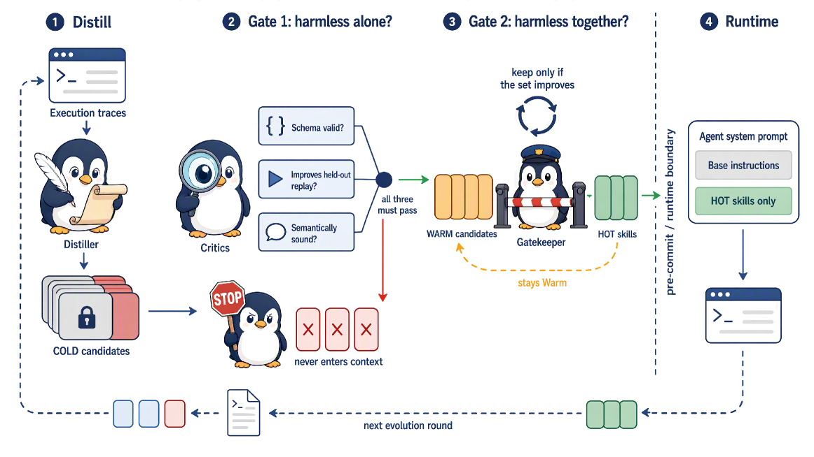

# When Self-Evolution Backfires: Pre-Commit Gating against Skill Contamination in LLM Agents

<!-- source-sha256: 31d88b528c83633b94bf56cf68e4c25dd6718895c7893aaf0cf176fb5ca6a4c0 -->

[简体中文](README.md)

> **Core-mechanism mini-suite.** Executes the skill-evolution safety operator. A deterministic evaluation is not a full reproduction.

## Paper information

| Field | Details |
|---|---|
| Paper | [arXiv 2608.05810](https://arxiv.org/abs/2608.05810) |
| Organization | No affiliation listed |
| First public release | 2026-08-06 (arXiv v1) |
| Authors' code | No public author code was found on 2026-08-09. |
| Adapter / method | `vag` |
| Local reproduction code | [`src/auto_research/agent_research/latest_20260809.py`](https://github.com/daiwk/auto-research/blob/main/src/auto_research/agent_research/latest_20260809.py) |

## Original paper

### Motivation and method

**Topic: skill-evolution safety.** Once a skill enters context, it can contaminate later generations; deleting it afterward cannot fully undo that. VaG checks structure, behavioral harmlessness, and semantic consistency before committing skills. Marginal gain then selects a compatible Hot set.

### Architecture


<!-- paper-figure:start -->
### Key figure from the paper

[](https://arxiv.org/html/2608.05810v1/x2.png)

> **Figure 2:** Overall workflow, stages, and data flow. From the [original paper](https://arxiv.org/abs/2608.05810); copyright remains with the authors.
<!-- paper-figure:end -->

### Core equation

$M_r=M_{r-1}\cup G(S_r),\quad f(H)=\mathbb E[R(agent\oplus H)]$.

### Paper results

Across five rounds, Terminal-Bench 2 reaches 72% pass@1 monotonically. The skill pool is about 5× smaller and the score remains 10 percentage points above the best ungated round.

## Local reproduction

See the [stable metrics](metrics/planbench-mini-seed42.json). Checkpoints and raw run directories are not committed.

```bash
auto-research agent-research --method vag --benchmark planbench-mini --episodes 120 --seed 42
```

> **Local comparison:** Compare VaG with a control without the mechanism in the same public mini-suite. Report only local artifact metrics; large-model and real-environment paper results are not local gains.

## Reproduction boundaries

- Implements the paper-specific state, credit, or selection operator, not merely a renamed method.
- No original large model, proprietary environment, or expensive judge was run; these are not marked integrated.
- VaG participates in unified evolve candidate discovery. Composed genomes remain subject to public evaluation and budget constraints.
