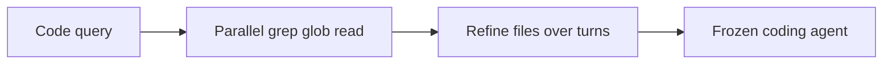
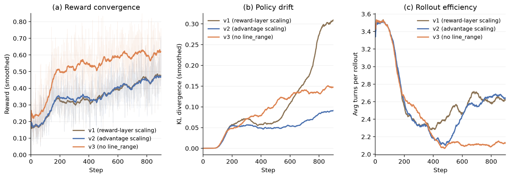

# CodeGrep: An RL-Trained Retrieval Agent for LLM Coding Agents

<!-- source-sha256: 367030fd3c7bbddc9c2dd1313b783283e00f4a7c3a1d9ef9f9a9d88798e0eb53 -->

[简体中文](README.md)

> Core code-retrieval operator, not paper-scale software-engineering capability.

## Paper information

| Field | Details |
|---|---|
| Paper | [Paper or original source](https://arxiv.org/abs/2608.05886) |
| Institution | NetEase Guangzhou AI Lab. |
| First public release | 2026-08-06 (arXiv v1) |
| Author code | No public author code found as of 2026-08-09. |
| Local adapter or method key | `codegrep` |
| Local reproduction code | [`src/auto_research/agent_research/latest_20260809.py`](https://github.com/daiwk/auto-research/blob/main/src/auto_research/agent_research/latest_20260809.py) |

## Paper method and evidence

Train a 14B retrieval agent with GRPO to issue parallel grep/glob/read calls and narrow files over several turns. A frozen coding agent handles fixes; optimize downstream resolution, not standalone retrieval.



<!-- paper-figure:start -->
### Original paper figure

[](https://arxiv.org/html/2608.05886v1/figures/training_curves_main.png)

Figure shows retrieval before coding. From the [original paper](https://arxiv.org/abs/2608.05886); copyright remains with the authors.
<!-- paper-figure:end -->

### Core equation

$R=R_{resolve}-\lambda_{tok}C_{tok}-\lambda_{round}C_{round}$.

### Reported results

SWE-Bench Verified (500 items): resolve **25.8%→27.0% (+1.2 pp)**; successful traces use **15%** fewer rounds and **19%** fewer tokens.

## Local reproduction

Compare against the disabled mechanism in the same public mini-suite.

```bash
auto-research agent-research --method codegrep --benchmark planbench-mini --episodes 120 --seed 42
```

[Metrics](metrics/planbench-mini-seed42.json); no checkpoints or raw run directories committed. No author model, proprietary environment or costly judge. Candidate discovery includes `codegrep`; genome composition remains limited by public evaluation and budget.
