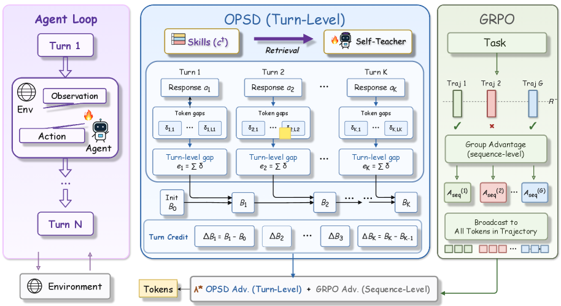

# AgentOPSD: Recursive Bayesian credit for pivotal turns

<!-- source-sha256: 0536dc6e5f15a5b29246ea5da856944bf56586124eee4c18a29becfd582b9f3c -->

[简体中文](README.md)

> Core turn evidence, recursive belief, pivotal credit and critic-free update.

## Paper information

| Field | Details |
|---|---|
| Paper | [Paper or original source](https://arxiv.org/abs/2608.05987) |
| Institution | Tsinghua University / Zhejiang University / Meituan. |
| First public release | 2026-08-06 (arXiv v1) |
| Author code | [ZethWang/AgentOPSD](https://github.com/ZethWang/AgentOPSD) is public; README says complete code is pending. |
| Local adapter or method key | `agent-opsd` |
| Local reproduction code | [`src/auto_research/agent_research/`](https://github.com/daiwk/auto-research/tree/main/src/auto_research/agent_research/) |

## Paper method and evidence

Aggregate privileged-replay teacher/student log-prob gaps into turn evidence. Update success belief recursively in log-odds space and use adjacent revisions to identify pivotal turns.


<!-- paper-figure:start -->
### Original paper figure

[](https://arxiv.org/html/2608.05987v1/x2.png)

The original figure shows recursive turn-credit estimation. From the [original paper](https://arxiv.org/abs/2608.05987); copyright remains with the authors.
<!-- paper-figure:end -->

### Core equation

$$
e_t=\sum_{j\in turn_t}(\log\pi_T(y_j)-\log\pi_S(y_j)),\quad \ell_t=\ell_{t-1}+e_t,\quad c_t=\sigma(\ell_t)-\sigma(\ell_{t-1}).
$$

### Reported results

Qwen2.5-7B reaches 89.1% ALFWorld success, ahead of GRPO and self-distillation baselines. No production A/B.

## Local reproduction

PlanBench mini, 120 episodes, seed 42: joint success **1.0000**, mean cost **0.9000**, nonzero mechanism telemetry. [Metrics](../../experiments/p0-p1-closed-audit-20260808-seed42.json). A public deterministic mini-suite verifies state updates at matched budget, not paper LLMs, multi-GPU RL, private environments or complete benchmarks.

```bash
auto-research agent-eval --method agent-opsd --benchmark planbench-mini --episodes 120 --seed 42
auto-research evolve --model agent --dataset planbench-mini --direction "Combine agent-opsd with installed paper operators" --generations 2 --population 4
```
