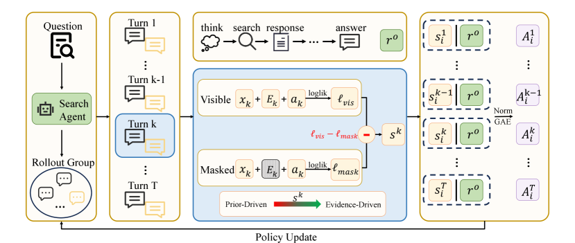

# Contextual Information Policy Optimization for Search Agents

<!-- source-sha256: 82d05f81759c56ff6a43f9052f3adcc679def8e8050d4a822802401014d9d38f -->

[简体中文](README.md)

> **Core-mechanism mini-suite.** Runs the paper's search-agent RL operator; a small deterministic evaluation does not reproduce the full paper.

## Paper information

| Field | Details |
|---|---|
| Paper | [arXiv 2608.06128](https://arxiv.org/abs/2608.06128) |
| Organization | Beihang University |
| First public release | 2026-08-06 (arXiv v1) |
| Authors' code | No public author code was found on 2026-08-09. |
| Adapter / method | `cipo` |
| Local reproduction code | [`src/auto_research/agent_research/latest_20260809.py`](https://github.com/daiwk/auto-research/blob/main/src/auto_research/agent_research/latest_20260809.py) |

## Original paper

### Motivation and method

**Topic: search-agent RL.** Rewarding only the final answer can reduce retrieval to confirmation bias. CIPO identifies later actions influenced by external evidence, gives dense turn-level credit, and jointly optimizes it with global outcome reward.

### Architecture


<!-- paper-figure:start -->
### Key figure from the paper

[](https://arxiv.org/html/2608.06128v1/x2.png)

> **Figure 2:** Core architecture, modules, and connections. From the [original paper](https://arxiv.org/abs/2608.06128); copyright remains with the authors.
<!-- paper-figure:end -->

### Core equation

$A_t=\lambda A_t^{evidence}+(1-\lambda)A^{outcome}$.

### Paper results

Across seven in-domain and out-of-domain benchmarks, the method reduces prior-driven reasoning and achieves best or competitive results on most tasks.

## Local reproduction

See the [stable metrics](metrics/planbench-mini-seed42.json). Checkpoints and raw run directories are not committed.

```bash
auto-research agent-research --method cipo --benchmark planbench-mini --episodes 120 --seed 42
```

> **Local comparison:** Compare `cipo` with a control that disables the mechanism in the same public mini-suite. Report only local artifact metrics; do not treat large-model or real-environment paper results as local gains.

## Reproduction boundaries

- Implements the paper-specific state, credit, or selection operator rather than merely renaming a method.
- No original large model, proprietary environment, or expensive judge was run; these are not marked integrated.
- `cipo` participates in unified evolve candidate discovery. Composed genomes remain subject to public evaluation and budget constraints.
