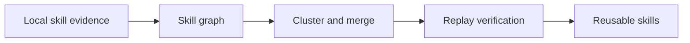
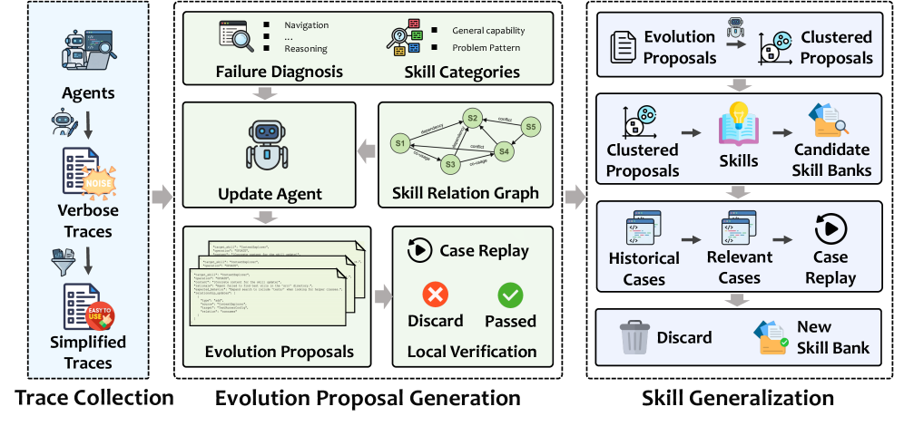

# Learning Globally Reusable Skills for Coding Agents

<!-- source-sha256: c5434a01132a71498389a6ab3bb6610ae1d3ca16db650a2f6ebb259cb2710eec -->

[简体中文](README.md)

> **Core mechanism evidence.** Paper and local evaluations are separate.

## Paper information

| Field | Value |
| --- | --- |
| Paper | [arXiv 2608.06153](https://arxiv.org/abs/2608.06153) |
| Affiliations | Tianjin University |
| First public release | 2026-08-06 (arXiv v1) |
| Authors' code | No public author code found as of 2026-08-09. |
| Adapter / method | `gse` |
| Local code | [`src/auto_research/agent_research/latest_20260809.py`](https://github.com/daiwk/auto-research/blob/main/src/auto_research/agent_research/latest_20260809.py) |

## Original paper

### Background and contribution

GSE maintains a Skill Relation Graph. Cluster local experience to consolidate skills and use replay verification to reject overfitting and regressions.



<!-- paper-figure:start -->
### Key figure from the paper

[](https://arxiv.org/html/2608.06153v1/x1.png)

Original Figure 1: Learning Globally Reusable Skills for Coding Agents. From the [paper](https://arxiv.org/abs/2608.06153); copyright belongs to the authors. Not a local result.
<!-- paper-figure:end -->

### Core mechanism

$\max_{S,G}\;U(S)-\lambda\operatorname{Conflict}(G)-\mu\operatorname{Regression}(S)$.

### Paper results

Paper test-generation precision/recall gains 6.1%–34.1% / 31.8%–180.0%; internal industrial agent F1 +61.4%.

## Local reproduction

Compare with a same-suite control without the mechanism. [Metrics](metrics/planbench-mini-seed42.json); no committed checkpoint or raw run directory. Evolve discovery includes `gse`, but combinations remain constrained by public evaluation and budget.

```bash
auto-research agent-research --method gse --benchmark planbench-mini --episodes 120 --seed 42
```

## Reproduction limits

Executes the skill evolution operator, not the paper model, private environment, or expensive judge.
