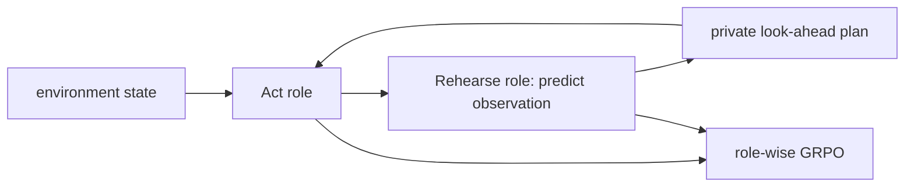
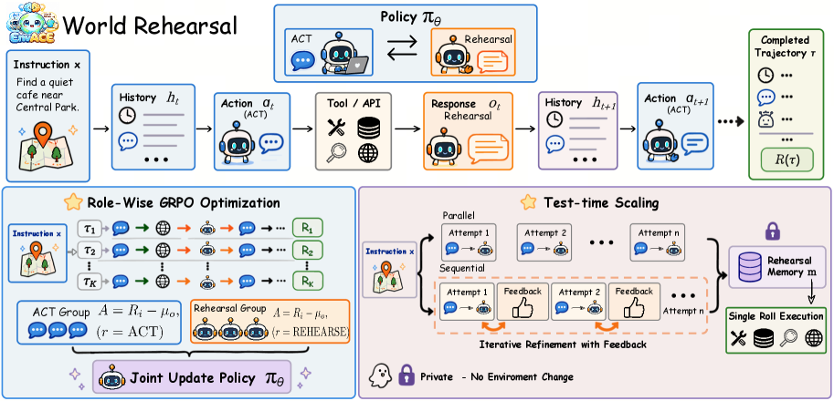

# EnvACE: agent RL with acting and environment rehearsal roles

<!-- source-sha256: 2245b4f0310f733865ddb9674760671c1bcabbb3de7c9a45dc731247a6ed046b -->

[简体中文](README.md)

> **Fidelity: core mechanism.** One policy alternates act and rehearse. Predicted observations are private planning state, and advantages are computed by role.

## Paper information

| Field | Details |
|---|---|
| Paper | [EnvACE (arXiv 2608.06197)](https://arxiv.org/abs/2608.06197) |
| Organization | Shanghai Jiao Tong / Zhejiang / NUS / SYSU / CSU / CUHK / Tencent |
| First public release | 2026-08-06 (arXiv v1) |
| Authors' code | [Within-yao/EnvACE](https://github.com/Within-yao/EnvACE) is public. |
| Adapter / method | `envace` |
| Local reproduction code | [`src/auto_research/agent_research/`](https://github.com/daiwk/auto-research/tree/main/src/auto_research/agent_research/) |

## Original paper

### Motivation and method

Without a separately trained world model, the same policy switches to rehearsal between real acts and predicts the next observation. Separate group-relative advantages for acting and rehearsal avoid mixing reward scales. A few private rehearsals extend test-time planning.



<!-- paper-figure:start -->
### Key figure from the paper

[](https://arxiv.org/html/2608.06197v1/x4.png)

> **Figure 2:** Training flow and key optimization steps. From the [original paper](https://arxiv.org/abs/2608.06197); copyright remains with the authors.
<!-- paper-figure:end -->

### Core equations

$$
A_i^{(r)}=R_i^{(r)}-\frac1{|G_r|}\sum_{j\in G_r}R_j^{(r)},\qquad
\mathcal L=-\sum_{r\in\{act,rehearse\}}\mathbb E_i[A_i^{(r)}\log\pi_\theta(\tau_i^{(r)})].
$$

### Paper results

The overall paper score is 32.91. At test time with N=2 rehearsals, overall score reaches **40.9**, compared with 36.7 for the control. No production A/B is reported.

## Local reproduction

On 120 PlanBench mini-suite episodes, joint success is 1.0000, with 360 world rehearsals and 720 role-wise advantage updates. `real_tool_responses=0` confirms predicted observations are not passed off as real feedback.

```bash
auto-research agent-eval --method envace --benchmark planbench-mini --episodes 120 --seed 42
auto-research evolve --model agent --dataset planbench-mini --direction "比较 EnvACE act/rehearse 与 role-wise GRPO" --generations 2 --population 4
```

See the [fixed metrics](../../experiments/envace-planbench-seed42.json).

## Reproduction boundaries

The deterministic mini-suite checks state routing and counts, not the paper's browser/tool environments or large-model RL training.
