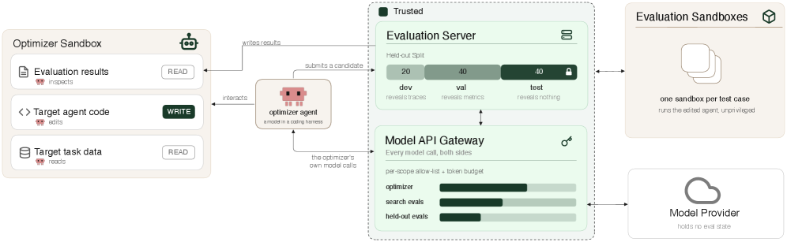

# HarnessOpt-Bench: Evaluating LLMs at Harness Optimization

<!-- source-sha256: 52fd7489d4d25dfeed4fbdf6a4d9bd5572072230e2c36856921dbec46beb3cec -->

[简体中文](README.md)

> **Core-mechanism mini-suite.** Runs the harness-optimization evaluation operator. A small deterministic evaluation is not a full reproduction.

## Paper information

| Field | Details |
|---|---|
| Paper | [arXiv 2608.06301](https://arxiv.org/abs/2608.06301) |
| Organization | Scale AI |
| First public release | 2026-08-06 (arXiv v1) |
| Authors' code | No public author code was found on 2026-08-09. |
| Adapter / method | `harnessopt-bench` |
| Local reproduction code | [`src/auto_research/agent_research/latest_20260809.py`](https://github.com/daiwk/auto-research/blob/main/src/auto_research/agent_research/latest_20260809.py) |

## Original paper

### Motivation and method

**Topic: harness optimization evaluation.** Under a fixed target-evaluation budget, optimizers modify prompts, tools, control flow, and memory. Hidden tests and a trusted runtime isolate search feedback; candidate versions remain auditable.

### Architecture


<!-- paper-figure:start -->
### Key figure from the paper

[](https://arxiv.org/html/2608.06301v1/x1.png)

> **Figure 1:** Overview of the paper's method and key components. From the [original paper](https://arxiv.org/abs/2608.06301); copyright remains with the authors.
<!-- paper-figure:end -->

### Core equation

$Score=(J(h^*)-J(h_0))/\max(|J(h_0)|,\epsilon)$.

### Paper results

Across five frontier models, four downstream tasks, and 111 scored runs, model differences exceed coding-harness differences. Native harnesses are not consistently better.

## Local reproduction

See the [stable metrics](metrics/planbench-mini-seed42.json). Checkpoints and raw run directories are not committed.

```bash
auto-research agent-research --method harnessopt-bench --benchmark planbench-mini --episodes 120 --seed 42
```

> **Local comparison:** Compare HarnessOpt-Bench with a control without the mechanism in the same public mini-suite. Report only local artifact metrics; large-model and real-environment paper results are not local gains.

## Reproduction boundaries

- Implements the paper-specific state, credit, or selection operator, not merely a renamed method.
- No original large model, proprietary environment, or expensive judge was run; these are not marked integrated.
- HarnessOpt-Bench participates in unified evolve candidate discovery. Composed genomes remain subject to public evaluation and budget constraints.
