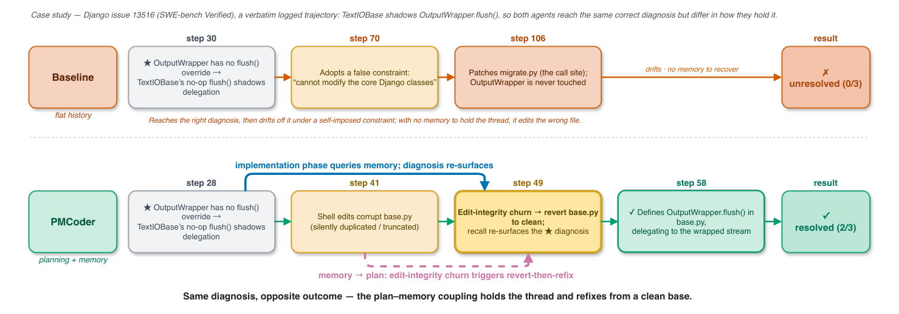

# Coupling Planning with Episodic Memory in LLM Agents for Software Issue Resolution

<!-- source-sha256: 85fc39750ec9726c88cf166a3399813d990f71dc28c07b4b7a77e8cbab63b9ed -->

[简体中文](README.md)

> **Core agent-mechanism mini-suite.** Implements independent planning, memory, credit assignment, or topology paths and records process counts on deterministic tasks, not the full external environment.

## Paper information

| Field | Details |
|---|---|
| Paper | [arXiv 2608.06811](https://arxiv.org/abs/2608.06811) |
| Organization | Vanderbilt University |
| First public release | 2026-08-07 (arXiv v1) |
| Authors' code | No public author code was found as of 2026-08-24. |
| Adapter / method | `pmcoder` |
| Local reproduction code | `src/auto_research/agent_research/historical_b10_b11.py` |
| First author | Jiahao Zhang |

## Original paper

### Motivation and method

Condition episodic retrieval on a hierarchical phase planner. Statistics from remembered trajectories detect stalls and trigger replanning, with real execution verdicts for verification.


<!-- paper-figure:start -->
### Key figure from the paper

[](https://arxiv.org/html/2608.06811v1/case_django13516.png)

> **Figure 1:** Overview of the paper's method and key components. From the [original paper](https://arxiv.org/abs/2608.06811); copyright remains with the authors.
<!-- paper-figure:end -->

### Core equation

$$
m_t=Retrieve(M,phase_t),\quad phase_{t+1}=Replan(s_t,m_t)
$$

### Paper results

SWE-bench Verified has 25 more resolutions (+5.0 points) than a harness-matched baseline and at least 14 more across models. These are paper results, not local mini-suite or online conclusions.

## Local reproduction

On 120 planbench-mini episodes, PMCoder has joint success 1.0000 and mean cost 0.5800. The long-context control scores 1.0000 and costs 64.5000. With saturated success, inspect traces, source, and method-specific counts rather than inventing improvement. See the [method metrics](metrics/planbench-mini-seed42.json) and [batch index](../../experiments/historical-b07-b11-seed42.json).

```bash
auto-research agent-research --method pmcoder --benchmark planbench-mini --episodes 120 --seed 42
```

## Reproduction boundaries

The deterministic mini-suite does not access real browsers, AppWorld, SWE-bench, or external tool services. It verifies mechanism branches, intermediate states, and reporting contracts. Reproducing full environments requires the paper's resources. Raw runs are in runs/agent-research/; the repository keeps only metrics. See [experiments](../../experiments/).
