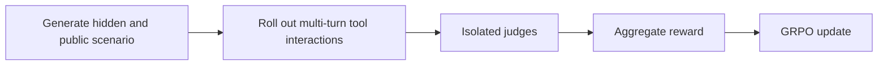
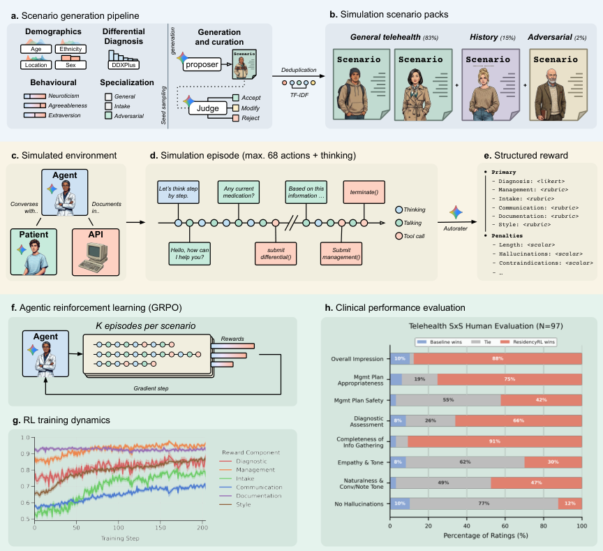

# ResidencyRL: Training interaction policies in full multi-turn simulation

<!-- source-sha256: 235a88c275f1dac162df7e2d5e3dc4b93feaa4a80783102bfd9d89d6f170ff90 -->

[简体中文](README.md)

> **Too costly, not reproduced (review DONE).** Research-method notes only, not medical advice or local verification of clinical capability. `residency-rl` is a reference key; `adapter: null`. Method and cost reviewed on v1; v2 posted 2026-10-09 was observed but not fully compared.

## Paper information

| Field | Details |
|---|---|
| Paper | [Pinned v1](https://arxiv.org/abs/2608.07418v1); [Google's official entry](https://research.google/pubs/residencyrl-reinforcement-learning-in-simulated-clinical-environments/) |
| Institution | First author Valentin Liévin: Google DeepMind; collaborators include Google Research |
| First public release | 2026-08-07 17:04:41 UTC (arXiv v1; historical backfill, not an October release) |
| Author code | Explicitly not released; [Code Availability](https://arxiv.org/html/2608.07418v1#S6) cites internal training infrastructure and safety restrictions. Third-party benchmarks are not the implementation. |
| Local adapter or method key | `residency-rl` |
| Local reproduction code | None; no runnable reproduction, clinical tool or Evolve operator. |

## Paper method and evidence

Static knowledge QA does not test active questioning, tool use or long-horizon decisions. The paper combines scenario generation, information-asymmetric simulations, isolated dimension-specific judges and GRPO. Hidden references belong to environment and judges, not evaluated policies. Weighted normalized dimension scores minus truncation penalty are only reward aggregation, not the complete algorithm. [Section 3](https://arxiv.org/html/2608.07418v1#S3) · [Table 2 and Eq. 1](https://arxiv.org/html/2608.07418v1#S3.T2).

<!-- paper-figure:start -->
### Original paper figure

Figure 1 shows training and the authors' evaluation, not local experiments. From the [original paper](https://arxiv.org/html/2608.07418v1); copyright remains with the authors.
<!-- paper-figure:end -->

### Core equation

$$
R=3\sum_{d}w_d\bar r_d-\min(3,P),\qquad
w=(2,3,1,1,1,1)/9.
$$

### Reported results

Reported simulated, external-task and blinded results are not clinical production benefits or industrial online A/B. Prospective real-workflow validation remains necessary. No local recomputation or import of author figures as experimental records.

## Local reproduction

The internal Gemini training stack uses separate simulation/judge calls and 49,870 regular, 5,000 history-taking and 2,583 adversarial scenarios, with up to 60 turns and eight tool calls per trajectory. [Section 3.4](https://arxiv.org/html/2608.07418v1#S3.SS4). One A100/A30 or a Mac cannot faithfully replace it, and public APIs do not expose the same weight update. No paid long probe, substitute checkpoint, scripted reproduction claim, runnable code, metrics, GPU receipt, Evolve operator or retry queue.
