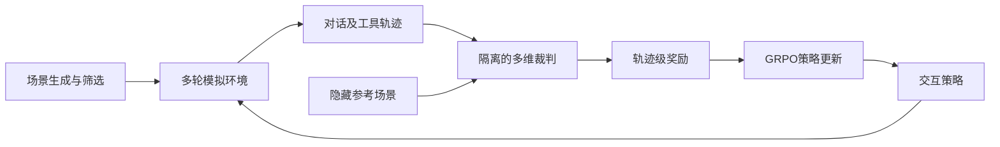
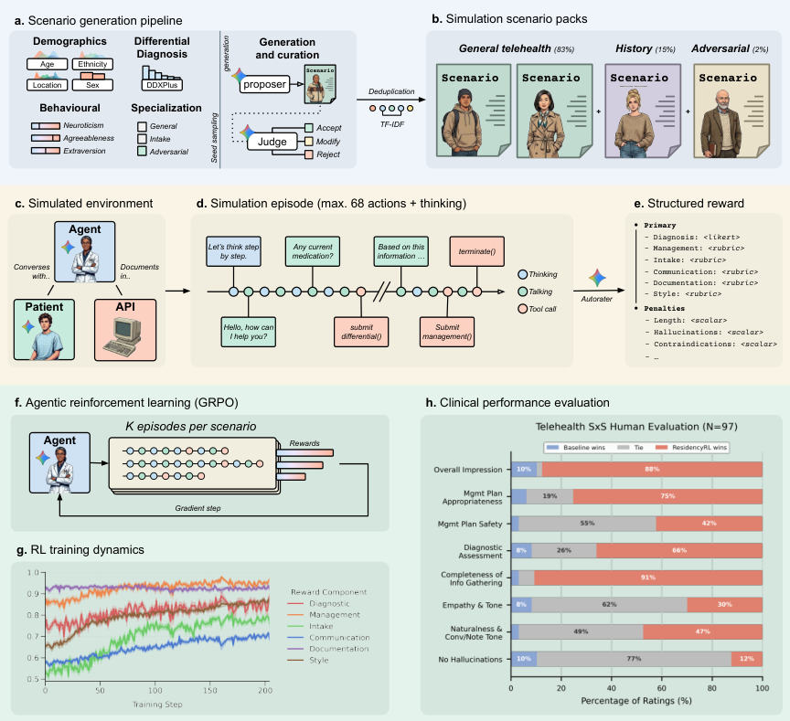

# ResidencyRL：在完整多轮模拟中训练交互策略

## 论文信息

| 字段 | 内容 |
| --- | --- |
| 论文链接 | [固定v1](https://arxiv.org/abs/2608.07418v1)；[Google官方介绍](https://research.google/pubs/residencyrl-reinforcement-learning-in-simulated-clinical-environments/) |
| 公司 / 机构 | 一作Valentin Liévin：Google DeepMind；Google Research等合作 |
| 首次公开日期 | 2026-08-07 17:04:41 UTC；这是历史补发现，不计为10月新首发 |
| 审查版本 | 方法与成本核对v1；观察到v2于2026-10-09更新，不声称已审查版本全部差异 |
| 原作者代码 | **明确未开源**；Code Availability说明依赖Google内部训练基础设施及安全限制 |
| 本地 Adapter | `residency-rl`仅为资料稳定键；`adapter: null` |
| 本地复现代码位置 | 无；本条不提供可执行复现、医疗工具或Evolve算子 |

> **成本过高，不复现（审查 DONE）**。本文只整理Agentic RL研究方法，不提供临床使用建议或宣称医疗能力已获本地验证。

## 原始论文总结

### 背景与主要改动

静态知识题不能覆盖主动询问、工具调用及长程决策。论文通过场景生成、带信息不对称的模拟环境、按维度隔离的裁判和GRPO组成完整训练链路；隐藏参考信息只属于环境/裁判，不能直接暴露给被评估策略。[原文§3](https://arxiv.org/html/2608.07418v1#S3)

<!-- paper-figure:start -->
### 原论文关键图

> 原文Figure 1，包含训练流程和作者评估图。图片来自[原论文](https://arxiv.org/html/2608.07418v1)，版权归原作者所有；不是本地实验结果。
<!-- paper-figure:end -->

### 核心公式

原文将归一化子维度按权重汇总，再减去截断惩罚：

$$
R=3\sum_{d}w_d\bar r_d-\min(3,P),\qquad
w=(2,3,1,1,1,1)/9.
$$

各维度由隔离的裁判调用获得；奖励聚合公式不是完整研究算法，更不能以固定分数代替裁判/策略训练。[原文表2与公式1](https://arxiv.org/html/2608.07418v1#S3.T2)

### 论文离线与线上效果

作者报告模拟环境、外部任务和盲评结果；这些不等于生产临床收益，未报告搜广推业务线上A/B。论文也明确仍需前瞻性真实流程验证。本地没有重新计算作者指标，不把原图或表格导入本地实验看板当作运行结果。

## 本地复现与成本边界

原配置依赖内部Gemini策略训练及独立模拟/裁判调用，使用49,870个常规场景、5,000个历史询问场景和2,583个对抗场景；每条轨迹可达60轮对话及8次工具调用。[原文§3.4](https://arxiv.org/html/2608.07418v1#S3.SS4)

现有单张A100/A30或Mac不能忠实替代内部训练栈，公共API亦不提供同一权重更新入口。按成本门槛直接结束为**不复现（审查 DONE）**，不做付费长程探针、不下载替代大模型、不用脚本化模拟声称完成。作者明确[不公开代码](https://arxiv.org/html/2608.07418v1#S6)，不将第三方基准仓库冒充作者实现。

该条目无代码/指标/GPU回执，不参与Evolve晋级，也不进入自动重试队列。
