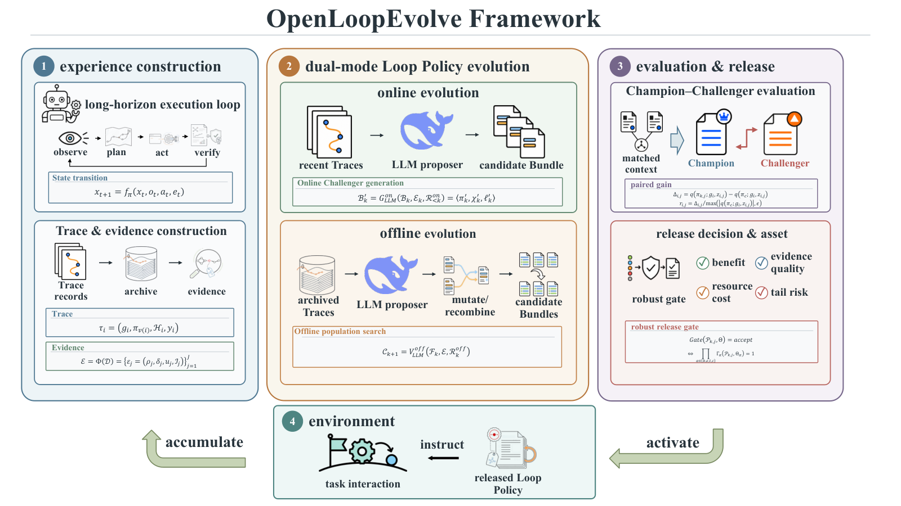

<!-- source-sha256: e532979559739bd86b6167ad694bee0a0de7c5a18e4f757fccc6a3cd95f03e45 -->

[简体中文](README.md) · English

# OpenLoopEvolve: A Verifiable Self-Evolution Framework for Loop Policies in Long-Horizon Complex Tasks

> **Core agent mechanism mini-suite.** Standalone planning, memory, credit or topology paths run with process counts on deterministic tasks, not the full external environment.

## Paper information

| Field | Details |
| --- | --- |
| Paper | [arXiv 2608.09380](https://arxiv.org/abs/2608.09380) |
| Institution | Tsinghua University |
| First public release | 2026-08-10 (arXiv v1) |
| Author code | Yes: [OpenLoopEvolve](https://github.com/yoyoshikc/OpenLoopEvolve). |
| Local adapter or method key | `openloopevolve` |
| Local reproduction code | `src/auto_research/agent_research/historical_b10_b11.py` |
| First author | Siqi Wang |

## Original paper summary

### Background and main changes

Version observation, planning, memory, action, verification and recovery assets in the loop policy. Govern changes by Champion–Challenger comparison, release monitoring and rollback.


<!-- paper-figure:start -->
### Key figure from the paper

[](https://arxiv.org/html/2608.09380v1/openloopevolve_framework.png)

> **Figure 1:** Core architecture, modules and connections. From the [paper](https://arxiv.org/abs/2608.09380); copyright belongs to the authors. Click for the source.
<!-- paper-figure:end -->

### Core equations

$$
\pi_{v+1}=\operatorname{Release}(\arg\max_{c\in C}Eval(c,\pi_v))
$$

### Offline and online results

Both online and offline evolution on YC-Bench improve aggregate scores, success rates and risk metrics in the paper. The local mini-suite does not establish those benchmark or online results.

## Local reproduction

On 120 PlanBench-mini episodes, `openloopevolve` joint success is `1.0000` and average cost `0.6900`, versus `1.0000` and `64.5000` for the long-context control. With saturated accuracy, check traces, sources and method-specific diagnostic counts rather than inventing a gain. See [per-paper metrics](metrics/planbench-mini-seed42.json) and [batch index](../../experiments/historical-b07-b11-seed42.json).

```bash
auto-research agent-research --method openloopevolve --benchmark planbench-mini --episodes 120 --seed 42
```

## Scope

The deterministic mini-suite uses no real browser, AppWorld, SWE-bench or external tool service. It checks mechanism branches, process state and reporting contracts. Full environment results require a separate paper-resource run. Runs go in `runs/agent-research/`; only metrics are committed. See [experiment records](../../experiments/).
