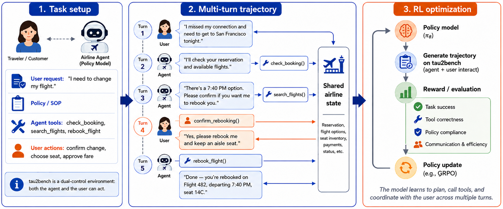

<!-- source-sha256: 8bc4130f79130b521dc86267e7dd9894f5ba433c990eba8780bc747c53d591ea -->

[简体中文](README.md) · English

# SinkFlex-RL: Memory-efficient RL for tool agents with long trajectories

> **Fidelity: core-mechanism mini-suite.** The local implementation executes sink retention, a causal sliding window, and critic-free group-relative updates. It does not reproduce the CUDA FlexAttention kernel.

## Paper information

| Field | Details |
| --- | --- |
| Paper | [arXiv 2608.10357](https://arxiv.org/abs/2608.10357) |
| Institution | Capital One AI Foundations |
| First public release | 2026-08-11 (arXiv v1) |
| Author code | No author-released code found (checked 2026-08-13). |
| Local adapter or method key | `sinkflex-rl` |
| Local reproduction code | [`src/auto_research/agent_research/latest_20260813.py`](https://github.com/daiwk/auto-research/blob/main/src/auto_research/agent_research/latest_20260813.py) |

## Original paper summary

### Background and main changes

On-policy rollouts for long-horizon tool agents are constrained by environment state, long context, and training memory. SinkFlex-RL combines a Gymnasium dual-control environment, VERL-style data flow, GRPO without a value model, and sink-aware FlexAttention. Causal and sliding-window masks retain the model-specific sink scaling.


<!-- paper-figure:start -->
### Key figure from the paper

[](https://arxiv.org/html/2608.10357v1/agentic_rl_framework.png)

> **Figure 1:** Overall design and components. From the [paper](https://arxiv.org/abs/2608.10357); copyright belongs to the authors. Click for the source.
<!-- paper-figure:end -->

### Core equations

$$
L_{GRPO}=-\frac{1}{\sum_iT_i}\sum_{i,t}\min(\rho_{i,t}\hat A_i,\operatorname{clip}(\rho_{i,t},1-\epsilon,1+\epsilon)\hat A_i)+\beta D_{KL}(\pi_\theta\Vert\pi_{ref}).
$$

### Offline and online results

On τ²-Bench retail, validation reward rises from 0.25 to 0.44. At 4096 tokens, peak GPU memory falls from 28.06 GB to 22.52 GB (**−19.7%**); at 8192 tokens, the method uses 25.53 GB while the eager baseline runs out of memory. The paper reports offline agent benchmarks and memory experiments, not an industrial online A/B test.

## Local reproduction

Across 120 ScaleMCP mini-suite episodes, joint success is 1.0 and average cost is 0.67. The sink/window path makes 120 policy updates and compresses long context. Stable metrics: [`metrics/scalemcp-mini-seed42.json`](metrics/scalemcp-mini-seed42.json). The [cross-domain batch index](../../experiments/mr7-latest-20260813-seed42.json) points to each paper's own metrics without duplicating the values.

```bash
auto-research agent-eval --method sinkflex-rl --benchmark scalemcp-mini --episodes 120 --seed 42
```

## Scope

The local run does not reproduce the paper's MoE checkpoint, VERL cluster, complete τ²-Bench environment, or kernel-level GPU memory curves. The mini-suite verifies the state retention rule and RL control flow; GPU performance numbers are from the original paper only.
