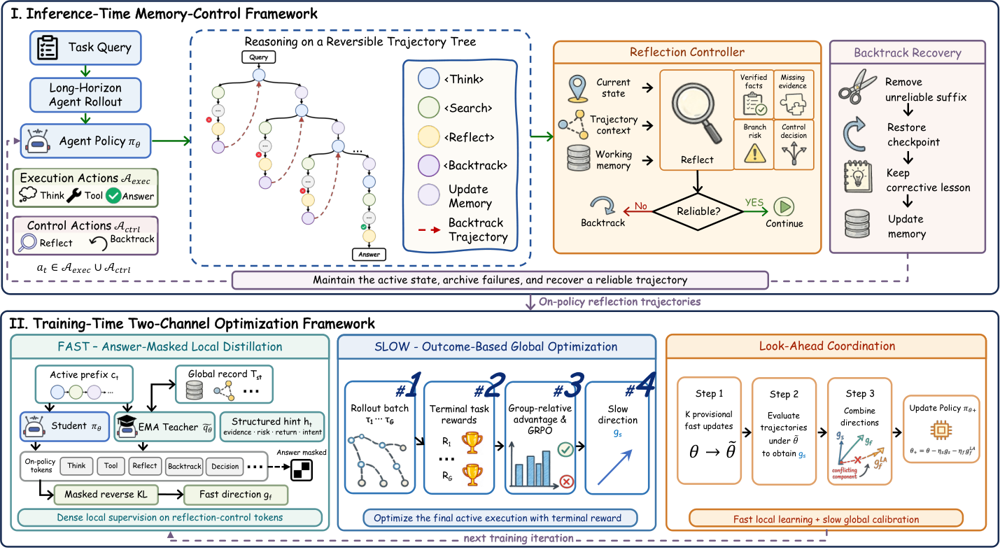

<!-- source-sha256: 980ff6bd77695d7e0ea9bad02971890e943bfcc9a7eea6d7a35ceb6874111822 -->

[简体中文](README.md) · English

# LoongReflect: Boosting Long-Horizon Reflection in Search Agents via Global Perspective Distillation

> **Core agent mechanism mini-suite.** Runs a standalone planning, memory, credit assignment or topology path and records process counts on deterministic tasks, not the paper's full external environment.

## Paper information

| Field | Details |
| --- | --- |
| Paper | [arXiv 2608.11967](https://arxiv.org/abs/2608.11967) |
| Institution | Authors did not disclose affiliation |
| First public release | 2026-08-12 (arXiv v1) |
| Author code | No public author code found as of 2026-08-24. |
| Local adapter or method key | `loongreflect` |
| Local reproduction code | `src/auto_research/agent_research/historical_b10_b11.py` |
| First author | Zhixin Zhang |

## Original paper summary

### Background and main changes

Treat reflect and backtrack as memory-control actions on a reversible trajectory tree. Coordinate fast privileged-teacher supervision with slower outcome GRPO.


<!-- paper-figure:start -->
### Key figure from the paper

[](https://arxiv.org/html/2608.11967v1/method_overview.png)

> **Figure 2:** Core architecture, modules and connections. From the [paper](https://arxiv.org/abs/2608.11967); copyright belongs to the authors. Click for the source.
<!-- paper-figure:end -->

### Core equations

$$
\mathcal L=\mathcal L_{reflect\text{-}OPD}+\lambda\mathcal L_{trajectory\text{-}GRPO}
$$

### Offline and online results

The paper consistently beats outcome-only RL and self-distillation on multi-hop RAG and math reasoning. The local mini-suite does not establish those benchmark or online results.

## Local reproduction

On 120 PlanBench-mini episodes, `loongreflect` has joint success `1.0000` and average cost `0.7700`; the long-context control has `1.0000` and `64.5000`. With saturated accuracy, verify traces, sources and paper-specific counts instead of claiming gains. See [per-paper metrics](metrics/planbench-mini-seed42.json) and [batch index](../../experiments/historical-b07-b11-seed42.json).

```bash
auto-research agent-research --method loongreflect --benchmark planbench-mini --episodes 120 --seed 42
```

## Scope

The deterministic mini-suite does not access browsers, AppWorld, SWE-bench or external tool services. It checks mechanism branches, process state and reporting. Full environment results require the paper's resources. Runs go in `runs/agent-research/`; only metrics are committed. See [experiment records](../../experiments/).
